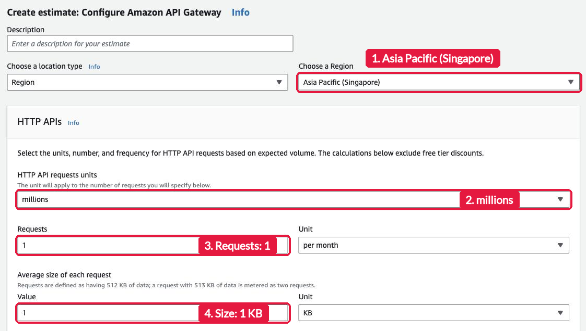
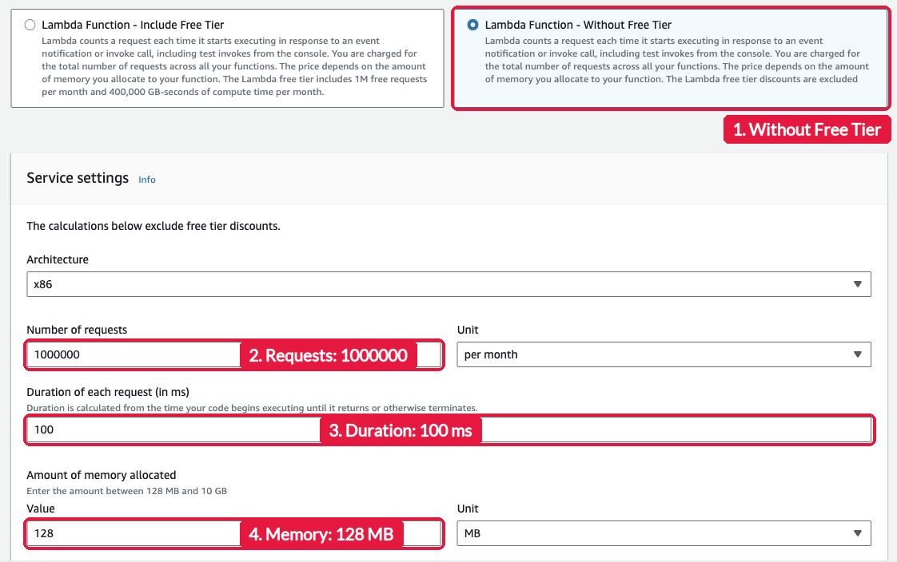
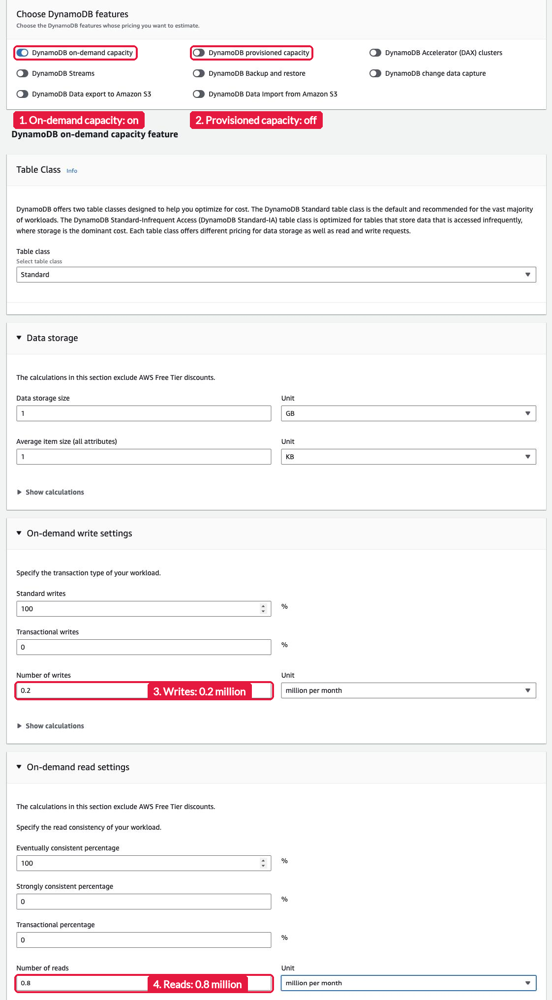
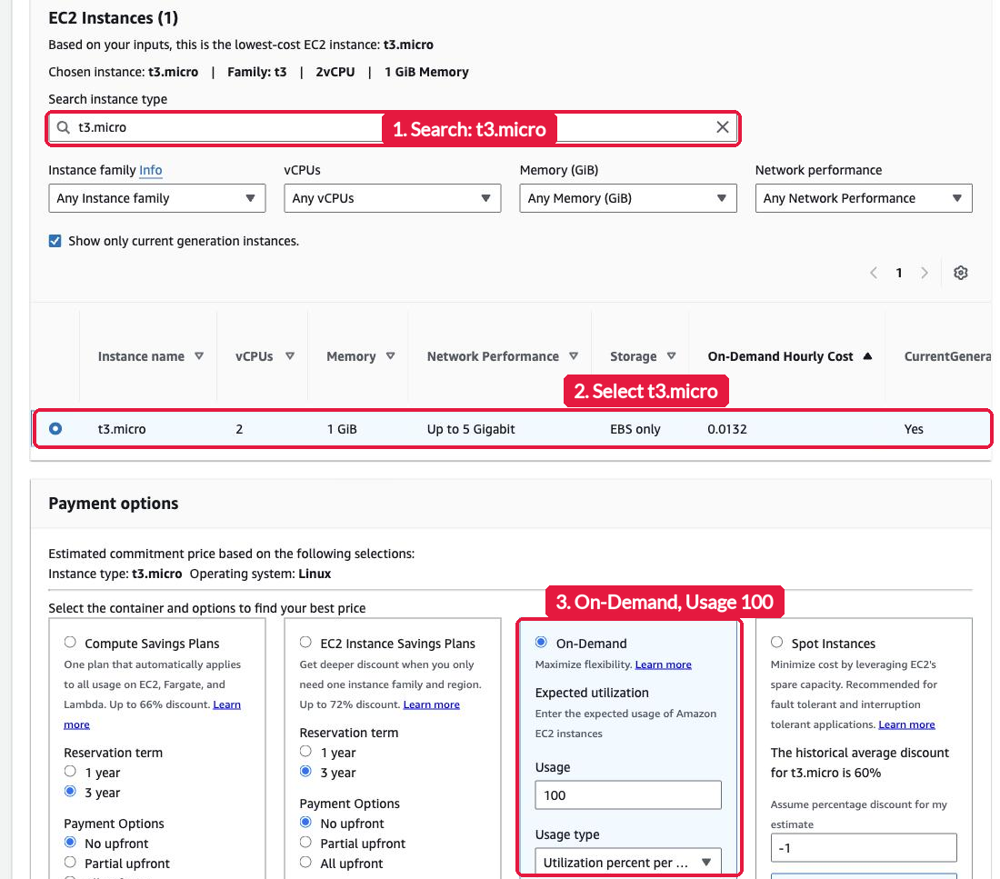

# Assignment 4: Price the Serverless Endpoint

> Submit one Pull Request per group to this repository. Then one groupmate submits the Pull Request link in the Google Form: https://docs.google.com/forms/d/e/1FAIpQLSdev8rYJiMfbe4mw-w64i39TUxPnYvCs0fCVNAcH_vnpyBZ_g/viewform. Both are due on Tuesday, November 10, 2026, at 11:59 PM (Asia/Manila). Do not merge your own Pull Request.

This is a self-guided activity. Your group prices the [Lab 4](../lab-4/lab.md) endpoint at 1 million requests a month, and the [Lab 2](../lab-2/lab.md) EC2 setup for the same month, in the AWS Pricing Calculator. You create nothing in AWS, so this activity costs nothing. Read [`README.md`](README.md) before you start. It explains the numbers that you enter and why.

## The tool

The AWS Pricing Calculator is at <https://calculator.aws>. You do not sign in. Choose **Create estimate**. For each service below, search for the service and choose **Configure**. Set the Region to **Asia Pacific (Singapore)** first. Then fill in the fields. After each service, choose **Save and add service**. After the last one, choose **Save and view summary**.

## Estimate 1: the Lab 4 endpoint

### Amazon API Gateway

Fill in the **HTTP APIs** section only. Leave **REST APIs** and **WebSocket APIs** empty.

| Field | Value |
| --- | --- |
| HTTP API requests units | millions |
| Requests | `1` per month |
| Average size of each request | `1` KB |

The unit is millions, so type `1`, not `1000000`. Replace any number that is already in **Average size of each request**.

### AWS Lambda

Choose **Lambda Function - Without Free Tier**. Fill in **Service settings** only. Leave **Provisioned Concurrency**, **SnapStart**, and **Lambda@Edge** empty, and keep **Lambda HTTP Response Streaming** at **Buffered**.

| Field | Value |
| --- | --- |
| Architecture | x86 |
| Number of requests | `1000000` per month |
| Duration of each request (in ms) | `100` |
| Amount of memory allocated | `128` MB |
| Amount of ephemeral storage allocated | `512` MB, the default |

### Amazon DynamoDB

Under **Choose DynamoDB features**, turn on **DynamoDB on-demand capacity** and turn off **DynamoDB provisioned capacity**. Then check that **Total Upfront cost** at the bottom of the page is 0.00 USD.

| Field | Value |
| --- | --- |
| Table class | Standard |
| Data storage size | `1` GB |
| Average item size (all attributes) | `1` KB |
| Standard writes | `100` % |
| Transactional writes | `0` % |
| Number of writes | `0.2` million per month, the POST requests |
| Eventually consistent percentage | `100` % |
| Strongly consistent percentage | `0` % |
| Transactional percentage | `0` % |
| Number of reads | `0.8` million per month, the GET requests |

Your Lab 4 Scan uses eventually consistent reads, the default, so all reads are eventually consistent.

## Estimate 2: the Lab 2 setup

### Amazon EC2

The EBS and monitoring fields are hidden at first. Open **Amazon Elastic Block Store (EBS) - optional** and **Detailed monitoring - optional** to see them.

| Field | Value |
| --- | --- |
| Tenancy | Shared Instances |
| Operating system | Linux |
| Workloads | Constant usage |
| Number of instances | `1` |
| EC2 instance | `t3.micro`. Type it in **Search instance type** and select it |
| Payment options | **On-Demand**, with Usage `100` and **Utilization percent per month** |
| Amazon Elastic Block Store (EBS): storage for each EC2 instance | General Purpose SSD (gp3) |
| EBS storage amount | `8` GB |
| EBS snapshot frequency | No snapshot storage |
| Detailed monitoring | **Enable monitoring** on, because Lab 2 turned it on |

One instance is the minimum size of your Lab 2 Auto Scaling group. It runs all month, with or without visitors.

## Save and share

On the summary page, check that the estimate lists four services, all in Asia Pacific (Singapore). Note the monthly cost of each service. Then use **Share** to get a public link to the estimate.

## What to submit

1. Create the folder `submissions/assignment-4/group-<number>/` on a branch named `assignment-4-group-<number>`.
2. Copy [`submission-template.md`](submission-template.md) to that folder as `submission.md`. Fill in every item:
   - Your section and group number.
   - The monthly cost in USD of API Gateway, Lambda, and DynamoDB, and their total.
   - The monthly cost in USD of the Lab 2 EC2 setup.
   - The share link of your estimate.
   - The answer to this question: in a month with no requests at all, which costs remain in each setup, and why?
   - A recommendation of five sentences: which setup fits the Lab 4 message API at 1 million requests a month, and why? Use your two totals, your answer to the question, and the work that each setup needs from your group, such as patching a server or handling a sudden spike in traffic.
   - One line per groupmate: GitHub username and what each one did.
3. Open one Pull Request. One groupmate submits its link in the Google Form for the whole group: https://docs.google.com/forms/d/e/1FAIpQLSdev8rYJiMfbe4mw-w64i39TUxPnYvCs0fCVNAcH_vnpyBZ_g/viewform.

| Check | Points |
| --- | --- |
| The Lab 4 estimate: API Gateway, Lambda, and DynamoDB with the given settings, and their monthly costs and total | 3 |
| The Lab 2 estimate with the given settings, and its monthly cost | 2 |
| A share link that opens your estimate with all four services | 1 |
| A correct answer about the costs that remain with no requests | 1 |
| A five-sentence recommendation that uses your numbers | 3 |
| **Total** | **10** |

## If you get stuck

- The API Gateway cost is one million times too high: the unit is millions. Type `1`.
- The DynamoDB estimate has an upfront cost: provisioned capacity is still on. Turn it off.
- The EC2 cost is lower than you expect: check that **On-Demand** is selected, not a Savings Plan.
- The total does not change: click outside the field that you typed in, so the calculator updates.
- Check your share link before you submit: open it in a private browser window and confirm that all four services show.
- Anything else: message me in the group chat.

AWS documentation, if you want more detail: [What is AWS Pricing Calculator?](https://docs.aws.amazon.com/pricing-calculator/latest/userguide/what-is-pricing-calculator.html), [Amazon API Gateway pricing](https://aws.amazon.com/api-gateway/pricing/), [AWS Lambda pricing](https://aws.amazon.com/lambda/pricing/), [Amazon DynamoDB pricing](https://aws.amazon.com/dynamodb/pricing/), and [Amazon EC2 On-Demand pricing](https://aws.amazon.com/ec2/pricing/on-demand/).
