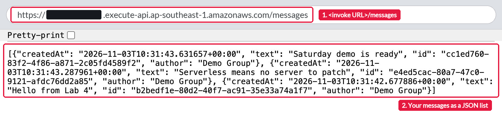

# Lab 4: Guided Serverless Endpoint

This is a self-guided lab. Your group turns its [Seatwork 4](../seatwork-4/README.md) function into a small web API (application programming interface) for messages. Anyone with its address can read the messages and post new ones. Amazon API Gateway receives each web request, AWS Lambda runs your code, and Amazon DynamoDB stores the messages. No server runs while nobody calls the API.

Work through this page first. It explains the ideas that each step uses. Then follow the steps in [`lab.md`](lab.md). Finish Seatwork 4 first.



## What you do

This is group work. You sign in with your group IAM (Identity and Access Management) user. Your group submits one Pull Request.

1. Create the DynamoDB table `umak-elec3-<group user>-messages`.
2. Update your Seatwork 4 function so that it reads and stores messages.
3. Add two routes, `GET /messages` and `POST /messages`, to the HTTP (Hypertext Transfer Protocol) API `umak-elec3-<group user>-api`, which I made for your group, and connect both routes to your function.
4. Post messages with `curl` and read them in the browser.
5. Take four screenshots, answer three questions, and submit.

## How a request flows

```text
Browser or curl
   |  GET or POST https://<api-id>.execute-api.ap-southeast-1.amazonaws.com/messages
   v
API Gateway HTTP API: route GET /messages or POST /messages, stage $default
   |  an event with routeKey, headers, and body
   v
Lambda function umak-elec3-<group user>-api
   |  Scan (read all items) or PutItem (store one item)
   v
DynamoDB table umak-elec3-<group user>-messages
```

The answer travels back the same way. The function's return value becomes the web response.

## Key ideas

### DynamoDB tables, items, and the partition key

DynamoDB is a key-value database. A table holds items. An item is a set of attributes, much like one JSON (JavaScript Object Notation) object. Each item needs a partition key, here `id`, and no two items in the table have the same `id`. Other attributes can differ from item to item, so you do not define columns first.

Each message in your table has four attributes: `id`, `author`, `text`, and `createdAt`.

### On-demand capacity

With on-demand capacity, you do not reserve read or write capacity ahead of time. DynamoDB charges for each read and each write, and for the data that it stores. A table that nobody uses costs only its storage.

### Scan and PutItem

`PutItem` writes one item. `Scan` reads every item in the table. Scan is fine for a small table like yours. Question 3 in [`lab.md`](lab.md) asks what happens when the table grows.

### API Gateway HTTP APIs and routes

An HTTP API gives your function a public web address. A route is an HTTP method and a path, for example `GET /messages`. API Gateway matches each request to a route and sends it to the route's integration. Here, the integration is your Lambda function.

Both of your routes send their requests to the same function. The function tells them apart by `event["routeKey"]`. The routeKey holds the route that matched, for example `"POST /messages"`.

### The event from API Gateway

API Gateway turns each web request into an event. Your API uses payload format version 2.0, the default for HTTP APIs. An event for a POST request has fields like these:

```json
{
  "version": "2.0",
  "routeKey": "POST /messages",
  "rawPath": "/messages",
  "headers": { "content-type": "application/json" },
  "body": "{\"author\": \"Group 3\", \"text\": \"Hello from Lab 4\"}",
  "isBase64Encoded": false
}
```

The body arrives as text, so your code turns it into a dictionary with `json.loads`. Your handler returns `statusCode`, `headers`, and `body`, the same shape as in Seatwork 4. API Gateway sends it back as the web response.

### The $default stage and automatic deployment

A stage is a live copy of your API with its own address, the invoke URL. API Gateway serves the `$default` stage at the root of the invoke URL, so the address has no stage name in it. With automatic deployment on, each change to the routes goes live by itself.

### Who can call your API

Your API has no sign-in. Anyone with the invoke URL can read and post messages. So your invoke URL goes only in the private Google Form, never in your public Pull Request, and your function refuses a message longer than 280 characters. Do not post personal data, passwords, or keys in a message.

## Cost

None of the three services charges by the hour. Each one charges per request, and DynamoDB also charges for the data that it stores. The requests of one class session and a few messages cost far less than one cent. Compare Lab 2: an EC2 instance cost money every hour that it ran, even when nobody opened its page. [Assignment 4](../assignment-4/README.md) prices this API at 1 million requests a month.

## How you submit

Submit one Pull Request per group to this repository. Then one groupmate submits the Pull Request link and your invoke URL in the Google Form: https://forms.gle/VAUNTZE9fq6Jo8gU9. Finish in class if you can. If your group does not finish in class, both are due on Sunday, November 8, 2026, at 11:59 PM (Asia/Manila).

## Files in this folder

| File | What it is |
| --- | --- |
| [`README.md`](README.md) | This page: what you do and the ideas behind each step. |
| [`lab.md`](lab.md) | The eight steps with screenshots, what to submit, the scoring, the cleanup, and what to check when you get stuck. |
| [`submission-template.md`](submission-template.md) | Copy it to your submission folder as `submission.md`. |
| [`contribution-template.md`](contribution-template.md) | Copy it to your submission folder as `contribution.md`. |
