# Lab 4: Guided Serverless Endpoint

> **Submission format:** One Pull Request per group, with your `submission.md`, `contribution.md`, and four screenshots. When the Pull Request is open, one groupmate submits its link in the Google Form: https://forms.gle/VAUNTZE9fq6Jo8gU9. Finish in class if you can. If your group does not finish in class, both are due on Sunday, November 8, 2026, at 11:59 PM (Asia/Manila). Do not merge your own Pull Request.

This is a self-guided lab. Your group builds a small API (application programming interface) for messages. An HTTP (Hypertext Transfer Protocol) API in Amazon API Gateway sits in front of your Seatwork 4 Lambda function, and Amazon DynamoDB stores the messages. The steps follow the pattern of the AWS tutorial [Create a CRUD HTTP API with Lambda and DynamoDB](https://docs.aws.amazon.com/apigateway/latest/developerguide/http-api-dynamo-db.html). That tutorial has four routes to create, read, update, and delete (CRUD) items. Your API has two routes, and it uses your group's names. Read [`README.md`](README.md) before you start. It explains the ideas that each step uses.

## Before you start

- Finish [Seatwork 4](../seatwork-4/seatwork.md) and take its screenshots first. Step 2 of this lab replaces your Seatwork 4 code.
- Sign in at the class sign-in URL with your group IAM (Identity and Access Management) user. Do not change the group password.
- Work in Asia Pacific (Singapore), `ap-southeast-1`. Check the Region in the top bar before each step.
- Use exactly these names. Replace `<group user>` with your user name, for example `acsad-g03`.

  | What | Name |
  | --- | --- |
  | DynamoDB table | `umak-elec3-<group user>-messages` |
  | Lambda function, from Seatwork 4 | `umak-elec3-<group user>-api` |
  | HTTP API, which I made for your group | `umak-elec3-<group user>-api` |
  | Log group, from Seatwork 4 | `/aws/lambda/umak-elec3-<group user>-api` |

- You need a terminal with `curl`. Windows 10 and 11, macOS, and Linux all include it. On Windows, use Command Prompt, WSL (Windows Subsystem for Linux), or Git Bash. Do not use PowerShell for this lab. In PowerShell, `curl` runs a different command.

## Step 1. Create the DynamoDB table (10 minutes)

Open the DynamoDB console. Choose **Tables**, then **Create table**. Fill in the form:

- **Table name**: `umak-elec3-<group user>-messages`
- **Partition key**: `id`, type **String**
- **Sort key**: leave it empty

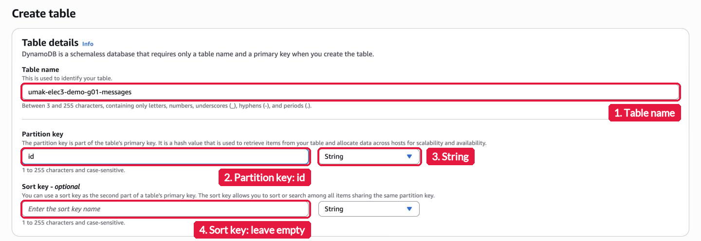

Under **Table settings**, choose **Customize settings**. Keep **DynamoDB Standard** as the table class. Under **Read/write capacity settings**, keep **Capacity mode** at **On-demand**. Keep every other setting and choose **Create table**.

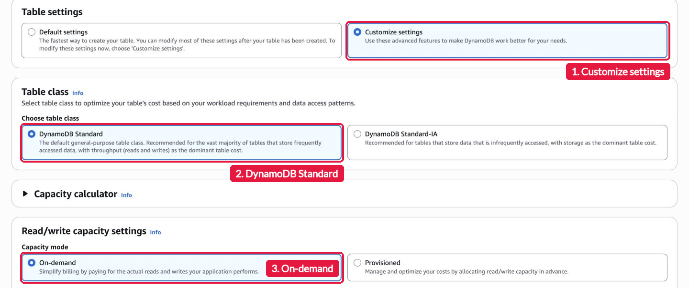

Wait until the status of your table is **Active**. It takes less than a minute.

## Step 2. Update the function code (15 minutes)

Open the Lambda console and open your function `umak-elec3-<group user>-api`. On the **Code** tab, replace all of `lambda_function.py` with this code:

```python
import base64
import json
import uuid
from datetime import datetime, timezone

import boto3

GROUP_NAME = "Group 3 of IV-ACSAD"  # Keep your group's name from Seatwork 4.
TABLE_NAME = "umak-elec3-acsad-g03-messages"  # Change acsad-g03 to your group IAM user.

table = boto3.resource("dynamodb").Table(TABLE_NAME)


def respond(status_code, body):
    return {
        "statusCode": status_code,
        "headers": {"Content-Type": "application/json"},
        "body": json.dumps(body),
    }


def read_json_body(event):
    body = event.get("body") or "{}"
    if event.get("isBase64Encoded"):
        body = base64.b64decode(body).decode("utf-8")
    return json.loads(body)


def lambda_handler(event, context):
    route = event.get("routeKey")

    if route == "GET /messages":
        items = table.scan()["Items"]
        return respond(200, items)

    if route == "POST /messages":
        try:
            data = read_json_body(event)
        except ValueError:
            data = None
        if not isinstance(data, dict) or not data.get("text"):
            return respond(400, {"error": "Send a JSON body with a text field."})
        if len(str(data["text"])) > 280:
            return respond(400, {"error": "Keep the text at 280 characters or fewer."})
        message = {
            "id": str(uuid.uuid4()),
            "author": str(data.get("author") or GROUP_NAME)[:80],
            "text": str(data["text"]),
            "createdAt": datetime.now(timezone.utc).isoformat(),
        }
        table.put_item(Item=message)
        return respond(201, message)

    return respond(404, {"error": f"No route for {route}"})
```

Change the two lines at the top:

- `GROUP_NAME`: your group's name, as in Seatwork 4.
- `TABLE_NAME`: your table name from Step 1.

Choose **Deploy**, and wait for the message that says that the function was updated.

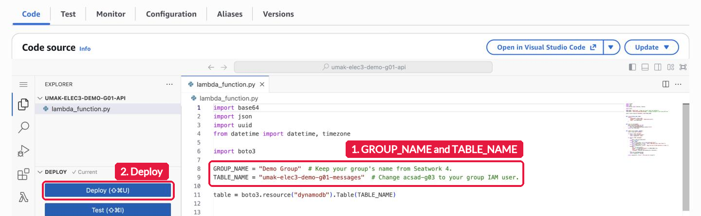

What the code does:

| Part | What it does |
| --- | --- |
| `boto3.resource("dynamodb").Table(...)` | Connects to your table. `boto3` is the AWS SDK (software development kit) for Python. Lambda includes it, so you install nothing |
| `GET /messages` | Scans the table and returns every item as a JSON (JavaScript Object Notation) list, with status 200 (OK) |
| `POST /messages` | Reads the JSON body, adds a random `id` and the time, stores the item, and returns it with status 201 (Created) |
| A POST without a `text` field | Returns status 400 (Bad Request) and stores nothing |
| A `text` longer than 280 characters | Returns status 400 and stores nothing, so nobody can fill your table with long messages |
| Any other route | Returns status 404 (Not Found) |
| `respond` | Builds the return value in the shape that API Gateway expects |
| `read_json_body` | Turns the body text into a dictionary. API Gateway sends some bodies in base64, a text encoding for any data, so the function decodes those first |

## Step 3. Test the function in the console (5 minutes)

Before you add API Gateway, check that the function can read your table. Open the **Test** tab. Choose **Create new event**. Type `get-messages` as the **Event name**. Replace the **Event JSON** with this event:

```json
{
  "routeKey": "GET /messages"
}
```

Choose **Save**, then choose **Test**. Open **Details**. The response shows `"statusCode": 200` and `"body": "[]"`. The body is an empty list, because your table has no items yet.

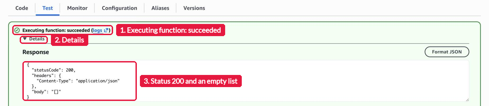

If the result shows an error, fix it now. Most errors come from a `TABLE_NAME` that does not match your table name. See [If you get stuck](#if-you-get-stuck).

## Step 4. Connect your API to your function (20 minutes)

I made the HTTP API `umak-elec3-<group user>-api` for your group, because groups cannot create APIs in this account. Your group adds the two routes and connects them to your function.

Open the API Gateway console. Choose **APIs**, then your API `umak-elec3-<group user>-api`. The **Routes** page opens.

**Create the GET route.** Choose **Create**. Change the method from **ANY** to **GET**, type `/messages` as the path, and choose **Create**.

**Attach a new Lambda integration.** Under `/messages`, choose **GET**. In **Route details**, choose **Attach integration**, then **Create and attach an integration**. Fill in the form:

- **Integration type**: **Lambda function**
- **AWS Region**: keep `ap-southeast-1`
- **Lambda function**: choose your function `umak-elec3-<group user>-api`
- **Advanced settings**: open it and keep **Payload format version** at **2.0**
- **Invoke permissions**: keep **Grant API Gateway permission to invoke your Lambda function** turned on. API Gateway then gives itself permission to call your function.

Choose **Create**.

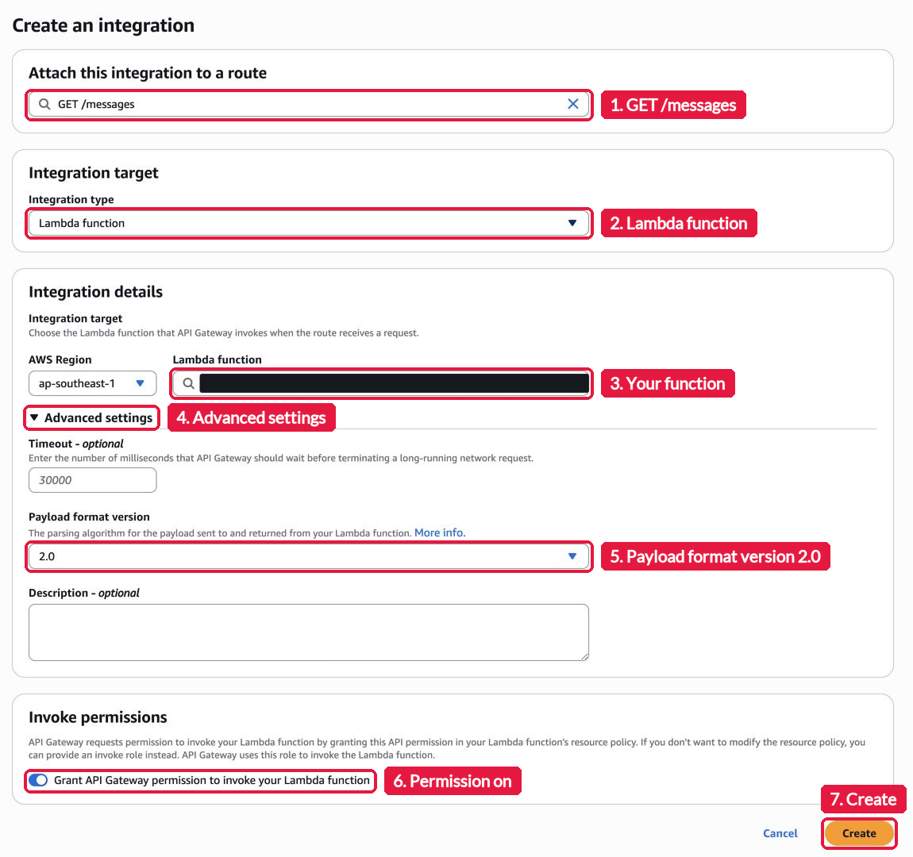

**Create the POST route and attach the same integration.** In the left menu, choose **Routes**, then **Create**. Choose **POST**, type `/messages`, and choose **Create**. Under `/messages`, choose **POST**, then **Attach integration**. In **Choose an existing integration**, choose your function's integration, then choose **Attach integration**. Both routes now show **AWS Lambda**.

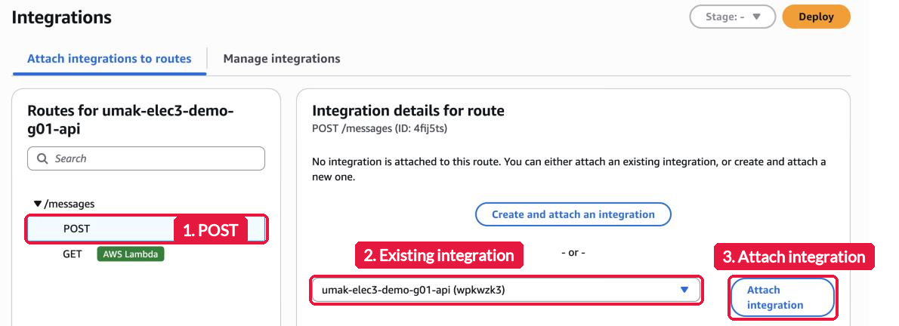

**Check the stage.** In the left menu, under **Deploy**, choose **Stages**, then `$default`. Under **Attached deployment**, **Automatic Deployment** must say **Enabled**. Each change to your routes then goes live by itself, so you do not choose **Deploy**.

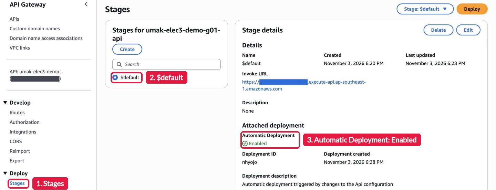

## Step 5. Copy the invoke URL (2 minutes)

In the left menu, choose the line that starts with **API:** to open the **API details** page. The **Invoke URL** of the `$default` stage is in the **Stages** table. It has this form:

```text
https://a1b2c3d4e5.execute-api.ap-southeast-1.amazonaws.com
```

Your routes are under `/messages`. In the next steps, replace `<invoke URL>` with your URL.

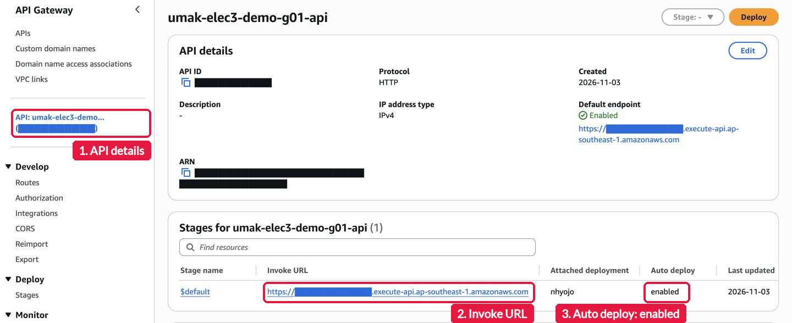

## Step 6. Post messages with curl (10 minutes)

Open a terminal. Change the author and the text before you run the command.

On macOS, Linux, WSL, or Git Bash:

```bash
curl -X POST "<invoke URL>/messages" \
  -H "Content-Type: application/json" \
  -d '{"author": "Group 3", "text": "Hello from Lab 4"}'
```

On Windows Command Prompt, as one line:

```bat
curl -X POST "<invoke URL>/messages" -H "Content-Type: application/json" -d "{\"author\": \"Group 3\", \"text\": \"Hello from Lab 4\"}"
```

The API answers with the stored message, with its new `id` and time:

```json
{"id": "6f1c2a9e-...", "author": "Group 3", "text": "Hello from Lab 4", "createdAt": "2026-11-07T03:15:42.123456+00:00"}
```

Post at least three messages, each with a different text. Take the screenshot `post.png` of the terminal with your commands and the answers.

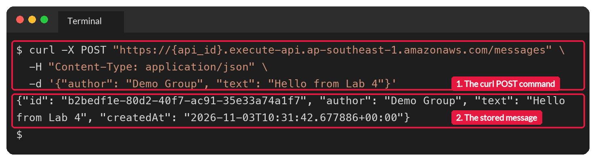

## Step 7. Read the messages in the browser (5 minutes)

Open `<invoke URL>/messages` in your browser. The browser sends a GET request. You see your messages as a JSON list. Take the screenshot `get.png`, with the address bar visible. Before you save it, cover your API ID in the address bar: the part between `https://` and `.execute-api`.

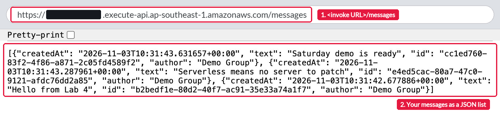

You can also read the messages in the terminal with `curl "<invoke URL>/messages"`.

Now open the invoke URL without `/messages`. Write down the answer that you get. Question 2 asks about it.

## Step 8. Check the table (5 minutes)

Open the DynamoDB console. Choose **Explore items**, then your table. The items match the messages from Step 7. Take the screenshot `items.png`.

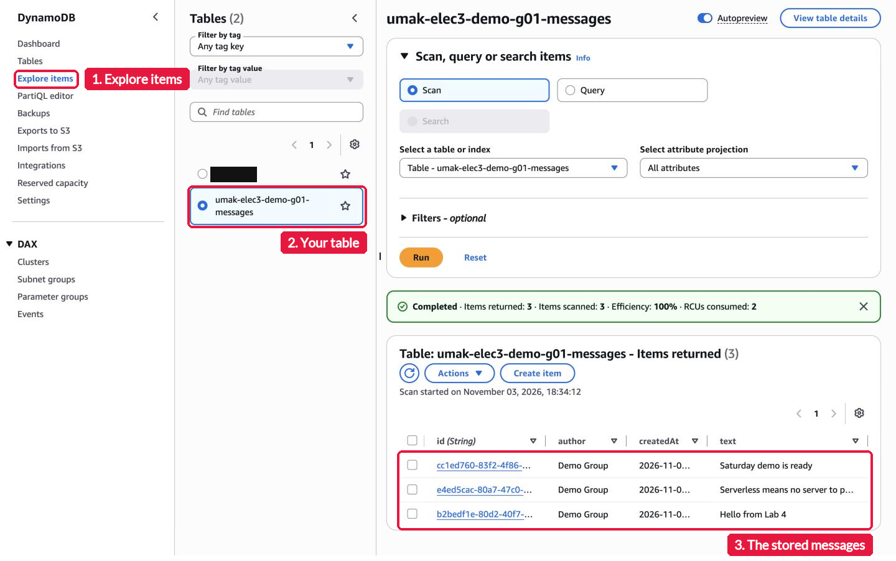

## Questions

Answer in `submission.md`.

1. Both routes call the same function. How does your code know which route a request came through?
2. What answer do you get when you open the invoke URL without `/messages`? Why does API Gateway answer this way, and not your function?
3. Your `GET /messages` route uses Scan. What happens to the cost of each GET request as the table grows to thousands of messages? Why?

## What to submit

1. Fork this repository and clone your fork. Create the folder `submissions/lab-4/group-<number>/` on a branch named `lab-4-group-<number>`.
2. Add four screenshots to that folder:
   - `routes.png`: the **Routes** page of your API, with `GET /messages` and `POST /messages`.
   - `post.png`: your terminal with the curl commands and the answers.
   - `get.png`: the browser with your messages and the address bar.
   - `items.png`: **Explore items** with the items of your table.
3. Crop the AWS console top bar out of `routes.png` and `items.png`, because it shows the account number. Also cover every ARN (Amazon Resource Name), a long name that starts with `arn:aws:`, because it holds the account number too.
4. Keep your invoke URL out of the Pull Request, because anyone can read this repository and post to your API. Cover your API ID in every screenshot: in `post.png`, in `get.png`, and on the **Routes** page. The full invoke URL goes only in the Google Form.
5. Copy [`submission-template.md`](submission-template.md) to that folder as `submission.md`, and [`contribution-template.md`](contribution-template.md) as `contribution.md`. Fill in both.
6. Commit, push your branch, and open one Pull Request to this repository. Title: `Lab 4: Group <number>`.
7. One groupmate submits the Pull Request link and your invoke URL in the Google Form: https://forms.gle/VAUNTZE9fq6Jo8gU9.

| Check | Points |
| --- | --- |
| The table `umak-elec3-<group user>-messages` is in Singapore, with the partition key `id` (String) and on-demand capacity | 5 |
| The function handles `GET /messages` and `POST /messages` by `routeKey` | 8 |
| The HTTP API has both routes with the Lambda integration, and the `$default` stage with automatic deployment | 7 |
| Your invoke URL answers `GET /messages` with your messages when I test it | 6 |
| The four screenshots show the routes, at least three posted messages, the list in the browser, and the items in the table | 6 |
| Three correct answers, 2 points each | 6 |
| The console top bar, every ARN, and your API ID are hidden, and `submission.md` and `contribution.md` are complete | 2 |
| **Total** | **40** |

## Cleanup

### Keep these until grading is done

Keep your table, your function, and your API. I open your invoke URL when I grade. If it does not answer, your group loses the points for that check. After grading, I delete every Lab 4 table, function, API, and log group.

### What costs nothing while idle

| Resource | What it costs while nobody calls the API |
| --- | --- |
| Lambda function | Nothing. Lambda charges only for runs |
| HTTP API | Nothing. API Gateway charges only for requests |
| DynamoDB table, on-demand | Only its storage. A few messages cost far less than one cent a month |
| Log group | Only its storage. A few log lines cost far less than one cent a month |

Your Lab 2 instance was different. An EC2 instance costs money every hour that it runs, even when nobody visits it.

### Delete extra copies

If your group made a second table by mistake, delete the extra one now. Keep only the names in [Before you start](#before-you-start).

- An extra table: in the DynamoDB console, choose **Tables**, select the table, choose **Delete**, and confirm.

## If you get stuck

| What you see | What to check |
| --- | --- |
| `Access Denied` when you create the table | The table name must be exactly `umak-elec3-<group user>-messages`, in lowercase, in Singapore |
| `AccessDeniedException` in the test result, with `umak-elec3-acsad-g03-messages` in it | You did not change `TABLE_NAME`. Change it to your table name and choose **Deploy** |
| `ResourceNotFoundException` in the test result | `TABLE_NAME` and your table name differ, or the table is not **Active** yet |
| The test result still shows your Seatwork 4 greeting | You did not choose **Deploy** after you pasted the new code |
| `Access Denied` when you create a route or an integration | You opened another group's API. Choose **APIs** and open `umak-elec3-<group user>-api` |
| **Unable to load content** in the API Gateway console | Refresh the page. If it stays, choose **Routes** or **Integrations** in the left menu again |
| `{"message":"Not Found"}` from `/messages` | The route path has a typo. Open **Routes** and check `/messages` |
| `{"message":"Internal Server Error"}` | The function failed. Open the log group `/aws/lambda/umak-elec3-<group user>-api` and read the newest error lines |
| `{"error": "No route for ..."}` | A route in your API differs from the code. The routes must be exactly `GET /messages` and `POST /messages` |
| `{"error": "Send a JSON body with a text field."}` | The `-H` part or a quote is missing from your curl command. Copy the command again |
| `curl` asks for `Uri` or prints a table on Windows | You are in PowerShell. Use Command Prompt |
| The console says you cannot sign in | Message me in the group chat |

AWS documentation, if you want more detail: [Create a CRUD HTTP API with Lambda and DynamoDB](https://docs.aws.amazon.com/apigateway/latest/developerguide/http-api-dynamo-db.html), [Create routes for HTTP APIs](https://docs.aws.amazon.com/apigateway/latest/developerguide/http-api-develop-routes.html), and [Create AWS Lambda proxy integrations for HTTP APIs](https://docs.aws.amazon.com/apigateway/latest/developerguide/http-api-develop-integrations-lambda.html).
