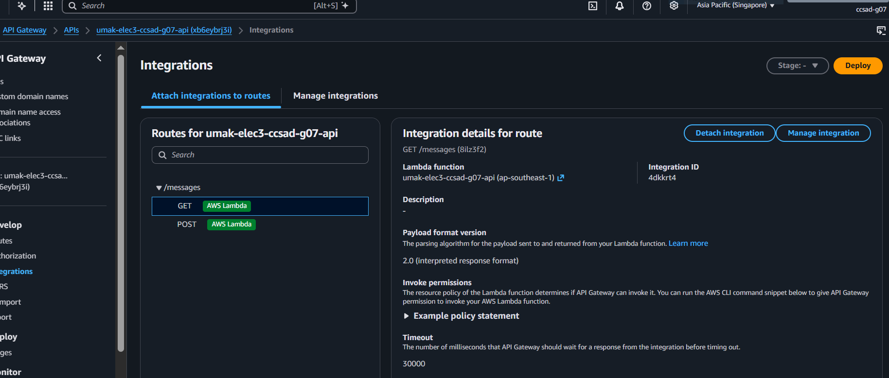
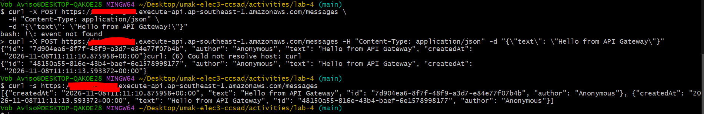
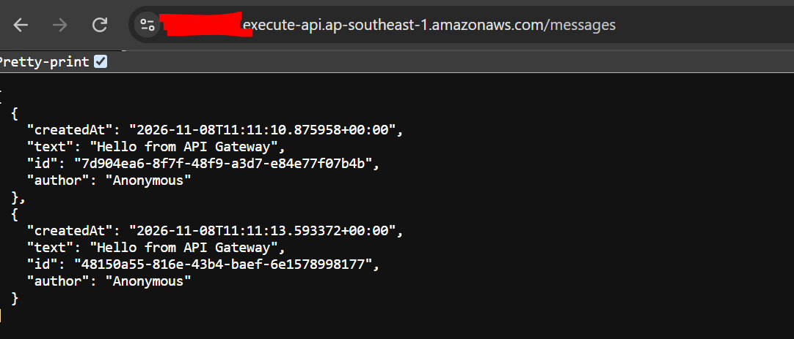
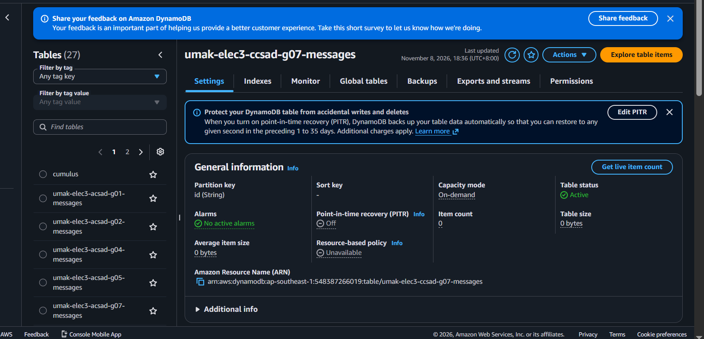

# Lab 4 Submission

<!--
How to use this template:

1. Copy this file to submissions/lab-4/group-<number>/submission.md
2. Replace every <answer> with your group's answer. Delete the angle brackets too.
3. Save routes.png, post.png, get.png, and items.png in the same folder.
4. Crop the AWS console top bar out of routes.png and items.png, and cover every ARN.
5. Do not write full names or student numbers in this file.
-->

## About us

- Group number: <answer>
- Section: <answer>
- Group IAM user: <answer>
- DynamoDB table name: <answer>
- HTTP API name: <answer>

## Handler code

```python
<answer>
```

## Screenshots









## Questions

1. Both routes call the same function. How does your code know which route a request came through?

   <answer>

2. What answer do you get when you open the invoke URL without `/messages`? Why does API Gateway answer this way, and not your function?

   <answer>

3. Your `GET /messages` route uses Scan. What happens to the cost of each GET request as the table grows to thousands of messages? Why?

   <answer>
