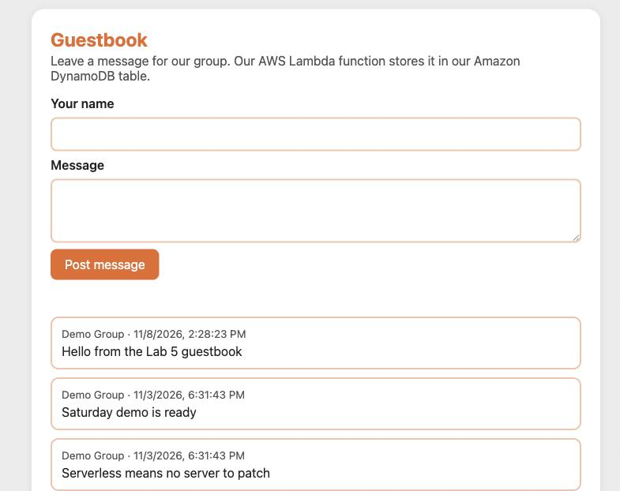

# Lab 5: Add a Guestbook to Your Group Site

This is a self-guided lab, and it is the last build of the semester. Your group joins two things that it already made. Your [Seatwork 3](../seatwork-3/README.md) site on Amazon S3 gets a guestbook, and the guestbook reads and posts messages through your [Lab 4](../lab-4/README.md) API. Then your group protects the API with a throttle. You start in class on Saturday, November 14, 2026, and your Pull Request is due on Thursday, November 19, 2026, at 11:59 PM.

Work through this page first. It explains the ideas that each step uses. Then follow the steps in [`lab.md`](lab.md).



## What you do

This is group work. You sign in with your group IAM (Identity and Access Management) user. Your group submits one Pull Request. You create nothing new in AWS.

1. Check that your Seatwork 3 site and your Lab 4 API still work.
2. Paste the guestbook block into your `index.html` and set your invoke URL in it.
3. Upload the page and watch the browser block it.
4. Allow your site in the CORS settings of your API, then post messages from your page.
5. Set a throttle on your API and test it with 30 requests at once.
6. Demo your site in class if you finish there, take four screenshots, answer three questions, and submit.

## How the parts connect

```text
Browser of a visitor
   |  1. GET http://umak-elec3-<group user>-linktree.s3-website-ap-southeast-1.amazonaws.com
   v
S3 website endpoint: sends index.html, with the guestbook script in it
   .
   .  2. The script runs in the browser and calls your API on another origin
   v
API Gateway HTTP API, stage $default: CORS settings, throttle 2 per second, burst 5
   |  3. GET /messages or POST /messages, as in Lab 4
   v
Lambda function umak-elec3-<group user>-api  ->  DynamoDB table umak-elec3-<group user>-messages
```

## Key ideas

### Origin

An origin is the scheme, the host, and the port of a URL together. These two URLs have different origins, because both the scheme and the host differ:

| URL | Scheme | Host |
| --- | --- | --- |
| Your site | `http` | `umak-elec3-<group user>-linktree.s3-website-ap-southeast-1.amazonaws.com` |
| Your API | `https` | `<API ID>.execute-api.ap-southeast-1.amazonaws.com` |

### CORS

CORS (cross-origin resource sharing) is a browser rule. A script on a page can read an answer from another origin only when that origin says, in a header, that it allows the page. Your API answers with `Access-Control-Allow-Origin` and the address of your site after you set it up in Step 4.

CORS is not a lock on your API. `curl` and other programs ignore it, so your API still answers them. CORS only decides whether a browser lets a page read the answer.

### The preflight request

Your POST sends JSON with the header `content-type: application/json`. Before such a request, the browser first sends a preflight request: an `OPTIONS` request that asks whether your site may send `POST` with that header. When your API has CORS settings, API Gateway answers the preflight itself. Your function never sees it.

### HTTP site, HTTPS API

Your site is served over HTTP and your API over HTTPS. A page on HTTP can call an API on HTTPS. The opposite, a page on HTTPS that calls an HTTP address, is blocked by the browser as mixed content, which is a different rule from CORS.

### Throttling and the 429 answer

Your page is public, and its source holds your invoke URL, so anyone can send requests to your API. A throttle limits the requests that API Gateway passes on to your function. API Gateway uses a token bucket: the bucket holds up to 5 tokens (the burst), it gains 2 tokens each second (the rate), and each request takes one token. With no token left, API Gateway answers `429 Too Many Requests`, and your function does not run, so it costs nothing.

### Plain text, not HTML

The guestbook shows each message with `textContent`. A message is shown as plain text, so a visitor cannot post HTML or a script that runs on your page. Question 3 asks why this matters.

## Cost

You add no new service. Your site, your API, your function, and your table cost what they cost in Seatwork 3 and Lab 4: far less than one cent for a class session. The throttle costs nothing. A request that the throttle refuses never runs your function. [Assignment 5](../assignment-5/README.md) prices this whole architecture for a month.

## How you submit

Submit one Pull Request per group to this repository. Then one groupmate submits the Pull Request link and your website endpoint in the Google Form: https://forms.gle/5qgFnysjh89qZ1ir5. If your group finishes in class, demo your site to me before you leave. Both are due on Thursday, November 19, 2026, at 11:59 PM (Asia/Manila).

## Files in this folder

| File | What it is |
| --- | --- |
| [`README.md`](README.md) | This page: what you do and the ideas behind each step. |
| [`lab.md`](lab.md) | The seven steps, what to submit, the scoring, the cleanup, and what to check when you get stuck. |
| [`guestbook.html`](guestbook.html) | The guestbook block that you paste into your `index.html`. |
| [`submission-template.md`](submission-template.md) | Copy it to your submission folder as `submission.md`. |
| [`contribution-template.md`](contribution-template.md) | Copy it to your submission folder as `contribution.md`. |
