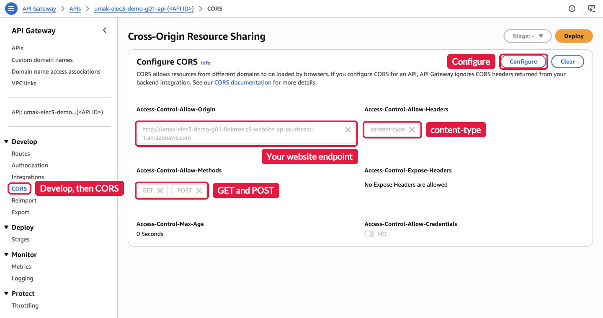
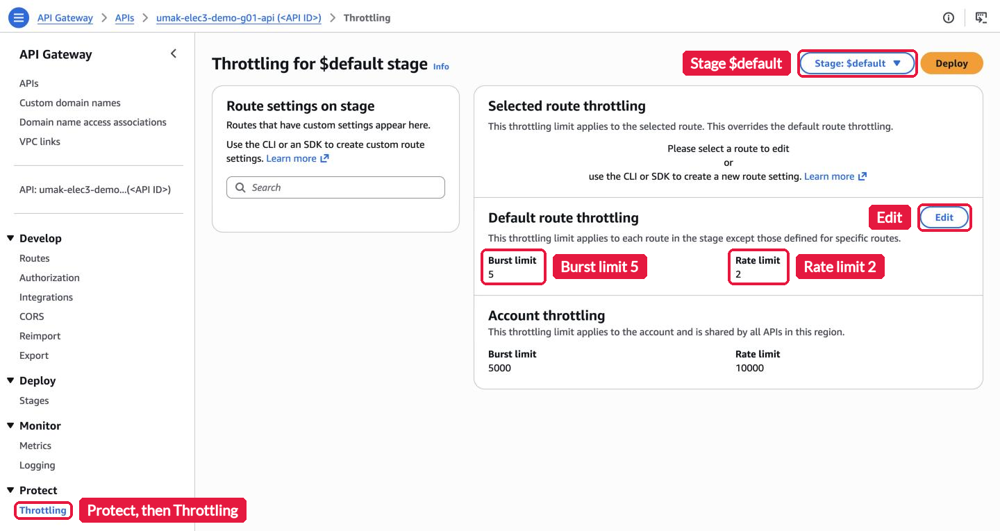

# Lab 5: Add a Guestbook to Your Group Site

> **Submission format:** One Pull Request per group, with your `submission.md`, `contribution.md`, and four screenshots. When the Pull Request is open, one groupmate submits its link and your website URL in the Google Form: https://forms.gle/5qgFnysjh89qZ1ir5. If your group finishes in class, demo your site to me before you leave. Both are due on Saturday, November 21, 2026, at 11:59 PM (Asia/Manila). Do not merge your own Pull Request.

This is a self-guided lab, and it joins two things that your group already built. Your [Seatwork 3](../seatwork-3/seatwork.md) site on Amazon S3 gets a guestbook. The guestbook reads and posts messages through your [Lab 4](../lab-4/lab.md) API. The site and the API are on different origins, so the browser blocks the calls until your API allows your site. Then you add one improvement: a throttle that protects your API from a flood of requests. Read [`README.md`](README.md) before you start. It explains the ideas that each step uses.

## Before you start

- Sign in at the class sign-in URL with your group IAM (Identity and Access Management) user. Do not change the group password.
- Work in Asia Pacific (Singapore), `ap-southeast-1`. Check the Region in the top bar before each step.
- You create nothing new in this lab. Every resource below already exists from Seatwork 3 and Lab 4. Do not create a new bucket, function, table, or API. Replace `<group user>` with your user name, for example `acsad-g03`.

  | What | Name |
  | --- | --- |
  | S3 bucket, from Seatwork 3 | `umak-elec3-<group user>-linktree` |
  | Website endpoint, from Seatwork 3 | `http://umak-elec3-<group user>-linktree.s3-website-ap-southeast-1.amazonaws.com` |
  | HTTP API, from Lab 4 | `umak-elec3-<group user>-api` |
  | Lambda function, from Lab 4 | `umak-elec3-<group user>-api` |
  | DynamoDB table, from Lab 4 | `umak-elec3-<group user>-messages` |

- You need your `index.html` from Seatwork 2 and Seatwork 3, and your invoke URL from Lab 4. If a groupmate has them, get them first.
- You need a terminal with `curl`, as in Lab 4. On Windows, use Command Prompt, WSL (Windows Subsystem for Linux), or Git Bash. Do not use PowerShell.
- If your group has no Seatwork 3 site or no working Lab 4 API, do those steps first: [Seatwork 3](../seatwork-3/seatwork.md) Steps 1 to 5, then [Lab 4](../lab-4/lab.md) Steps 1 to 5. Your group IAM user can still do them today. Message me in the group chat if a step fails.

## Step 1. Check your two parts (5 minutes)

Open your website endpoint in the browser. Your Seatwork 3 page shows.

Open `<invoke URL>/messages` in a second tab. Your Lab 4 messages show as a JSON (JavaScript Object Notation) list.

If either one fails, fix it before you go on. See [If you get stuck](#if-you-get-stuck).

## Step 2. Add the guestbook to your page (15 minutes)

Open [`guestbook.html`](guestbook.html) in this folder and copy all of it. Open your `index.html` in a text editor. Paste the whole block right before the line `</body>`, near the end of the file.

In the pasted block, find this line:

```javascript
const API_URL = "https://YOUR-API-ID.execute-api.ap-southeast-1.amazonaws.com";
```

Replace the URL with your invoke URL from Lab 4. Keep the quotes. Do not add `/messages` or a slash at the end. Save the file.

The block has three parts:

| Part | What it does |
| --- | --- |
| `<section id="guestbook">` | The form and the list of messages on your page |
| `<style>` | The look of the guestbook. It uses the colors of your Seatwork 2 page |
| `<script>` | Loads the messages with `GET /messages` when the page opens, and sends the form with `POST /messages`. It shows each message as plain text with `textContent`, so a message that holds HTML cannot run code on your page |

## Step 3. Upload the page and see it fail (10 minutes)

Open the S3 console and your bucket `umak-elec3-<group user>-linktree`. Choose **Upload**, then **Add files**, and pick your new `index.html`. Choose **Upload**. The new file replaces the old one.

Open your website endpoint again and reload it. The guestbook shows this line, and no messages:

```text
Could not load the messages (Failed to fetch). Check API_URL and the CORS settings of your API.
```

Open the developer tools of your browser with **F12**, or with **Option+Command+I** on a Mac, and choose **Console**. The browser explains what happened:

```text
Access to fetch at 'https://<API ID>.execute-api.ap-southeast-1.amazonaws.com/messages' from origin
'http://umak-elec3-<group user>-linktree.s3-website-ap-southeast-1.amazonaws.com' has been blocked by
CORS policy: No 'Access-Control-Allow-Origin' header is present on the requested resource.
```

Take the screenshot `cors-error.png`: your page with the guestbook line, and the **Console** with the error. Cover your API ID before you save it.

Your page comes from one origin and your API from another. An origin is the scheme, the host, and the port of a URL together. Your page is on `http` at the S3 host. Your API is on `https` at the `execute-api` host. A script on a page can read an answer from another origin only when that origin allows it. In Lab 4, `curl` and the address bar worked, because CORS is a browser rule for scripts, and neither of them is a script on a page.

## Step 4. Allow your site in the CORS settings of your API (10 minutes)

Open the API Gateway console and your API `umak-elec3-<group user>-api`. In the left menu, under **Develop**, choose **CORS**, then **Configure**. Fill in three settings. After you type each value, choose **Add**.

| Setting | Value |
| --- | --- |
| **Access-Control-Allow-Origin** | Your website endpoint, for example `http://umak-elec3-acsad-g03-linktree.s3-website-ap-southeast-1.amazonaws.com`. Start with `http://`, and add no slash at the end |
| **Access-Control-Allow-Methods** | `GET` and `POST` |
| **Access-Control-Allow-Headers** | `content-type` |

Leave every other setting empty. Choose **Save**. Take the screenshot `cors.png` of the saved CORS settings. Cover your API ID.



Wait 30 seconds. Then reload your website with **Ctrl+F5**, or **Shift+Command+R** on a Mac, so the browser does not reuse the old answer. Your Lab 4 messages now show in the guestbook.

Post two messages from the guestbook, each with a groupmate's first name. Each one shows at the top of the list. Take the screenshot `site.png`: your page with the guestbook and your new messages, and the address bar.

Before each POST, the browser asks your API first with a preflight request, an `OPTIONS` request that asks whether your site may send `POST` with the header `content-type`. API Gateway answers the preflight for you, from the settings that you just saved. Your Lambda function never sees it.

## Step 5. Throttle your API (10 minutes)

Your site is public, and its page source holds your invoke URL. Anyone can now send requests to your API, and each request runs your function. A throttle limits the requests that API Gateway passes on.

In the API Gateway console, in the left menu, under **Protect**, choose **Throttling**. Select the stage `$default`. Under **Default route throttling**, choose **Edit**, and turn on throttling:

| Setting | Value |
| --- | --- |
| **Rate limit** | `2` requests per second |
| **Burst limit** | `5` requests |

Choose **Save**. Wait one minute, because the new limit takes a minute to reach every server. The page then shows the two limits under **Default route throttling**.



API Gateway uses a token bucket for each limit. The bucket holds up to 5 tokens, the burst. It gains 2 tokens each second, the rate. Each request takes one token. When the bucket is empty, API Gateway answers `429 Too Many Requests` and does not call your function.

## Step 6. Test the throttle (10 minutes)

Send 30 requests at the same time with one `curl` command. Replace `<invoke URL>` with your invoke URL.

On macOS, Linux, WSL, or Git Bash:

```bash
curl -s --parallel --parallel-max 30 -o /dev/null -w "%{http_code}\n" "<invoke URL>/messages?n=[1-30]"
```

On Windows Command Prompt:

```bat
curl -s --parallel --parallel-max 30 -o NUL -w "%{http_code}\n" "<invoke URL>/messages?n=[1-30]"
```

`?n=[1-30]` makes 30 URLs, and `--parallel` sends them at once. Each line shows the status code of one request. Some lines say `200` and the rest say `429`. When I tested this on 2026-11-08, 13 requests got `200` and 17 got `429`. Your numbers can differ a little.

Take the screenshot `throttle.png`: your terminal with the command and the status codes. Cover your API ID.

Now post one more message from your guestbook. It works, because one person who posts a message stays far below 2 requests each second.

## Step 7. Demo in class (3 minutes)

If your group finishes in class on Saturday, November 14, show me four things when I call your group. If your group finishes later, skip the demo. Your four screenshots show the same things.

1. Your website endpoint with the guestbook and its messages.
2. A new message that you post during the demo.
3. The CORS settings of your API.
4. The `curl` test with its `429` lines.

Then I ask each groupmate one question about the lab.

## Questions

Answer in `submission.md`.

1. In Lab 4, your API answered `curl` and the address bar of your browser. In Step 3, the same API did not answer your page. Why?
2. Which pillar of the AWS Well-Architected Framework does your throttle serve? Explain in two sentences.
3. Your guestbook shows each message with `textContent`. What could a visitor do if the page put each message into the page as HTML with `innerHTML`?

## What to submit

1. Fork this repository and clone your fork. Create the folder `submissions/lab-5/group-<number>/` on a branch named `lab-5-group-<number>`.
2. Add four screenshots to that folder:
   - `cors-error.png`: your page and the **Console** with the CORS error, from Step 3.
   - `cors.png`: the saved CORS settings of your API, from Step 4.
   - `site.png`: your website with the guestbook, your new messages, and the address bar, from Step 4.
   - `throttle.png`: your terminal with the `curl` test and its status codes, from Step 6.
3. Crop the AWS console top bar out of `cors.png`, because it shows the account number. Cover every ARN (Amazon Resource Name), a long name that starts with `arn:aws:`, because it holds the account number too.
4. Cover your API ID, the part between `https://` and `.execute-api`, in `cors-error.png`, `cors.png`, and `throttle.png`. Do not add your `index.html` to the Pull Request, because it holds your invoke URL.
5. Copy [`submission-template.md`](submission-template.md) to that folder as `submission.md`, and [`contribution-template.md`](contribution-template.md) as `contribution.md`. Fill in both.
6. Commit, push your branch, and open one Pull Request to this repository. Title: `Lab 5: Group <number>`.
7. One groupmate submits the Pull Request link and your website endpoint in the Google Form: https://forms.gle/5qgFnysjh89qZ1ir5.

| Check | Points |
| --- | --- |
| Your website shows the guestbook with the messages of your table when I open it | 8 |
| A message posted from your website is stored in your table | 6 |
| The CORS settings of your API allow your website endpoint, `GET`, `POST`, and `content-type` | 6 |
| The `$default` stage has a rate limit of 2 and a burst limit of 5 | 5 |
| The four screenshots show the CORS error, the CORS settings, the working guestbook, and the `429` lines | 6 |
| The demo in class | 3 |
| Three correct answers, 1 point each for questions 1 and 3, and 2 points for question 2 | 4 |
| The console top bar, every ARN, and your API ID are hidden, and `submission.md` and `contribution.md` are complete | 2 |
| **Total** | **40** |

## Cleanup

Keep your bucket, your API, your function, and your table until grading is done. I open your website when I grade. After grading, I delete every Seatwork 3 bucket and every Lab 4 table, function, API, and log group.

Your throttle stays on, and it costs nothing. API Gateway charges only for the requests that it passes on.

## If you get stuck

| What you see | What to check |
| --- | --- |
| Your website endpoint answers `404 Not Found` or `403 Forbidden` | Seatwork 3 is not finished. Do Seatwork 3 Steps 1 to 5 again |
| `<invoke URL>/messages` answers `{"message":"Not Found"}` | Your Lab 4 routes are missing. Do Lab 4 Step 4 again |
| The guestbook still shows `Failed to fetch` after Step 4 | Check the origin in the CORS settings: `http://`, not `https://`, your own bucket name, and no slash at the end. Wait 30 seconds and reload with Ctrl+F5 |
| The **Console** says `The 'Access-Control-Allow-Origin' header has a value ... that is not equal to the supplied origin` | The origin in your CORS settings differs from your website endpoint. Copy the endpoint from the address bar of your site |
| The **Console** says that `content-type` is not allowed | Add `content-type` under **Access-Control-Allow-Headers** and choose **Save** |
| The guestbook says `Could not load the messages (the API answered 500)` | Your function fails. Open its log group in CloudWatch and read the newest error. Check `TABLE_NAME` from Lab 4 |
| `Access Denied` when you save the CORS settings or the throttle | You opened another group's API. Choose **APIs** and open `umak-elec3-<group user>-api` |
| Every `curl` line says `200` | Wait one more minute after you save the throttle, then run the command again |
| `curl: option --parallel: is unknown` | Your `curl` is older than version 7.66. Use Git Bash, or run the command on a lab computer |
| The page still shows your old version | Your browser kept the old page. Reload with Ctrl+F5 |

AWS documentation, if you want more detail: [Configure CORS for HTTP APIs in API Gateway](https://docs.aws.amazon.com/apigateway/latest/developerguide/http-api-cors.html), [Throttle requests to your HTTP APIs](https://docs.aws.amazon.com/apigateway/latest/developerguide/http-api-throttling.html), and [Cross-Origin Resource Sharing (CORS) on MDN](https://developer.mozilla.org/en-US/docs/Web/HTTP/Guides/CORS).
