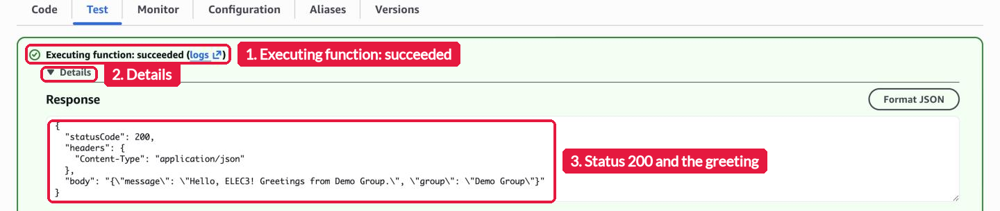

# Seatwork 4: Write Your First Lambda Function

This is a self-guided activity. Your group writes its first AWS Lambda function, runs it with a test event, and reads its log in Amazon CloudWatch. You do not run a server. Lambda runs your code only when something calls it.

Work through this page first. It explains the Lambda ideas that each step uses. Then follow the steps in [`seatwork.md`](seatwork.md). [Lab 4](../lab-4/README.md) starts from the function that you make here, so keep it.



## What you do

This is group work. You sign in with your group IAM (Identity and Access Management) user, the same user from Seatwork 3. Your group submits one Pull Request.

1. Create the function `umak-elec3-<group user>-api` in Asia Pacific (Singapore), with Python 3.13 and the role that I made for your group.
2. Write a handler that returns a JSON greeting with your group's name.
3. Create a test event and run the function twice.
4. Open the function's log group in CloudWatch and find the two REPORT lines.
5. Take three screenshots and submit.

## Key ideas

### Serverless and AWS Lambda

In Lab 2, your group ran an EC2 instance. It ran, and cost money, every hour, even when nobody opened the page. Lambda works the other way. You upload a function. Lambda starts it when an event arrives, runs it, and stops it. You pay for each run and for the milliseconds that it takes. When nobody calls the function, nothing runs and you pay nothing. This is serverless computing. Servers still exist, but AWS runs them for you.

### The handler and the event

The handler is the Python function that Lambda calls. It has this form:

```python
def lambda_handler(event, context):
    ...
    return result
```

`event` is the input, a Python dictionary. A test event in the console is an event. In Lab 4, a web request through Amazon API Gateway is an event too. `context` holds facts about the run, such as the time left. What the handler returns is the output.

Your handler returns a dictionary with `statusCode`, `headers`, and `body`. The `body` is text in JSON (JavaScript Object Notation), a text format for data. This is the shape that API Gateway expects. In Lab 4, API Gateway sends it back to the browser as a web response.

### The execution role

A Lambda function needs permission to write its logs and to call other AWS services. It gets these permissions from an IAM role, its execution role. Your group IAM user cannot create IAM roles, so I made one role for each group: `umak-elec3-<group user>-lambda-role`. You choose it when you create the function. It lets the function write logs to CloudWatch. In Lab 4, it also lets the function read and write your group's DynamoDB table.

### CloudWatch Logs and the REPORT line

Lambda sends the output of each run to a log group in CloudWatch Logs. The log group is named `/aws/lambda/<function name>`. Each run writes a `START` line, anything that your code prints, an `END` line, and a `REPORT` line. A REPORT line has this form:

```text
REPORT RequestId: <id> Duration: <time> ms Billed Duration: <time> ms Memory Size: 128 MB Max Memory Used: <size> MB Init Duration: <time> ms
```

| Field | What it means |
| --- | --- |
| Duration | How long your handler ran |
| Billed Duration | The time that AWS charges for |
| Memory Size | The memory that the function has. The default is 128 MB |
| Max Memory Used | The most memory that this run used |
| Init Duration | How long Lambda took to prepare a new environment and load your code. It shows only on a cold start |

### Cold starts and warm starts

The first time a function runs, Lambda creates an execution environment, a small, isolated place to run your code. Lambda starts Python in it and loads your code. This is a cold start. The REPORT line shows its time as Init Duration, and an `INIT_START` line comes before the first `START` line.

Lambda keeps the environment for a while after a run. A second run soon after reuses it. This is a warm start, and its REPORT line has no Init Duration. When you deploy new code, Lambda needs a new environment, so the next run is a cold start again.

### What your group IAM user can do

Your user can create and change only resources whose names start with `umak-elec3-` and your user name, in Asia Pacific (Singapore). Use the exact names in [`seatwork.md`](seatwork.md). Other names get `Access Denied`.

## Cost

Lambda charges for each run and for each millisecond of run time. A few test runs cost far less than one cent. A function that nobody calls costs nothing. Keep your function, because Lab 4 builds on it.

## How you submit

Submit one Pull Request per group to this repository. Then one groupmate submits the Pull Request link in the Google Form: https://forms.gle/Rqpn9rvGzTb99Lp76. Both are due on Sunday, November 8, 2026, at 11:59 PM (Asia/Manila).

## Files in this folder

| File | What it is |
| --- | --- |
| [`README.md`](README.md) | This page: what you do and the Lambda ideas behind each step. |
| [`seatwork.md`](seatwork.md) | The four steps with screenshots, what to submit, the scoring, and what to check when you get stuck. |
| [`submission-template.md`](submission-template.md) | Copy it to your submission folder as `submission.md`. |
