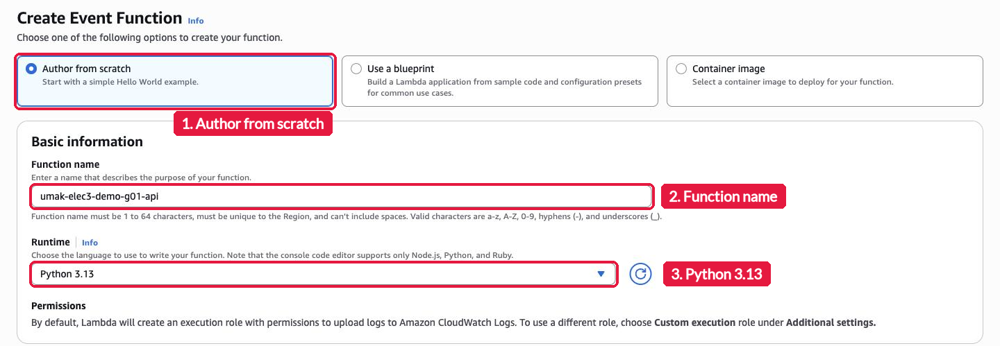
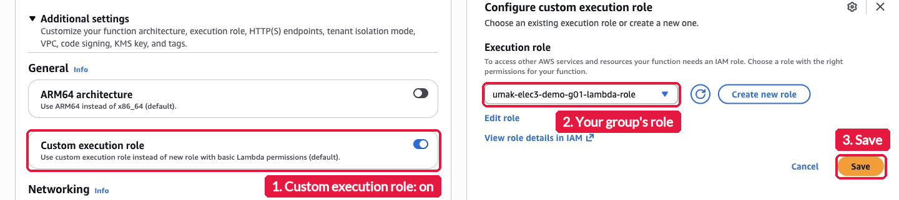
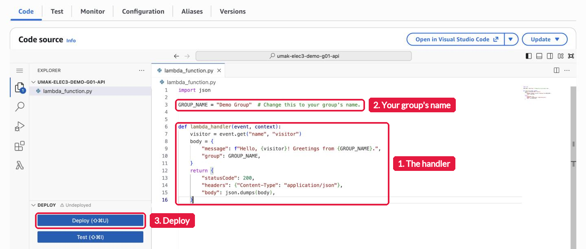
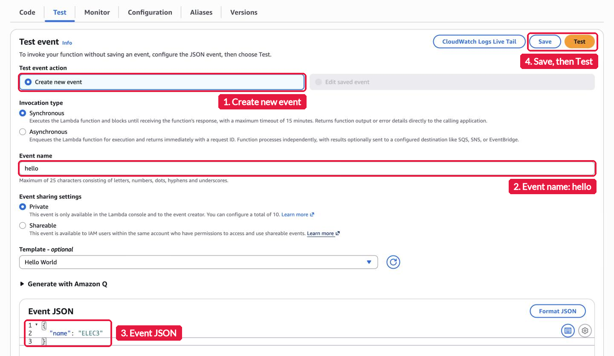
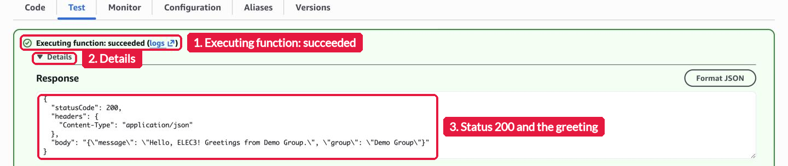
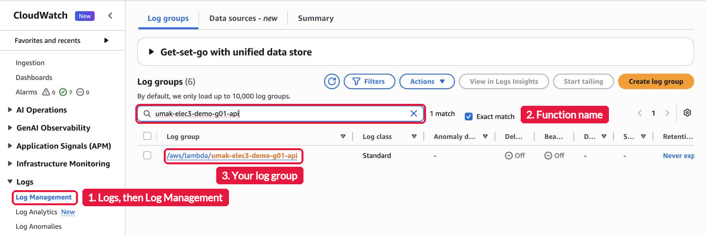
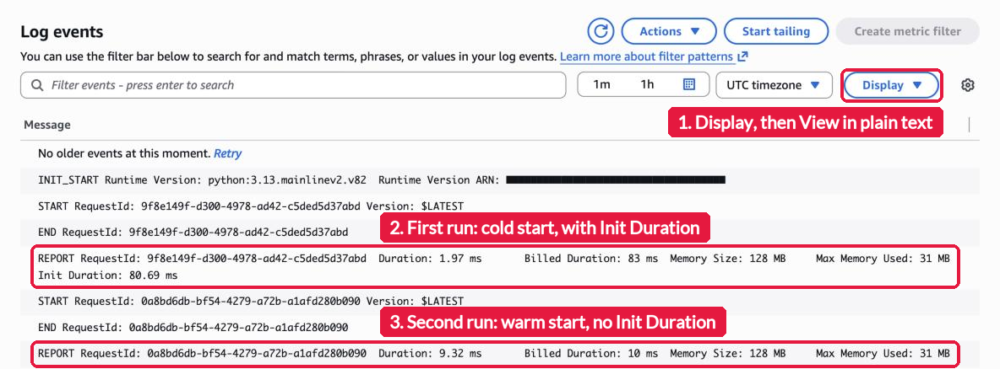

# Seatwork 4: Write Your First Lambda Function

> Submit one Pull Request per group to this repository. Then one groupmate submits the Pull Request link in the Google Form: https://docs.google.com/forms/d/e/1FAIpQLSeSwZ4hrYrWUqaG4KM4s6KFqmPGFsAFBaF4hrwqQYRJsxEsqw/viewform. Both are due on Saturday, November 7, 2026, at 11:59 PM (Asia/Manila). Do not merge your own Pull Request.

This is a self-guided activity. Your group creates an AWS Lambda function, runs it with a test event, and finds its REPORT lines in Amazon CloudWatch. [Lab 4](../lab-4/lab.md) starts from this function. Read [`README.md`](README.md) before you start. It explains the Lambda ideas that each step uses.

## Before you start

- Sign in at the class sign-in URL with your group IAM (Identity and Access Management) user, for example `acsad-g03`. Do not change the group password. A new password locks out your groupmates.
- Work in Asia Pacific (Singapore), `ap-southeast-1`. Check the Region in the top bar before each step.
- Use exactly these names. Replace `<group user>` with your user name.

  | What | Name |
  | --- | --- |
  | Lambda function | `umak-elec3-<group user>-api` |
  | Execution role, which I made for your group | `umak-elec3-<group user>-lambda-role` |
  | Log group, which Lambda makes on the first run | `/aws/lambda/umak-elec3-<group user>-api` |

  For example, group user `acsad-g03` uses the function `umak-elec3-acsad-g03-api`. Any other name gets `Access Denied`.

## Step 1. Create the function

Open the Lambda console and choose **Create Event Function**. Choose **Author from scratch**. Fill in the form:

- **Function name**: `umak-elec3-<group user>-api`
- **Runtime**: **Python 3.13**



Open **Additional settings**. Keep **ARM64 architecture** turned off, so the architecture stays **x86_64**. Turn on **Custom execution role**. A panel opens on the right. In **Execution role**, choose `umak-elec3-<group user>-lambda-role`, then choose **Save**. Choose your own group's role, not the role of another group. Keep every other setting and choose **Create Event Function**. If a **Getting started** window opens, choose **Dismiss**.



## Step 2. Write the handler

Open the **Code** tab. Lambda made the file `lambda_function.py` with sample code. Replace all of it with this code:

```python
import json

GROUP_NAME = "Group 3 of IV-ACSAD"  # Change this to your group's name.


def lambda_handler(event, context):
    visitor = event.get("name", "visitor")
    body = {
        "message": f"Hello, {visitor}! Greetings from {GROUP_NAME}.",
        "group": GROUP_NAME,
    }
    return {
        "statusCode": 200,
        "headers": {"Content-Type": "application/json"},
        "body": json.dumps(body),
    }
```

Change `Group 3 of IV-ACSAD` to your group's name. Keep the quotes around it. Then choose **Deploy**, and wait for the message that says that the function was updated.



The handler reads `name` from the event. If the event has no `name`, the greeting says `visitor`. The handler returns the greeting as JSON (JavaScript Object Notation), a text format for data.

## Step 3. Create a test event and run it twice

Open the **Test** tab. Choose **Create new event**. Type `hello` as the **Event name**. Replace the **Event JSON** with this event:

```json
{
  "name": "ELEC3"
}
```

Choose **Save**, then choose **Test**.



A green box says **Executing function: succeeded**. Open **Details**. The response shows `"statusCode": 200` and your greeting in `body`. Take the screenshot `test.png` now.



Choose **Test** again, right away. This second run reuses the environment of the first run.

## Step 4. Find the REPORT lines in CloudWatch

Open the CloudWatch console. In the left menu, choose **Logs**, then **Log Management**. Type your function name in the search box and open `/aws/lambda/umak-elec3-<group user>-api`.



On the **Log streams** tab, open the newest log stream. It holds both runs. The list cuts long lines short, so choose **Display**, then **View in plain text**. Find the two `REPORT` lines:

- The first run was a cold start. Its REPORT line ends with **Init Duration**, and an `INIT_START` line comes before it.
- The second run was a warm start. Its REPORT line has no Init Duration.

Copy both REPORT lines into your `submission.md`. Take the screenshot `report.png`.



## What to submit

Take all three screenshots before you start Lab 4. Lab 4 replaces your handler code.

1. Create the folder `submissions/seatwork-4/group-<number>/` on a branch named `seatwork-4-group-<number>`.
2. Add three screenshots to that folder:
   - `code.png`: the **Code** tab with your deployed handler.
   - `test.png`: the test result with **Executing function: succeeded** and your greeting.
   - `report.png`: the log events with both REPORT lines.
3. Crop the AWS console top bar out of all three screenshots, because it shows the account number. Also cover every ARN (Amazon Resource Name), a long name that starts with `arn:aws:`, because it holds the account number too.
4. Copy [`submission-template.md`](submission-template.md) to the same folder as `submission.md`. Fill in your section, group number, group IAM user, function name, handler code, both REPORT lines, the answer to the question, and one line per groupmate (GitHub username and what each one did).
5. Open one Pull Request. One groupmate submits its link in the Google Form for the whole group: https://docs.google.com/forms/d/e/1FAIpQLSeSwZ4hrYrWUqaG4KM4s6KFqmPGFsAFBaF4hrwqQYRJsxEsqw/viewform.

| Check | Points |
| --- | --- |
| The function `umak-elec3-<group user>-api` is in Singapore, with Python 3.13 and your group's role | 4 |
| The handler returns a JSON greeting with your group's name | 4 |
| A saved test event and a successful run | 3 |
| Both REPORT lines, the first one with Init Duration | 4 |
| A correct answer: why the second REPORT line has no Init Duration | 2 |
| Three screenshots, with the console top bar and every ARN hidden | 2 |
| `submission.md` is complete | 1 |
| **Total** | **20** |

Keep your function. Lab 4 builds on it.

## If you get stuck

| What you see | What to check |
| --- | --- |
| `Access Denied` when you create the function | The function name must be exactly `umak-elec3-<group user>-api`, in lowercase, in Singapore |
| Your role is not in the **Execution role** list | Type `umak-elec3-` in the list to filter it. If your role is still missing, message me in the group chat |
| An error that names `iam:PassRole` | You chose a role that is not your group's. Choose `umak-elec3-<group user>-lambda-role` |
| The test result still says `Hello from Lambda!` | You did not choose **Deploy**. Deploy, then test again |
| An error that names `Syntax` or `Indentation` | Copy the code again. Python needs the same spaces at the start of each line. Check the quotes around your group's name |
| No log group | Lambda makes the log group on the first run. Run the test, wait one minute, and refresh the list |
| Both REPORT lines have Init Duration | The second run got a new environment, for example after a new deploy. Choose **Test** twice, one right after the other, and look again |
| The console says you cannot sign in | Message me in the group chat |

AWS documentation, if you want more detail: [Building Lambda functions with Python](https://docs.aws.amazon.com/lambda/latest/dg/lambda-python.html), [Sending Lambda function logs to CloudWatch Logs](https://docs.aws.amazon.com/lambda/latest/dg/monitoring-cloudwatchlogs.html), and [Understanding the Lambda execution environment lifecycle](https://docs.aws.amazon.com/lambda/latest/dg/lambda-runtime-environment.html).
