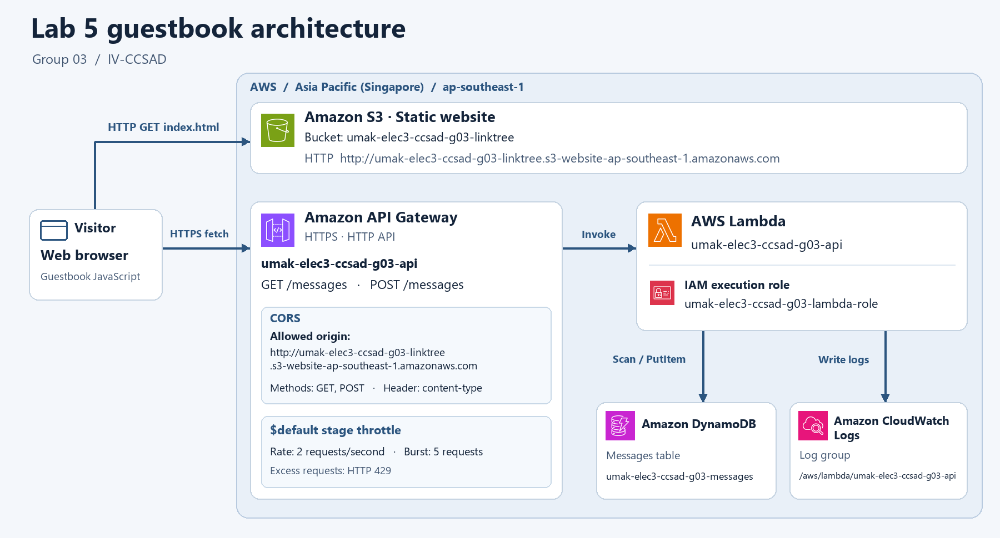

# Assignment 5 Submission

## About us

- Group number: 03
- Section: IV-CCSAD
- Group IAM user: `ccsad-g03`

## Diagram

Icons: [AWS Architecture Icons](https://aws.amazon.com/architecture/icons/).

## Estimate

Asia Pacific (Singapore), one month: 100,000 page views and 5,000 posts.

| Service | Settings | Monthly cost (USD) |
| --- | --- | ---: |
| Amazon S3 | S3 Standard, 1 GB, 100,000 GET requests | 0.07 |
| Amazon API Gateway | HTTP API, 0.105 million requests, 1 KB each | 0.13 |
| AWS Lambda | Without Free Tier, x86, 105,000 requests, 100 ms, 128 MB | 0.04 |
| Amazon DynamoDB | On-demand, Standard, 1 GB, 1 KB items, 0.005 million writes, 0.1 million eventually consistent reads | 0.29 |
| **Total** | | **0.53** |

Share link of our estimate: https://calculator.aws/#/estimate?id=1afe10026509e289480ce251d479c4088305ad7a

## Ten times the traffic

With 1,000,000 page views and 50,000 posts a month, which service's monthly cost grows the most in US dollars, and why?

**Amazon API Gateway** grows the most, from **USD 0.13 to USD 1.31 per month**, an increase of **USD 1.18** using the calculator's displayed amounts. Each page view sends one `GET /messages`, and each post sends one `POST /messages`, so billable HTTP API requests rise from 105,000 to 1,050,000 while the request size stays at 1 KB. Holding storage and the other assumptions fixed, S3 rises from USD 0.07 to USD 0.42, Lambda from USD 0.04 to USD 0.43, and DynamoDB from USD 0.29 to USD 0.39.

## The throttle and one more improvement

Which Well-Architected pillar does the throttle on the `$default` stage serve, and why?

**Reliability.** The rate limit of 2 requests per second and burst limit of 5 let API Gateway reject excess requests with HTTP 429 before they reach Lambda or DynamoDB, so a traffic spike is less likely to overwhelm the backend. See [REL05-BP02: Throttle requests](https://docs.aws.amazon.com/wellarchitected/latest/framework/rel05-bp02.html).

One more improvement for the same architecture, and the pillar that it serves:

**Cost Optimization.** Add a DynamoDB index keyed by guestbook and sorted by creation time, then use `Query` to return only the 50 newest messages instead of using `Scan`. This limits how much data each GET reads as the table grows. See [AWS guidance on DynamoDB queries and scans](https://docs.aws.amazon.com/amazondynamodb/latest/developerguide/bp-query-scan.html).

## Contribution

| GitHub username | What this groupmate did |
| --- | --- |
| dcchristine | Assigned tasks as group leader and checked the final submission against the assignment checklist. |
| salgadojamesvan | Revised the architecture diagram, checked the request arrows and labels, and exported `diagram.png`. |
| yajiiiii | Reproduced the four-service estimate in the AWS Pricing Calculator and verified the shared estimate against the required settings. |
| Tajarros-Zed | Recalculated the 10× traffic comparison, revised the Well-Architected answers, and assembled `submission.md`. |
