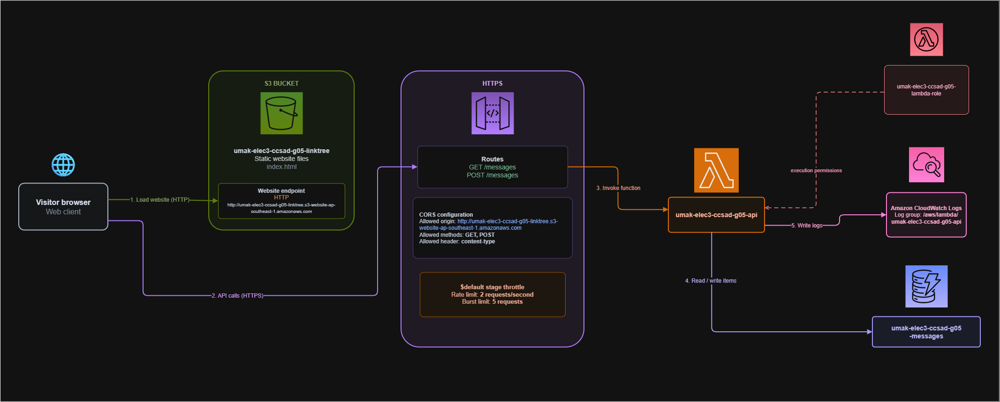

# Assignment 5 Submission

<!--
How to use this template:

1. Copy this file to submissions/assignment-5/group-<number>/submission.md
2. Replace every <answer> with your group's answer. Delete the angle brackets too.
3. Save diagram.png in the same folder.
4. Keep your invoke URL, your API ID, every ARN, and the account number out of this folder.
5. Write GitHub usernames, not full names or student numbers.
-->

## About us

- Group number: 05  
- Section: IV-CCSAD  
- Group IAM user: ccsad-g05

## Diagram

## Estimate

Asia Pacific (Singapore), one month: 100,000 page views and 5,000 posts.

| Service | Settings | Monthly cost (USD) |
| --- | --- | --- |
| Amazon S3 | S3 Standard, 1 GB, 100,000 GET requests | 0.06 |
| Amazon API Gateway | HTTP API, 0.105 million requests, 1 KB each | 0.10 |
| AWS Lambda | Without Free Tier, x86, 105,000 requests, 100 ms, 128 MB | 0.04 |
| Amazon DynamoDB | On-demand, Standard, 1 GB, 1 KB items, 0.005 million writes, 0.1 million eventually consistent reads | 0.26 |
| **Total** | | 0.47 |

Share link of our estimate: https://calculator.aws/#/estimate?id=fadf06005f22154062f7faecfc98f5fa12e3a092

## Ten times the traffic

With 1,000,000 page views and 50,000 posts a month, which service's monthly cost grows the most in US dollars, and why?

Every page view (GET) and every post (POST) must pass through API Gateway, totaling 1.05 million requests. Because it charges $1.00 per million requests, the 10× increase in traffic directly multiplies its cost by 10. By comparison, the dollar increases for the other services are much smaller: Lambda grows by ~$0.39, S3 GETs by ~$0.36, and DynamoDB reads/writes by ~$0.28. DynamoDB storage (~$0.25) does not grow at all because the table size remains roughly 1 GB.

## The throttle and one more improvement

Which Well-Architected pillar does the throttle on the `$default` stage serve, and why?

The throttle on the $default stage serves the Reliability pillar through best practice REL05-BP02: Throttle requests. By setting rate and burst limits at the API entry point, it prevents traffic spikes, runaway scripts, or abusive clients from overwhelming downstream Lambda functions and DynamoDB tables which ensures that the workload degrades fluidly and stays available for legitimate users. Though, it is worth noting that this also indirectly supports Cost Optimization by capping runaway invocation bills during a traffic flood.

One more improvement for the same architecture, and the pillar that it serves:

One improvement that can be added to the same architecture would be adding Amazon CloudFront in front of the S3 static website and even add cache GET responses for the guestbook entries. This would serve the Performance Efficiency and Security pillar as Cloudfront caches static assets and read responses at global edge locations closer to visitors. This reduces page-load latency while also enabling HTTPS enforcement and lowering origin requests to S3 and API Gateway.

## Contribution

| GitHub username | What this groupmate did |
| --- | --- |
| DeviDo2 | Lead the group, drew the diagram, and submitted the submission.md |
| gracefeliciano | Estimated the cost using the AWS calculator |
| PalattaoMekylla | Guided the calculator and answered a question |
| GlorianaSkye | Completed the remaining questions |
