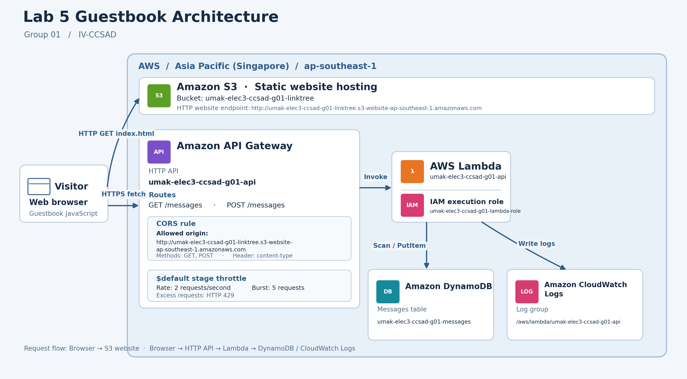

# Assignment 5 Submission

## About us

-   Group number: 1
-   Section: IV-CCSAD
-   Group IAM user: `ccsad-g01`

## Diagram

## Estimate

Asia Pacific (Singapore), one month: 100,000 page views and 5,000 posts.

  ------------------------------------------------------------------------
  Service               Settings                        Monthly cost (USD)
  --------------------- --------------------- ----------------------------
  Amazon S3             S3 Standard, 1 GB,                          \$0.07
                        100,000 GET requests  

  Amazon API Gateway    HTTP API, 0.105                             \$0.13
                        million requests, 1   
                        KB each               

  AWS Lambda            Without Free Tier,                          \$0.04
                        x86, 105,000          
                        requests, 100 ms, 128 
                        MB                    

  Amazon DynamoDB       On-demand, Standard,                        \$0.29
                        1 GB, 1 KB items,     
                        0.005 million writes, 
                        0.1 million           
                        eventually consistent 
                        reads                 

  **Total**                                                     **\$0.53**
  ------------------------------------------------------------------------

Share link of our estimate: [AWS Pricing Calculator
estimate](https://calculator.aws/#/estimate?id=883462811a7030c86102382f7700c866021d2efa)

## Ten times the traffic

With 1,000,000 page views and 50,000 posts a month, which service's
monthly cost grows the most in US dollars, and why?

Amazon API Gateway's monthly cost grows the most in US dollars when
traffic increases ten times. Its requests increase from 0.105 million to
1.05 million per month, making its estimated cost increase from \$0.13
to approximately \$1.30. This is an increase of approximately \$1.17
because API Gateway charges based on the number of requests it receives.

## The throttle and one more improvement

Which Well-Architected pillar does the throttle on the `$default` stage
serve, and why?

The throttle serves the Reliability pillar because it limits the number
of requests the API accepts. It helps prevent too many requests from
overwhelming the system and keeps the application available. Requests
that exceed the limit receive a `429 Too Many Requests` response instead
of being sent to Lambda.

One more improvement for the same architecture, and the pillar that it
serves:

**Improvement:** Add Amazon CloudWatch Alarms.

**Pillar:** Operational Excellence.

CloudWatch Alarms can monitor Lambda errors and API Gateway failures.
When too many errors occur, CloudWatch can notify the developers so they
can identify and fix problems quickly. This helps the team monitor and
maintain the application.

## Contribution

  -----------------------------------------------------------------------
  GitHub username                     What this groupmate did
  ----------------------------------- -----------------------------------
  `madeliiine`                        Created the Lab 5 architecture
                                      diagram and checked the required
                                      AWS components.

  `NathanielCamachoUMAK`              Configured the Amazon S3 and Amazon
                                      API Gateway estimates and recorded
                                      their monthly costs.

  `flaaa01`                           Configured the AWS Lambda and
                                      Amazon DynamoDB estimates and
                                      checked their configurations and
                                      costs.

  `kcalicaa12346055-sudo`             Prepared the submission document,
                                      answered Task 3 and Task 4, and
                                      organized the final GitHub
                                      submission.
  -----------------------------------------------------------------------
