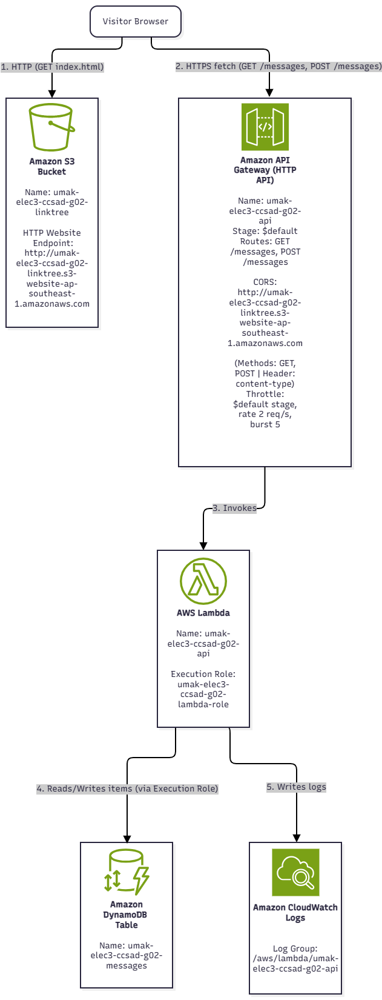

# Assignment 5 Submission

<!--
How to use this template:

1. Copy this file to submissions/assignment-5/group-<number>/submission.md
2. Replace every <answer> with your group's answer. Delete the angle brackets too.
3. Save diagram.png in the same folder.
4. Keep your invoke URL, your API ID, every ARN, and the account number out of this folder.
5. Write GitHub usernames, not full names or student numbers.
-->

## About us

- Group number: Group-2 
- Section: IV-CCSAD
- Group IAM user: ccsad-g02

## Diagram

## Estimate

Asia Pacific (Singapore), one month: 100,000 page views and 5,000 posts.

| Service | Settings | Monthly cost (USD) |
| --- | --- | --- |
| Amazon S3 | S3 Standard, 1 GB, 100,000 GET requests | 0.07 USD |
| Amazon API Gateway | HTTP API, 0.105 million requests, 1 KB each | 0.13 USD |
| AWS Lambda | Without Free Tier, x86, 105,000 requests, 100 ms, 128 MB | 0.4 USD |
| Amazon DynamoDB | On-demand, Standard, 1 GB, 1 KB items, 0.005 million writes, 0.1 million eventually consistent reads | 0.29 USD |
| **Total** | | 0.53 USD |

Share link of our estimate: https://calculator.aws/#/estimate?id=dd81875b7ecb20795b4f307e4f8ec4407be91698

## Ten times the traffic

With 1,000,000 page views and 50,000 posts a month, which service's monthly cost grows the most in US dollars, and why?

Amazon API Gateway grows the most in US dollars, jumping from $0.13 to $1.26 per month (an increase of $1.13). Because HTTP API charges per request for every page view and post submission (1,050,000 total calls), its bill scales directly with user activity. Meanwhile, fixed storage costs on S3 and DynamoDB stay completely flat, and Lambda and DynamoDB request fees remain much cheaper per million operations.

## The throttle and one more improvement

Which Well-Architected pillar does the throttle on the `$default` stage serve, and why?

The throttle on the `$default` stage serves the Reliability pillar. By capping traffic at 2 requests per second with a burst of 5, it prevents sudden traffic spikes or accidental spam loops from overwhelming our Lambda function and DynamoDB table, keeping the guestbook available for normal visitors.

One more improvement for the same architecture, and the pillar that it serves:

We could put Amazon CloudFront in front of our S3 website bucket so visitors can load the page over HTTPS instead of plain HTTP. This serves the Security pillar by encrypting data in transit between the visitor's browser and our site, while also speeding up page loads through edge caching.

## Contribution

| GitHub username | What this groupmate did |
| --- | --- |
| saromoAndreiLuis | Configured the S3, API Gateway, Lambda, and DynamoDB estimates in the AWS Pricing Calculator and generated the share link. |
| DietherUrdas | Set up the `assignment-5-group-2` branch, organized the submission folder, and formatted `submission.md`. |
| rssnjade | Designed and exported the AWS architecture diagram (`diagram.png`) with official service icons and Group 2 resource labels. |
| RalphEspartero3 | Analyzed the 10x traffic scaling costs and drafted the AWS Well-Architected Framework answers. |