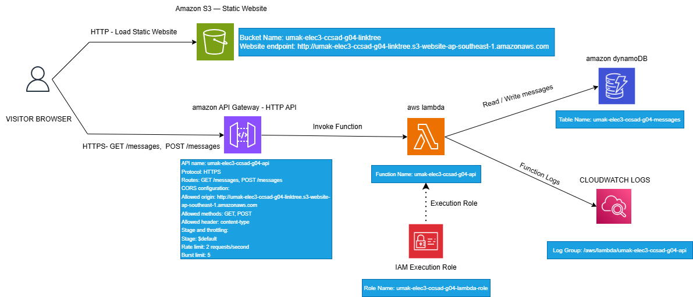

# Assignment 5 Submission

## About us

- Group number: 4
- Section: IV-CCSAD
- Group IAM user: ccsad-g04

## Diagram

## Estimate

Asia Pacific (Singapore), one month: 100,000 page views and 5,000 posts.

| Service | Settings | Monthly cost (USD) |
| --- | --- | --- |
| Amazon S3 | S3 Standard, 1 GB, 100,000 GET requests | $0.07 |
| Amazon API Gateway | HTTP API, 0.105 million requests, 1 KB each | $0.13 |
| AWS Lambda | Without Free Tier, x86, 105,000 requests, 100 ms, 128 MB | $0.04 |
| Amazon DynamoDB | On-demand, Standard, 1 GB, 1 KB items, 0.005 million writes, 0.1 million eventually consistent reads | $0.29 |
| **Total** | | **$0.53** |

Share link of our estimate: https://calculator.aws/#/estimate?id=8055aa9657aade144ef59a0b2a4c3b871a841fa3

## Ten times the traffic

With 1,000,000 page views and 50,000 posts a month, which service's monthly cost grows the most in US dollars, and why?

For our guestbook, each page view calls `GET /messages`, and one in twenty visitors also calls `POST /messages`. At ten times the traffic, API Gateway handles 1,050,000 requests instead of 105,000, so its $0.13 monthly cost becomes roughly $1.30, or about $1.17 more. This is the largest dollar increase; the 1 GB storage inputs for S3 and DynamoDB stay the same, and Lambda starts at only $0.04.

## The throttle and one more improvement

Which Well-Architected pillar does the throttle on the `$default` stage serve, and why?

Our `$default` stage throttle supports the Reliability pillar. Its rate of 2 requests per second and burst of 5 prevent a sudden rush of guestbook requests from overwhelming Lambda and DynamoDB; callers over the limit receive `429 Too Many Requests`.

One more improvement for the same architecture, and the pillar that it serves:

Add a CloudWatch alarm on the Lambda function's Errors metric so our group can spot a broken guestbook quickly. This supports Operational Excellence by giving us a clear signal to investigate instead of waiting for visitors to report the problem.

## Contribution

| GitHub username | What this groupmate did |
| --- | --- |
| StDevRhenz | Drew the architecture diagram and compiled `submission.md`. |
| Andre-Arcilla | Prepared the S3 and API Gateway cost estimates. |
| paupausiopau | Prepared the Lambda and DynamoDB cost estimates. |
| ScarlettRed6 | Answered the traffic and Well-Architected questions and checked the final estimate. |
