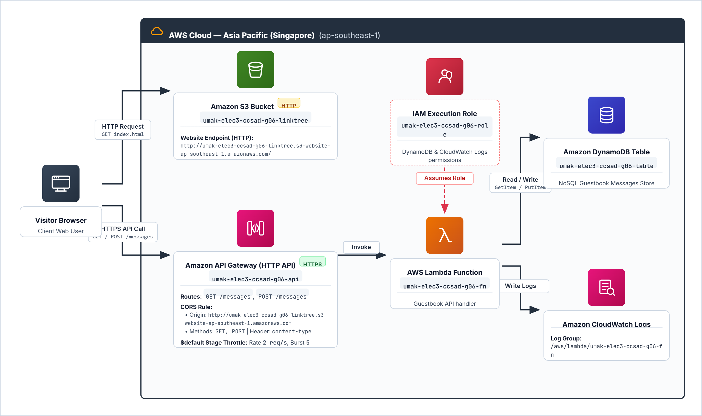

# Assignment 5 Submission

<!--
How to use this template:

1. Copy this file to submissions/assignment-5/group-<number>/submission.md
2. Replace every <answer> with your group's answer. Delete the angle brackets too.
3. Save diagram.png in the same folder.
4. Keep your invoke URL, your API ID, every ARN, and the account number out of this folder.
5. Write GitHub usernames, not full names or student numbers.
-->

## About us

- Group number: 6
- Section: CCSAD 
- Group IAM user: ccsad-g06

## Diagram

## Estimate

Asia Pacific (Singapore), one month: 100,000 page views and 5,000 posts.

| Service | Settings | Monthly cost (USD) |
| --- | --- | --- |
| Amazon S3 | S3 Standard, 1 GB, 100,000 GET requests | 0.07 USD |
| Amazon API Gateway | HTTP API, 0.105 million requests, 1 KB each | 0.13 USD |
| AWS Lambda | Without Free Tier, x86, 105,000 requests, 100 ms, 128 MB | 0.04 USD |
| Amazon DynamoDB | On-demand, Standard, 1 GB, 1 KB items, 0.005 million writes, 0.1 million eventually consistent reads | 0.29 USD |
| **Total** | | 0.53 USD |

Share link of our estimate: https://calculator.aws/#/estimate?id=3856d7fda16179b7d8f0619ffaee2befa4acbb7a

## Ten times the traffic

With 1,000,000 page views and 50,000 posts a month, which service's monthly cost grows the most in US dollars, and why?

Amazon API Gateway's monthly cost grows the most in US dollars. When monthly traffic multiplies tenfold to 1,000,000 page views and 50,000 posts, total requests to the backend surge from 105,000 to 1,050,000 requests. In the Asia Pacific (Singapore) region, HTTP API requests are priced at $1.29 per million, pushing API Gateway's monthly bill from $0.13 to approximately $1.35 USD, which represents an increase of roughly $1.22 USD. By comparison, the cost growth of the other services remains substantially lower: AWS Lambda compute and request charges only increase by approximately $0.39 USD (from $0.04 to $0.43 USD), Amazon S3 GET requests add around $0.36 USD while its 1 GB storage tier stays flat (rising from $0.07 to $0.43 USD), and Amazon DynamoDB on-demand request units add less than $0.20 USD on top of its fixed $0.25 USD storage cost (rising from $0.29 to $0.48 USD). Because API Gateway has the highest unit cost per million requests among the scalable components, it undergoes the greatest absolute financial increase.

## The throttle and one more improvement

Which Well-Architected pillar does the throttle on the `$default` stage serve, and why?

Setting a throttle on the `$default` stage serves the Reliability pillar of the AWS Well-Architected Framework, while also reinforcing Cost Optimization. By enforcing a rate limit of 2 requests per second and a burst limit of 5 requests, API Gateway prevents sudden traffic surges, unintended looping, or malicious denial-of-service attempts from saturating downstream resources. When incoming traffic exceeds these thresholds, API Gateway immediately sheds the excess load by returning HTTP 429 Too Many Requests directly at the edge, without executing the Lambda function or consuming DynamoDB read and write throughput. This protects downstream dependencies from exhausting concurrency limits, prevents cascading failures across the system, and ensures that the application remains available and stable for legitimate user requests.

One more improvement for the same architecture, and the pillar that it serves:

One key improvement for this architecture is deploying an Amazon CloudFront distribution in front of the Amazon S3 static website endpoint, which directly serves the Security and Performance Efficiency pillars. Currently, the S3 website endpoint serves content over unencrypted HTTP, exposing data in transit to interception or manipulation. Introducing CloudFront enables HTTPS delivery with a custom SSL/TLS certificate, satisfying the Security pillar's mandate to encrypt data in transit. In addition, CloudFront caches the static `index.html` file and frontend assets at edge locations physically closer to visitors worldwide, fulfilling the Performance Efficiency pillar by drastically reducing latency, accelerating page load speeds, and offloading repetitive GET traffic from the S3 origin.

## Contribution

| GitHub username | What this groupmate did |
| --- | --- |
| MadBunBun | aws calculations, submission |
| kadirisubs | aws calculations walkthrough |
| malorian-arms3516 | answered assignment questions |
| keiameere | answered assignment questions, double checked md file and calculation process |
