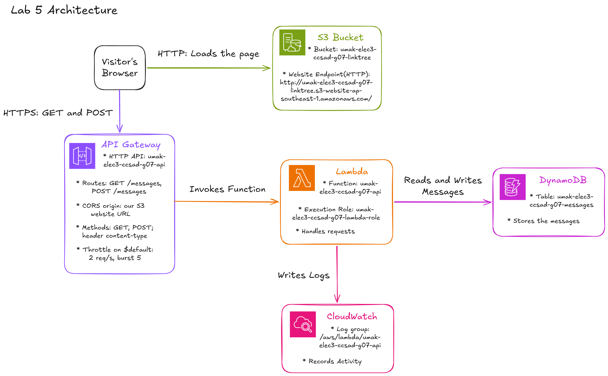

# Assignment 5 Submission

<!--
How to use this template:

1. Copy this file to submissions/assignment-5/group-<number>/submission.md
2. Replace every <answer> with your group's answer. Delete the angle brackets too.
3. Save diagram.png in the same folder.
4. Keep your invoke URL, your API ID, every ARN, and the account number out of this folder.
5. Write GitHub usernames, not full names or student numbers.
-->

## About us

- Group number: 7
- Section: IV - CCSAD
- Group IAM user: ccsad-g07

## Diagram

## Estimate

Asia Pacific (Singapore), one month: 100,000 page views and 5,000 posts.

| Service | Settings | Monthly cost (USD) |
| --- | --- | --- |
| Amazon S3 | S3 Standard, 1 GB, 100,000 GET requests | 0.07 USD |
| Amazon API Gateway | HTTP API, 0.105 million requests, 1 KB each | 0.13 USD |
| AWS Lambda | Without Free Tier, x86, 105,000 requests, 100 ms, 128 MB | 0.04 USD |
| Amazon DynamoDB | On-demand, Standard, 1 GB, 1 KB items, 0.005 million writes, 0.1 million eventually consistent reads | 0.29 USD |
| **Total** | | 0.53 USD Monthly cost |

Share link of our estimate: https://calculator.aws/#/estimate?id=619cbb0b54a1c01bcf9daf98be351f0fcb93fa20

## Ten times the traffic

With 1,000,000 page views and 50,000 posts a month, which service's monthly cost grows the most in US dollars, and why?

API Gateway grows the most, from about 0.13 USD to about 1.31 USD, an increase of roughly 1.2 USD. It charges per request with no fixed part, and every page view and post is an API request, so ten times the traffic means ten times the cost. S3 and Lambda also grow ten times, but their starting costs are tiny, so they add only about 0.4 USD each. DynamoDB barely grows, because most of its 0.29 USD is the fixed storage charge for 1 GB, which doesn’t depend on traffic.

## The throttle and one more improvement

Which Well-Architected pillar does the throttle on the `$default` stage serve, and why?

The throttle on the $default stage serves the Reliability pillar. It limits the API to 2 requests per second with a burst of 5, so a traffic spike or a spamming bot can’t overload Lambda and DynamoDB and make the guestbook fail for everyone.

One more improvement for the same architecture, and the pillar that it serves:

Improvement: put Amazon CloudFront in front of the S3 website endpoint. It serves the page over HTTPS, so visitors’ traffic is encrypted, and it also caches the page closer to visitors. The pillar it serves is Security.

## Contribution

| GitHub username | What this groupmate did |
| --- | --- |
| rewyuu | Made the diagram and calculated estimate |
| LarsUlrichPons | Answered ten times the traffic |
| JeromeMagno | Answered the throttle and one more improvement |
| VobAviso | Wrote everything in the submission |