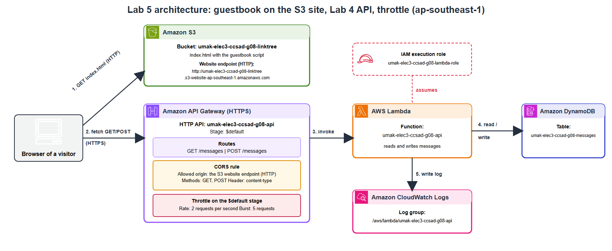

# Assignment 5 Submission

## About us

- Group number: 08
- Section: IV-CCSAD
- Group IAM user: ccsad-g08

## Diagram

## Estimate

Asia Pacific (Singapore), one month: 100,000 page views and 5,000 posts.

| Service | Settings | Monthly cost (USD) |
| --- | --- | --- |
| Amazon S3 | S3 Standard, 1 GB, 100,000 GET requests | 0.07 |
| Amazon API Gateway | HTTP API, 0.105 million requests, 1 KB each | 0.13 |
| AWS Lambda | Without Free Tier, x86, 105,000 requests, 100 ms, 128 MB | 0.04 |
| Amazon DynamoDB | On-demand, Standard, 1 GB, 1 KB items, 0.005 million writes, 0.1 million eventually consistent reads | 0.29 |
| **Total** | | 0.53 |

Share link of our estimate: https://calculator.aws/#/estimate?id=f972df76a083afe0fb4bdb2d7e1701b121c9e990

## Ten times the traffic

With 1,000,000 page views and 50,000 posts a month, which service's monthly cost grows the most in US dollars, and why?

Amazon API Gateway grows the most. Its cost is only per request, and it goes from USD 0.13 to about USD 1.31, which is an increase of about USD 1.18. Lambda grows by about USD 0.39 (from 0.04 to 0.43), S3 by about USD 0.36 (from 0.07 to 0.43), and DynamoDB by only about USD 0.10 (from 0.29 to 0.39), because most of its cost is the fixed 1 GB of storage, which does not grow with traffic. The monthly total grows from about USD 0.53 to about USD 2.55.

## The throttle and one more improvement

Which Well-Architected pillar does the throttle on the `$default` stage serve, and why?

The throttle serves the Reliability pillar. It limits how many requests reach the function and the table, so a flood of requests cannot overload them, and the guestbook keeps working for normal visitors. It also helps the Cost Optimization pillar, because a request that gets a 429 answer never runs the function.

One more improvement for the same architecture, and the pillar that it serves:

Put Amazon CloudFront in front of the S3 bucket, so the site is served over HTTPS and visitors get the page from a nearby edge location. This serves the Security pillar, because the page is encrypted in transit, and it also serves the Performance Efficiency pillar.

## Contribution

| GitHub username | What this groupmate did |
| --- | --- |
| h0pSpaint | Priced Amazon S3 and Amazon API Gateway in the calculator with the given settings. |
| shamKirzon | Drew the architecture diagram with the AWS Architecture Icons, prepared `submission.md`, and opened the Pull Request. |
| deejay-torres | Priced AWS Lambda and Amazon DynamoDB on-demand, and checked that the upfront cost is 0.00 USD. |
| lurrenggg | Wrote the answers about ten times the traffic and the throttle, and checked the share link in a private browser window. |
