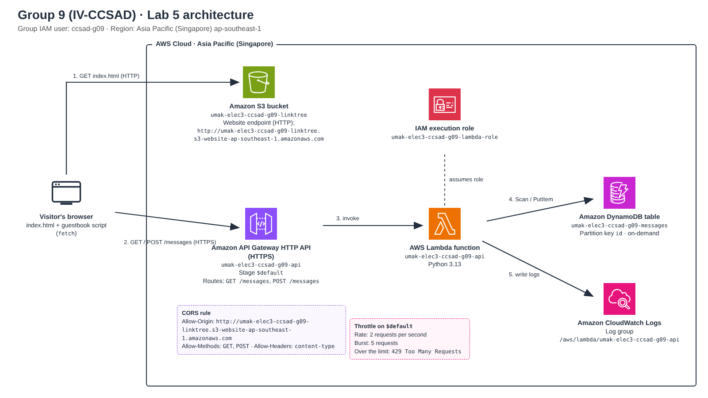

# Assignment 5 Submission

## About us

- Group number: 9
- Section: IV-CCSAD
- Group IAM user: ccsad-g09

## Diagram

## Estimate

Asia Pacific (Singapore), one month: 100,000 page views and 5,000 posts.

| Service | Settings | Monthly cost (USD) |
| --- | --- | --- |
| Amazon S3 | S3 Standard, 1 GB, 100,000 GET requests | 0.04 |
| Amazon API Gateway | HTTP API, 0.105 million requests, 1 KB each | 0.13 |
| AWS Lambda | Without Free Tier, x86, 105,000 requests, 100 ms, 128 MB | 0.04 |
| Amazon DynamoDB | On-demand, Standard, 1 GB, 1 KB items, 0.005 million writes, 0.1 million eventually consistent reads | 0.35 |
| **Total** | | **0.56** |

Share link of our estimate: https://calculator.aws/#/estimate?id=e3fdceda088aae7a07179c2122df449b95a9f7c7

## Ten times the traffic

With 1,000,000 page views and 50,000 posts a month, which service's monthly cost grows the most in US dollars, and why?

Amazon API Gateway grows the most. It costs 0.13 USD at 105,000 requests, and its whole price is per request, so ten times the requests (1.05 million) makes it about 1.31 USD, an increase of about 1.18 USD. The other services grow less: Lambda goes from 0.04 to about 0.44 USD (+0.40), S3 grows only on its GET requests (about +0.36 USD), because its 1 GB of storage does not change, and DynamoDB grows from 0.35 to about 0.94 USD (+0.59), because most of its cost now is the 1 GB of stored data, which stays the same while only the reads and writes grow ten times. So the service that is charged only per request, with the highest price per request, API Gateway, adds the most dollars.

## The throttle and one more improvement

Which Well-Architected pillar does the throttle on the `$default` stage serve, and why?

The throttle serves the Reliability pillar. With a rate of 2 requests per second and a burst of 5, API Gateway answers a flood of requests with `429 Too Many Requests` before they reach our Lambda function, so the function and the DynamoDB table are not overloaded and the guestbook keeps working for normal visitors. It also helps Cost Optimization, because a refused request never runs the function.

One more improvement for the same architecture, and the pillar that it serves:

Put Amazon CloudFront in front of the S3 website endpoint, so visitors get the page over HTTPS and from caches near them. This serves the Security pillar, because the page is encrypted in transit instead of plain HTTP, and it also helps Performance Efficiency, because cached copies load faster and fewer requests reach S3.

## Contribution

| GitHub username | What this groupmate did |
| --- | --- |
| Jsmnt | Built the estimate in the AWS Pricing Calculator, checked every setting, and wrote this submission |
| NotLathrell | Drew the architecture diagram with the AWS icons and checked the names |
| Edison | Checked the diagram against our Lab 5 setup |
| Jhayrome | Worked on the answers about ten times the traffic and the throttle |
