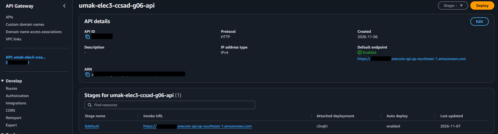
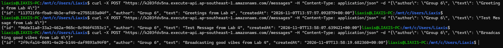
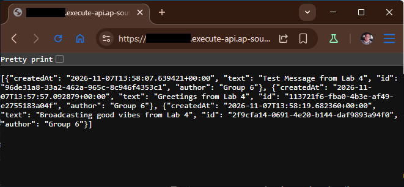
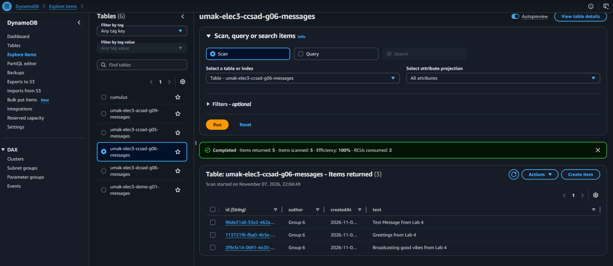

# Lab 4 Submission

## About us

- Group number: 06
- Section: ccsad
- Group IAM user: ccsad-g06
- DynamoDB table name: umak-elec3-ccsad-g06-messages
- HTTP API name: umak-elec3-ccsad-g06-api

## Handler code

```python
import base64
import json
import uuid
from datetime import datetime, timezone

import boto3

GROUP_NAME = "Group 6 of IV-CCSAD"  # Keep your group's name from Seatwork 4.
TABLE_NAME = "umak-elec3-ccsad-g06-messages"  # Change acsad-g03 to your group IAM user.

table = boto3.resource("dynamodb").Table(TABLE_NAME)

def respond(status_code, body):
    return {
        "statusCode": status_code,
        "headers": {"Content-Type": "application/json"},
        "body": json.dumps(body),
    }


def read_json_body(event):
    body = event.get("body") or "{}"
    if event.get("isBase64Encoded"):
        body = base64.b64decode(body).decode("utf-8")
    return json.loads(body)


def lambda_handler(event, context):
    route = event.get("routeKey")

    if route == "GET /messages":
        items = table.scan()["Items"]
        return respond(200, items)

    if route == "POST /messages":
        try:
            data = read_json_body(event)
        except ValueError:
            data = None
        if not isinstance(data, dict) or not data.get("text"):
            return respond(400, {"error": "Send a JSON body with a text field."})
        if len(str(data["text"])) > 280:
            return respond(400, {"error": "Keep the text at 280 characters or fewer."})
        message = {
            "id": str(uuid.uuid4()),
            "author": str(data.get("author") or GROUP_NAME)[:80],
            "text": str(data["text"]),
            "createdAt": datetime.now(timezone.utc).isoformat(),
        }
        table.put_item(Item=message)
        return respond(201, message)

    return respond(404, {"error": f"No route for {route}"})
```

## Screenshots









## Questions

1. Both routes call the same function. How does your code know which route a request came through?

   The code reads the routeKey field from the event that API Gateway passes to the Lambda function ("GET /messages" or "POST /messages"). We branch on that value: for POST /messages. save a new message, and for GET /messages and return the list of messages.

2. What answer do you get when you open the invoke URL without `/messages`? Why does API Gateway answer this way, and not your function?

   We get {"message":"Not Found"} (HTTP 404). API Gateway checks every incoming request against the routes defined, and only created GET /messages and POST /messages. Since no route matches /, API Gateway rejects the request on its own and never invokes the function.

3. Your `GET /messages` route uses Scan. What happens to the cost of each GET request as the table grows to thousands of messages? Why?

   The cost of each GET request goes up as the table grows. A Scan reads every item in the table, and DynamoDB bills for the data scanned, not just the data returned. With thousands of messages, each request has to read more 1 MB pages, so it consumes more read capacity units and runs slower.
