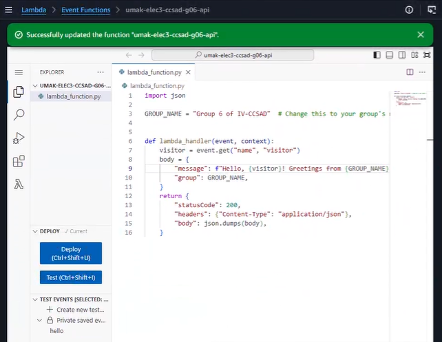
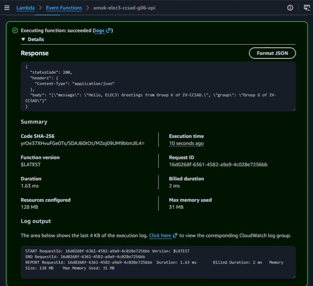
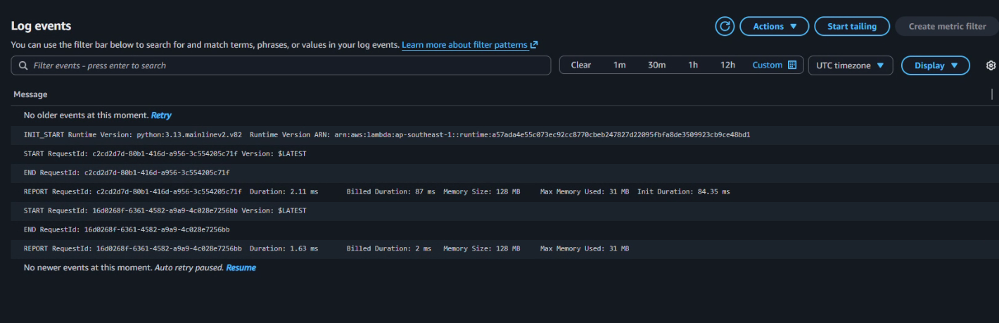

# Seatwork 4 Submission

## About us

- Group number: 06
- Section: ccsad
- Group IAM user: ccsad-g06
- Function name: umak-elec3-ccsad-g06-api

## Handler code

```python
def lambda_handler(event, context):
    visitor = event.get("name", "visitor")
    body = {
        "message": f"Hello, {visitor}! Greetings from {GROUP_NAME}.",
        "group": GROUP_NAME,
    }
    return {
        "statusCode": 200,
        "headers": {"Content-Type": "application/json"},
        "body": json.dumps(body),
    }
```

## REPORT lines

First run, a cold start:

```text
REPORT RequestId: c2cd2d7d-80b1-416d-a956-3c554205c71f	Duration: 2.11 ms	Billed Duration: 87 ms	Memory Size: 128 MB	Max Memory Used: 31 MB	Init Duration: 84.35 ms
```

Second run, a warm start:

```text
REPORT RequestId: 16d0268f-6361-4582-a9a9-4c028e7256bb	Duration: 1.63 ms	Billed Duration: 2 ms	Memory Size: 128 MB	Max Memory Used: 31 MB
```

## Question

Because the second invocation reused the execution environment created by the first, so the init phase (runtime startup plus your code outside the handler) didn’t run again. Lambda only includes Init Duration in the REPORT line when an init phase occurred, which means it appears on cold starts only.

That’s also why the billed durations differ: the first run billed 87 ms (about 2.11 ms handler + 84.35 ms init, rounded up), while the second billed only the handler’s 2 ms.

<answer>

## Screenshots







## Contribution

| GitHub username | What this groupmate did |
| --- | --- |
| keiameere | Wrote in submission.md |
| kadirisubs | Main Guide |
| malorian-arms3516 | At the keyboard |
| MadBunBun | guide |
