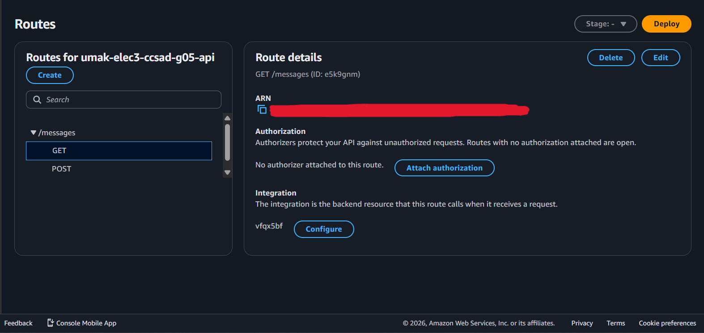
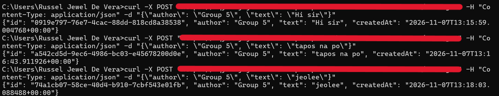
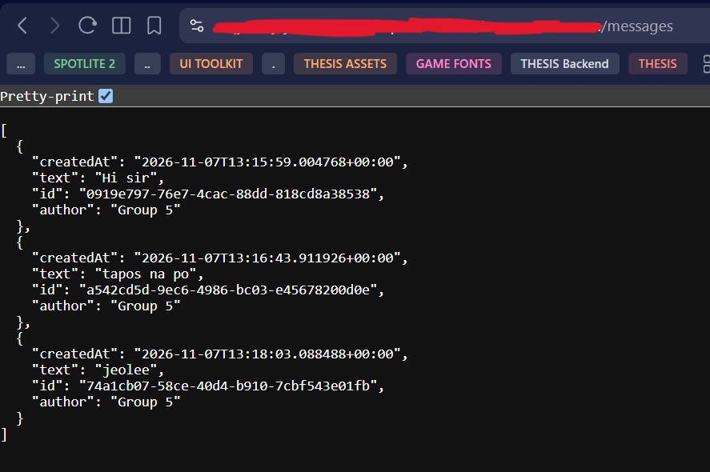
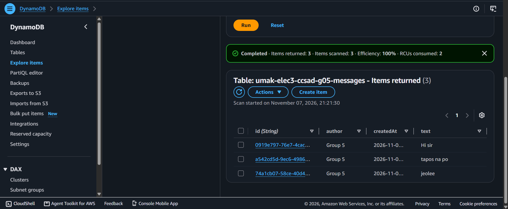

# Lab 4 Submission

<!--
How to use this template:

1. Copy this file to submissions/lab-4/group-<number>/submission.md
2. Replace every <answer> with your group's answer. Delete the angle brackets too.
3. Save routes.png, post.png, get.png, and items.png in the same folder.
4. Crop the AWS console top bar out of routes.png and items.png, and cover every ARN.
5. Cover your API ID, the part between https:// and .execute-api, in routes.png, post.png, and get.png. Your invoke URL goes only in the Google Form, never in this repository.
6. Do not write full names or student numbers in this file.
-->

## About us

- Group number: 05
- Section: IV-CCSAD
- Group IAM user: ccsad-g05
- DynamoDB table name: umak-elec3-ccsad-g05-messages
- HTTP API name: umak-elec3-ccsad-g05-api

## Handler code

```python
import base64
import json
import uuid
from datetime import datetime, timezone

import boto3

GROUP_NAME = "Group 5 of IV-CCSAD"  # Keep your group's name from Seatwork 4.
TABLE_NAME = "umak-elec3-ccsad-g05-messages"  # Change acsad-g03 to your group IAM user.

table = boto3.resource("dynamodb").Table(TABLE_NAME)


def respond(status_code, body):
    return {
        "statusCode": status_code,
        "headers": {"Content-Type": "application/json"},
        "body": json.dumps(body),
    }


def read_json_body(event):
    body = event.get("body") or "{}"
    if event.get("isBase64Encoded"):
        body = base64.b64decode(body).decode("utf-8")
    return json.loads(body)


def lambda_handler(event, context):
    route = event.get("routeKey")

    if route == "GET /messages":
        items = table.scan()["Items"]
        return respond(200, items)

    if route == "POST /messages":
        try:
            data = read_json_body(event)
        except ValueError:
            data = None
        if not isinstance(data, dict) or not data.get("text"):
            return respond(400, {"error": "Send a JSON body with a text field."})
        if len(str(data["text"])) > 280:
            return respond(400, {"error": "Keep the text at 280 characters or fewer."})
        message = {
            "id": str(uuid.uuid4()),
            "author": str(data.get("author") or GROUP_NAME)[:80],
            "text": str(data["text"]),
            "createdAt": datetime.now(timezone.utc).isoformat(),
        }
        table.put_item(Item=message)
        return respond(201, message)

    return respond(404, {"error": f"No route for {route}"})
```

## Screenshots









## Questions

1. Both routes call the same function. How does your code know which route a request came through?

   The code knows which route a request came through because API Gateway includes the matched route in the event it passes to the Lambda function. The handler reads that value from the event’s route key field and compares it with the configured route strings, such as the GET messages route and the POST messages route. Even though both routes invoke the same function, the route key tells the function which HTTP method and path combination was used, so it can branch into the correct behavior.

2. What answer do you get when you open the invoke URL without `/messages`? Why does API Gateway answer this way, and not your function?

   If you open the invoke URL without the messages path, you get an API Gateway 404 Not Found response, typically with a JSON message saying “Not Found.” This answer comes from API Gateway rather than the Lambda function because only the two specific routes are configured. There is no default or catch-all route, so API Gateway rejects the unmatched request before it ever invokes the function. The function’s own fallback 404 would only be reached if API Gateway actually invoked it with an unrecognized route key.

3. Your `GET /messages` route uses Scan. What happens to the cost of each GET request as the table grows to thousands of messages? Why?

   When the table grows to thousands of messages, the cost of each GET request would increase proportionally. This happens because an Amazon DynamoDB Scan examines every single item stored in the table to find matching records rather than using a primary key to look it up directly. The consumed Read Capacity Units (RCUs) or on-demand request costs scale directly with the total data size of the entire table. Every new message increases the aggregated size and item count with each subsequent Scan processes more data and incurs a higher charge. 
