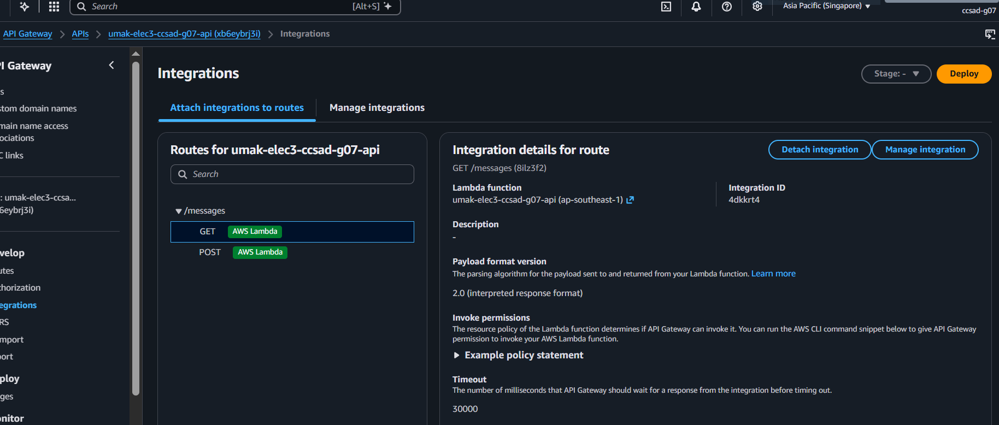
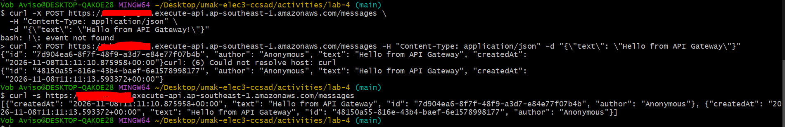
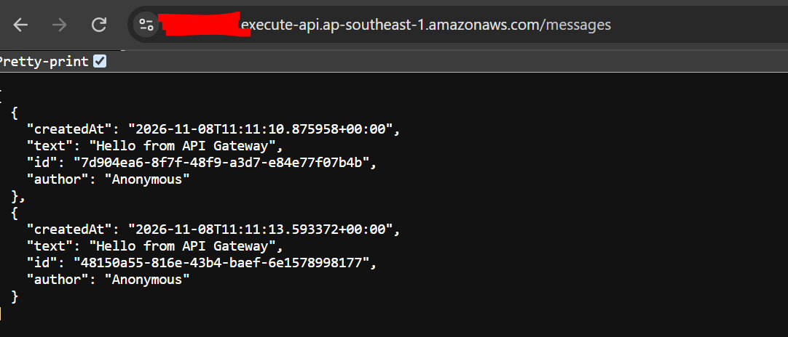
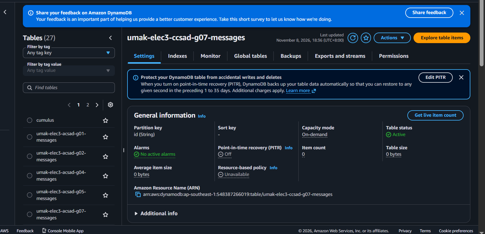

# Lab 4 Submission

<!--
How to use this template:

1. Copy this file to submissions/lab-4/group-<number>/submission.md
2. Replace every <answer> with your group's answer. Delete the angle brackets too.
3. Save routes.png, post.png, get.png, and items.png in the same folder.
4. Crop the AWS console top bar out of routes.png and items.png, and cover every ARN.
5. Do not write full names or student numbers in this file.
-->

## About us

- Group number: 7
- Section: IV - CCSAD
- Group IAM user: ccsad-g07
- DynamoDB table name: umak-elec3-ccsad-g07-messages
- HTTP API name: umak-elec3-ccsad-g07-api

## Handler code

```python
import json
import uuid
from datetime import datetime, timezone
import boto3

dynamodb = boto3.resource('dynamodb')
table = dynamodb.Table('umak-elec3-ccsad-g07-messages')

def lambda_handler(event, context):
    route_key = event.get('routeKey', '')
    
    if route_key == 'GET /messages':
        response = table.scan()
        items = response.get('Items', [])
        return {
            'statusCode': 200,
            'headers': {'Content-Type': 'application/json'},
            'body': json.dumps(items)
        }
        
    elif route_key == 'POST /messages':
        body = json.loads(event.get('body', '{}'))
        text = body.get('text') or body.get('message')
        
        if not text:
            return {
                'statusCode': 400,
                'headers': {'Content-Type': 'application/json'},
                'body': json.dumps({'error': 'Message text is required.'})
            }
            
        item = {
            'id': str(uuid.uuid4()),
            'author': body.get('author', 'Anonymous'),
            'text': text[:280],
            'createdAt': datetime.now(timezone.utc).isoformat()
        }
        
        table.put_item(Item=item)
        
        return {
            'statusCode': 200,
            'headers': {'Content-Type': 'application/json'},
            'body': json.dumps(item)
        }
        
    return {
        'statusCode': 404,
        'headers': {'Content-Type': 'application/json'},
        'body': json.dumps({'message': 'Not Found'})
    }
```

## Screenshots









## Questions

1. Both routes call the same function. How does your code know which route a request came through?

API Gateway passes an event object to the Lambda function containing the field event["routeKey"]. The code checks this string value (e.g., "GET /messages" or "POST /messages") using if/elif conditions to route execution to the appropriate logic (either reading from or writing to DynamoDB).

2. What answer do you get when you open the invoke URL without `/messages`? Why does API Gateway answer this way, and not your function?

You get a {"message":"Not Found"} JSON response with an HTTP status code 404. API Gateway answers this directly because no route is defined for GET / (the root path). Since there is no route match in API Gateway, the request is blocked at the gateway level and is never forwarded to the Lambda function execution environment.

3. Your `GET /messages` route uses Scan. What happens to the cost of each GET request as the table grows to thousands of messages? Why?

The cost of each GET request increases because DynamoDB Scan reads every single item in the entire table to compute the result. DynamoDB pricing for reads is based on the total volume of data read from disk (in 4 KB Read Capacity Unit blocks) rather than the number of returned items. As thousands of messages accumulate, the total read payload grows larger, consuming more Read Capacity Units (RCUs) per request.