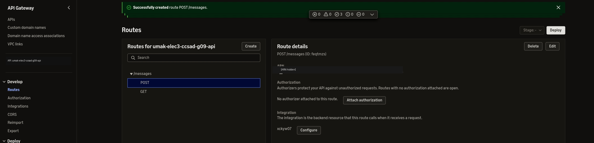
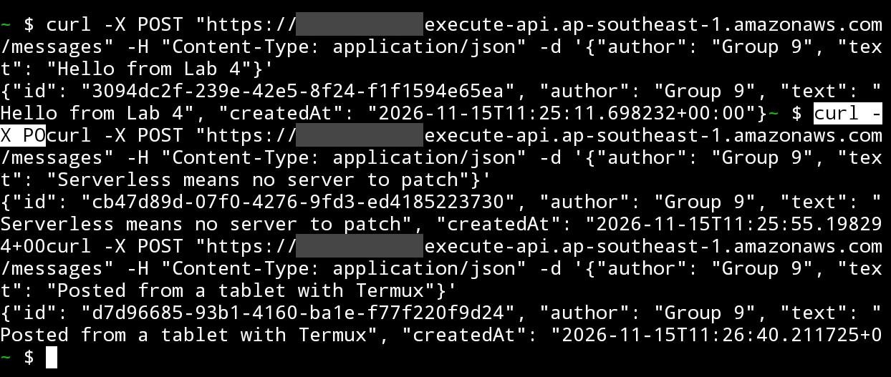
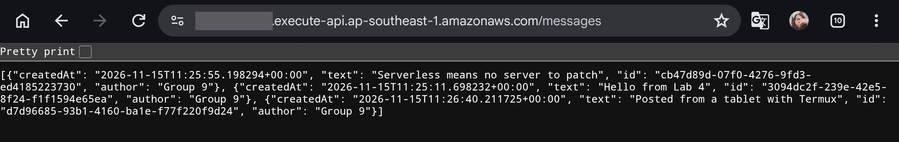
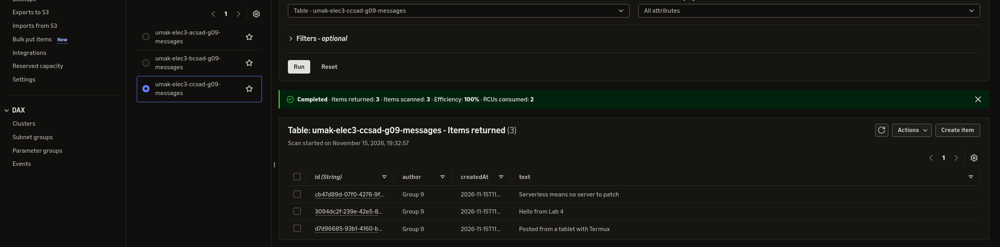

# Lab 4 Submission

## About us

- Group number: 9
- Section: IV-CCSAD
- Group IAM user: ccsad-g09
- DynamoDB table name: umak-elec3-ccsad-g09-messages
- HTTP API name: umak-elec3-ccsad-g09-api

## Handler code

```python
import base64
import json
import uuid
from datetime import datetime, timezone

import boto3

GROUP_NAME = "Group 9 of IV-CCSAD"
TABLE_NAME = "umak-elec3-ccsad-g09-messages"

table = boto3.resource("dynamodb").Table(TABLE_NAME)


def respond(status_code, body):
    return {
        "statusCode": status_code,
        "headers": {"Content-Type": "application/json"},
        "body": json.dumps(body),
    }


def read_json_body(event):
    body = event.get("body") or "{}"
    if event.get("isBase64Encoded"):
        body = base64.b64decode(body).decode("utf-8")
    return json.loads(body)


def lambda_handler(event, context):
    route = event.get("routeKey")

    if route == "GET /messages":
        items = table.scan()["Items"]
        return respond(200, items)

    if route == "POST /messages":
        try:
            data = read_json_body(event)
        except ValueError:
            data = None
        if not isinstance(data, dict) or not data.get("text"):
            return respond(400, {"error": "Send a JSON body with a text field."})
        if len(str(data["text"])) > 280:
            return respond(400, {"error": "Keep the text at 280 characters or fewer."})
        message = {
            "id": str(uuid.uuid4()),
            "author": str(data.get("author") or GROUP_NAME)[:80],
            "text": str(data["text"]),
            "createdAt": datetime.now(timezone.utc).isoformat(),
        }
        table.put_item(Item=message)
        return respond(201, message)

    return respond(404, {"error": f"No route for {route}"})
```

## Screenshots









## Questions

1. Both routes call the same function. How does your code know which route a request came through?

   API Gateway puts the route that matched into the event as `routeKey`, for example `"GET /messages"` or `"POST /messages"`. Our handler reads it with `event.get("routeKey")` and branches on it: for `GET /messages` it scans the table and returns the items, for `POST /messages` it checks the body and stores a new item, and for anything else it returns status 404.

2. What answer do you get when you open the invoke URL without `/messages`? Why does API Gateway answer this way, and not your function?

   We get `{"message":"Not Found"}`. Our API has only two routes, `GET /messages` and `POST /messages`, so a GET request to `/` matches no route. API Gateway only calls the Lambda integration of a route that matches, so it answers with its own 404 and never invokes our function. We can tell because our function's 404 has a different body, `{"error": "No route for ..."}`.

3. Your `GET /messages` route uses Scan. What happens to the cost of each GET request as the table grows to thousands of messages? Why?

   The cost of each GET request goes up as the table grows. Scan reads every item in the table, and DynamoDB on-demand charges read request units for all the data that it reads, not only for what the visitor needs. With 3 items one Scan is almost free, but with thousands of 1 KB messages every single GET reads thousands of KB, so it uses many more read units. The function also runs longer and returns a bigger response, so the Lambda duration cost rises too, and past 1 MB a single Scan call no longer returns the whole table.
