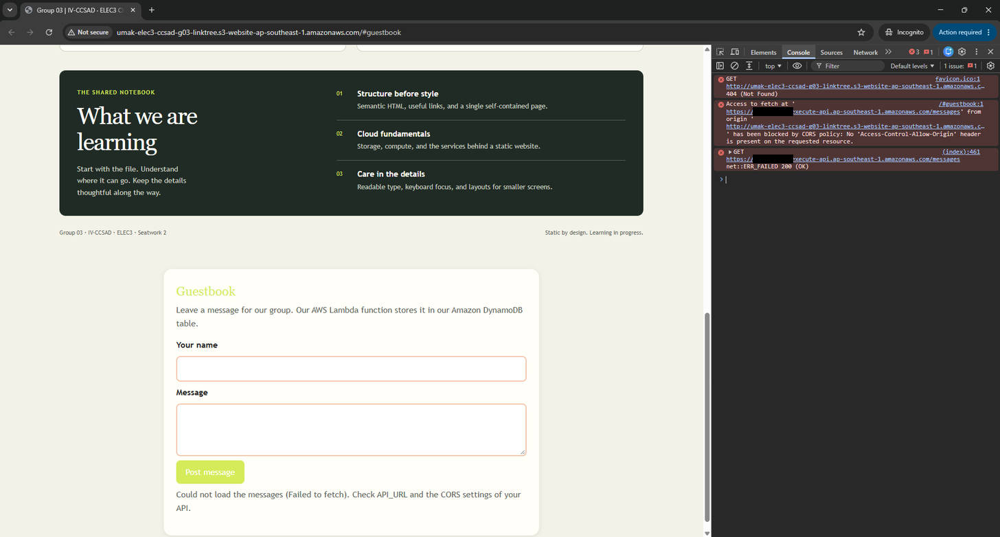
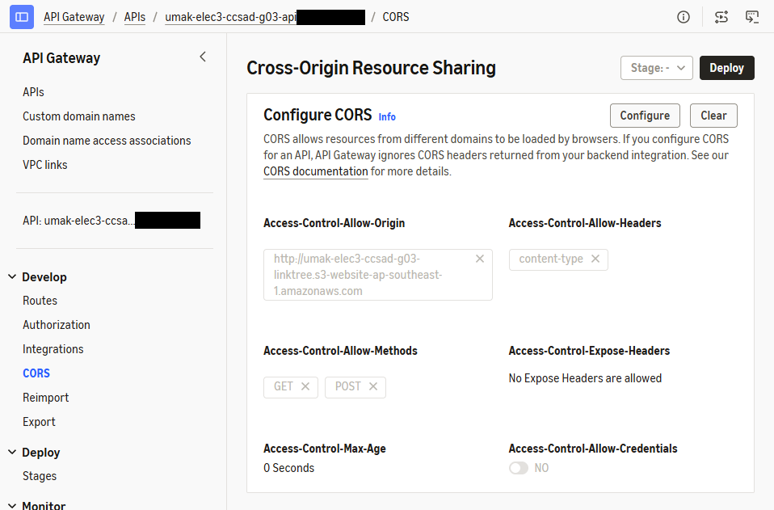
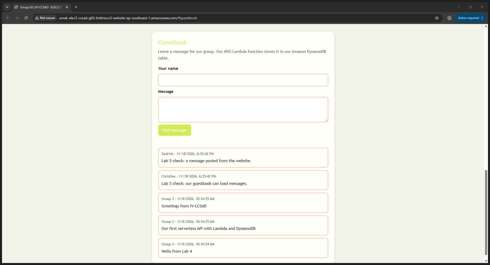
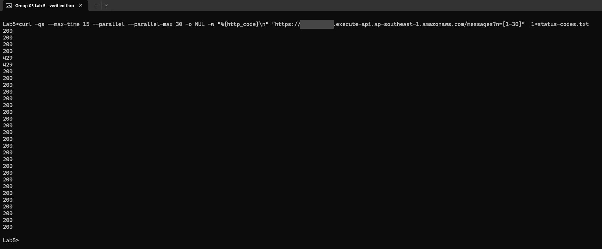

# Lab 5 Submission

## About us

- Group number: 03
- Section: IV-CCSAD
- Group IAM user: `ccsad-g03`
- Website endpoint: http://umak-elec3-ccsad-g03-linktree.s3-website-ap-southeast-1.amazonaws.com
- HTTP API name: `umak-elec3-ccsad-g03-api`

## Screenshots

The `$default` stage uses a rate limit of 2 requests per second and a burst limit of 5. Of the 30 requests in our test, 28 returned HTTP 200 and 2 returned HTTP 429. We posted one more message through the guestbook afterward and confirmed it appeared in the live list.

## Questions

1. In Lab 4, your API answered `curl` and the address bar of your browser. In Step 3, the same API did not answer your page. Why?

   The guestbook runs on the S3 website origin, while its JavaScript sends requests to a different origin on API Gateway. Before we configured CORS, the API still responded, but it did not send an `Access-Control-Allow-Origin` header that allowed our site, so the browser blocked the script from reading the response. `curl` and direct visits in the address bar are not subject to the browser's cross-origin script restriction.

2. Which pillar of the AWS Well-Architected Framework does your throttle serve? Explain in two sentences.

   The throttle supports the Reliability pillar. It returns HTTP 429 for excess requests before they reach Lambda or DynamoDB, helping the backend keep serving requests during a traffic spike.

3. Your guestbook shows each message with `textContent`. What could a visitor do if the page put each message into the page as HTML with `innerHTML`?

   A visitor could post markup that the guestbook stores and later renders as HTML for other visitors. If that markup causes JavaScript to run in their browsers, it is stored cross-site scripting (XSS), which could change the page or trigger unwanted actions. `textContent` prevents this by displaying the message as plain text.
