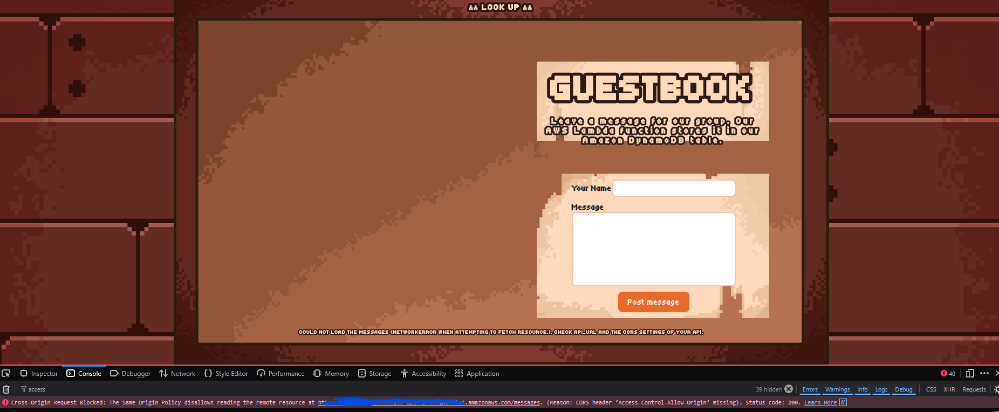
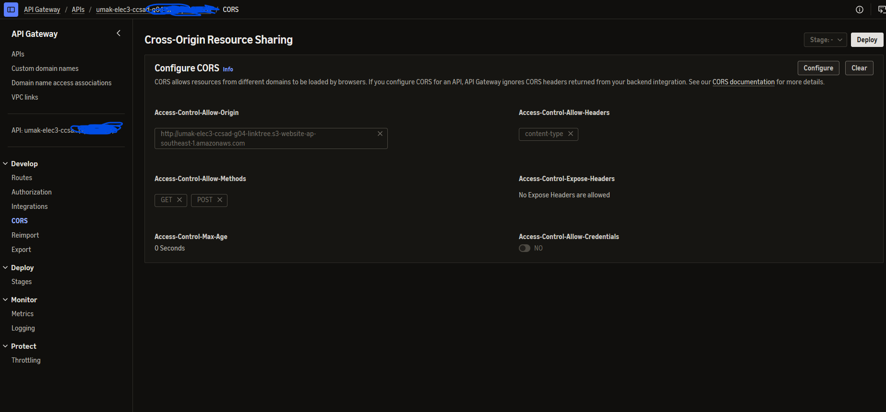
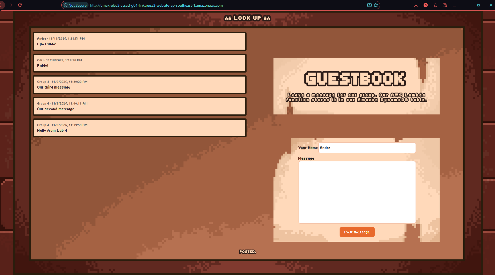
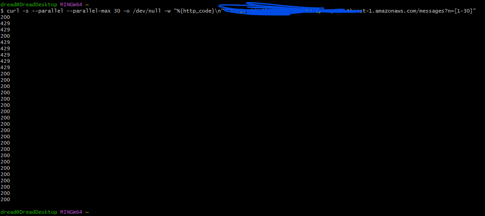

# Lab 5 Submission

## About us

- Group number: 04
- Section: IV - CCSAD
- Group IAM user: ccsad-g04
- Website endpoint: http://umak-elec3-ccsad-g04-linktree.s3-website-ap-southeast-1.amazonaws.com
- HTTP API name: umak-elec3-ccsad-g04-api

## Screenshots

## Questions

1. In Lab 4, your API answered `curl` and the address bar of your browser. In Step 3, the same API did not answer your page. Why?

CORS (Cross-Origin Resource Sharing) is a security rule enforced by web browsers for JavaScript `fetch` calls making cross-origin requests, not a server-side lock on the API itself[cite: 14]. `curl` and direct browser address bar visits are not cross-origin scripts, whereas the guestbook script on our `http` S3 website origin attempted to read data from our `https` API Gateway origin before the API sent an `Access-Control-Allow-Origin` header permitting it[cite: 14].

2. Which pillar of the AWS Well-Architected Framework does your throttle serve? Explain in two sentences.

Throttling primarily serves the **Reliability** pillar (and also supports **Cost Optimization** and **Security**) by protecting the backend Lambda function and DynamoDB table from being overwhelmed by sudden traffic spikes or request floods. By capping traffic at 2 requests per second with a burst of 5 and returning `429 Too Many Requests` at the API Gateway layer, the system absorbs excessive load gracefully and prevents unnecessary compute invocations[cite: 14].

3. Your guestbook shows each message with `textContent`. What could a visitor do if the page put each message into the page as HTML with `innerHTML`?

If the page used `innerHTML`, a visitor could perform a Cross-Site Scripting (XSS) attack by submitting malicious HTML or `<script>` tags inside a guestbook message that the browser would execute as active code for every subsequent visitor[cite: 14].