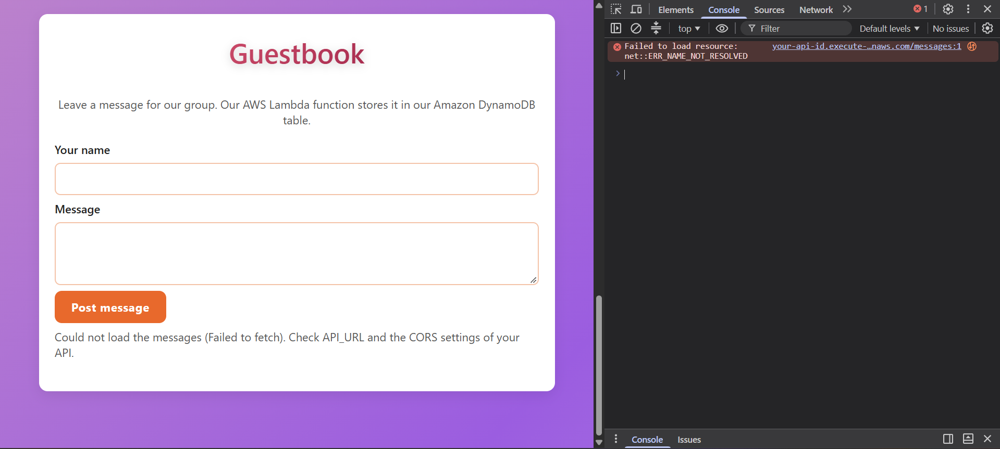
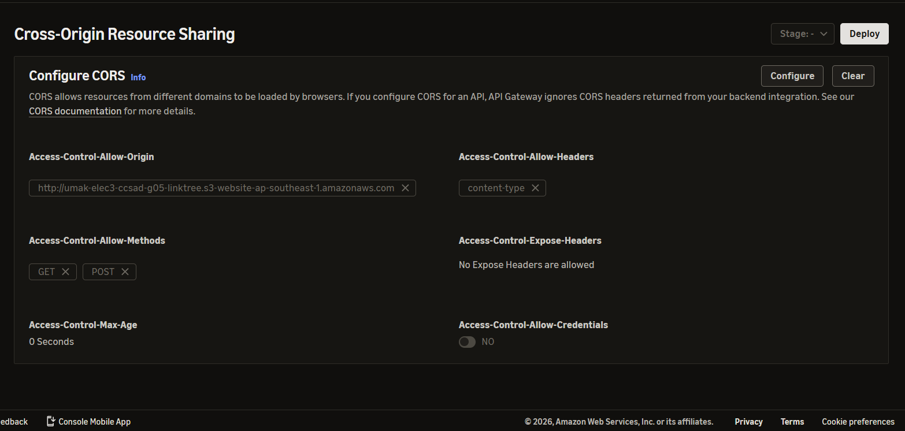
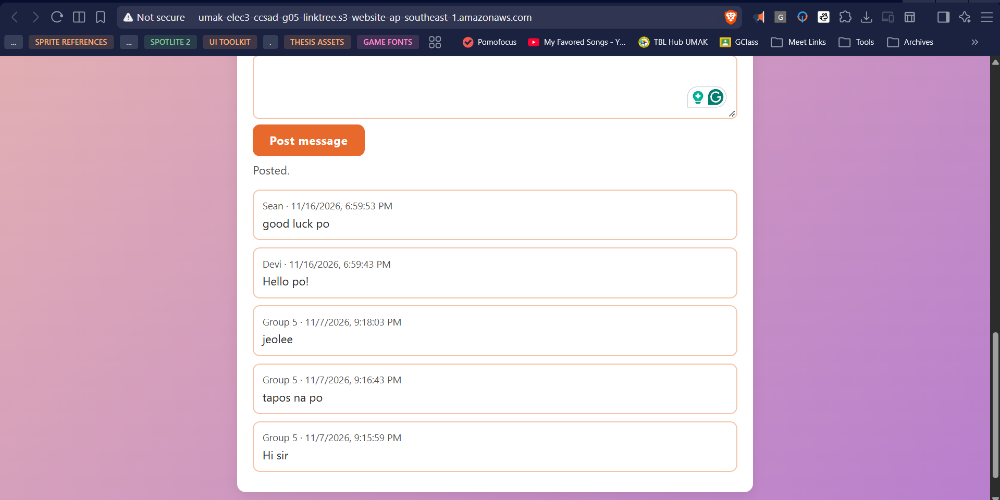
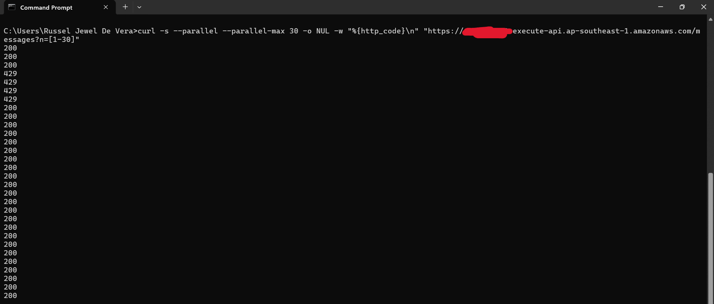

# Lab 5 Submission

<!--
How to use this template:

1. Copy this file to submissions/lab-5/group-<number>/submission.md
2. Replace every <answer> with your group's answer. Delete the angle brackets too.
3. Save cors-error.png, cors.png, site.png, and throttle.png in the same folder.
4. Crop the AWS console top bar out of cors.png, and cover every ARN.
5. Cover your API ID, the part between https:// and .execute-api, in cors-error.png, cors.png, and throttle.png.
6. Do not add your index.html. It holds your invoke URL.
7. Do not write full names or student numbers in this file.
-->

## About us

- Group number: 05  
- Section: IV-CCSAD  
- Group IAM user: ccsad-g05  
- Website endpoint: http://umak-elec3-ccsad-g05-linktree.s3-website-ap-southeast-1.amazonaws.com
- HTTP API name: umak-elec3-ccsad-g05-api

## Screenshots

## Questions

1. In Lab 4, your API answered `curl` and the address bar of your browser. In Step 3, the same API did not answer your page. Why?  
   
   When an API responds correctly to curl or a direct address bar navigation but fails to answer a web page, the issue is usually caused by the browser’s Same-Origin Policy and Cross-Origin Resource Sharing (CORS) restrictions. Curl and direct browser address bar navigation bypass security boundaries which mean they successfully retrieve the resource without restriction. But when a script running on a web page hosted on a different origin such as domain, port, or protocol attempts to fetch data from that API, the browser enforces the Same-Origin Policy and blocks the response unless the server explicitly returns the appropriate CORS headers permitting access.

2. Which pillar of the AWS Well-Architected Framework does your throttle serve? Explain in two sentences.  
   
   Throttling mainly serves the Reliability pillar of the AWS Well-Architected Framework by protecting backend services, APIs, and databases from being overwhelmed by sudden traffic spikes, distributed denial-of-service attempts, or runaway client applications. By limiting the rate of incoming requests, a throttle ensures graceful degradation, prevents cascading failures, and maintains overall system stability and availability under heavy load. 

3. Your guestbook shows each message with `textContent`. What could a visitor do if the page put each message into the page as HTML with `innerHTML`?

   If a guestbook uses innerHTML instead of textContent to render visitor messages, a malicious visitor could execute a Cross-Site Scripting (XSS) attack. Because innerHTML parses strings as raw HTML and executes embedded scripts or event handlers, an attacker could submit crafted input containing malicious JavaScript that would automatically execute in the browsers of every subsequent visitor viewing the page. This vulnerability could allow attackers to steal session cookies, spoof user actions, or compromise the accounts of other users, whereas textContent safely treats all input strictly as plain text.
