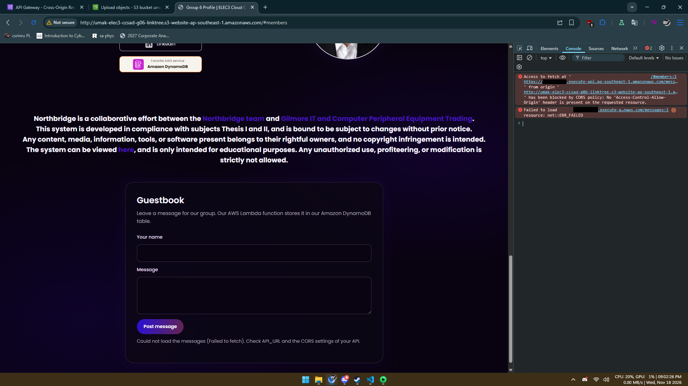
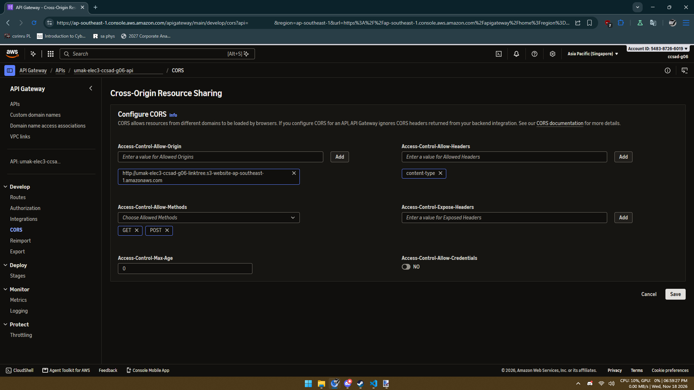
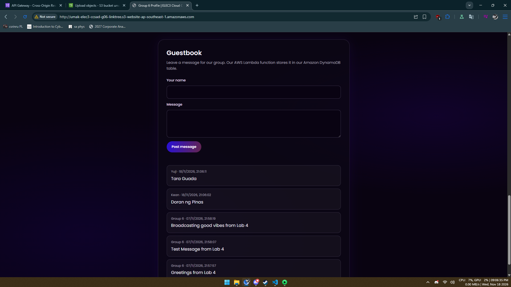
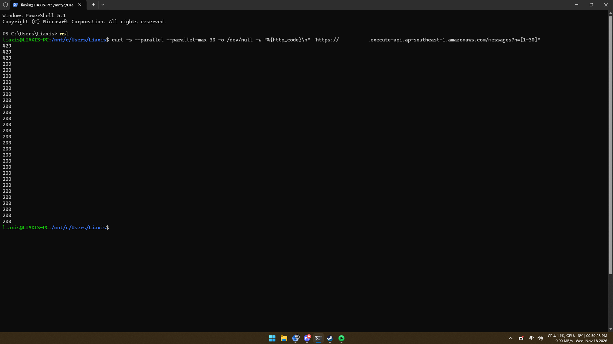

# Lab 5 Submission

<!--
How to use this template:

1. Copy this file to submissions/lab-5/group-<number>/submission.md
2. Replace every <answer> with your group's answer. Delete the angle brackets too.
3. Save cors-error.png, cors.png, site.png, and throttle.png in the same folder.
4. Crop the AWS console top bar out of cors.png, and cover every ARN.
5. Cover your API ID, the part between https:// and .execute-api, in cors-error.png, cors.png, and throttle.png.
6. Do not add your index.html. It holds your invoke URL.
7. Do not write full names or student numbers in this file.
-->

## About us

- Group number: group-06
- Section: CCSAD
- Group IAM user: ccsad-group-06
- Website endpoint: http://umak-elec3-ccsad-g06-linktree.s3-website-ap-southeast-1.amazonaws.com/
- HTTP API name: umak-elec3-ccsad-g06-api

## Screenshots

## Questions

1. In Lab 4, your API answered `curl` and the address bar of your browser. In Step 3, the same API did not answer your page. Why?

   The API did not answer our webpage as it has not allowed our site's origin prior to us making changes to its settings. Direct opening of the API URL and the `curl` command are not considered as page scripts, which bypasses being blocked by CORS.

2. Which pillar of the AWS Well-Architected Framework does your throttle serve? Explain in two sentences.

   The Cost Optimization pillar is one that is prominently served by our throttle, as it limits how many requests reach our Lambda function and DynamoDB table, which effectively prevents any unwanted usage and charges. Any requests that are rejected with `429 Too Many Requests` do not invoke our Lambda function, which means that we are not charged for any Lambda execution costs.

3. Your guestbook shows each message with `textContent`. What could a visitor do if the page put each message into the page as HTML with `innerHTML`?

   A webpage that uses `innerHTML` can allow users with malicious intent to submit HTML code that contains a script, which allows it to run on other website visitors' browsers when they view the guestbook. In order to circumvent this flaw, `textContent` should be used instead, which displays messages in plain text.
