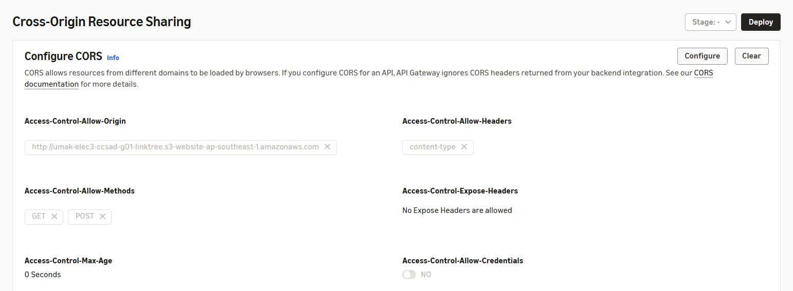
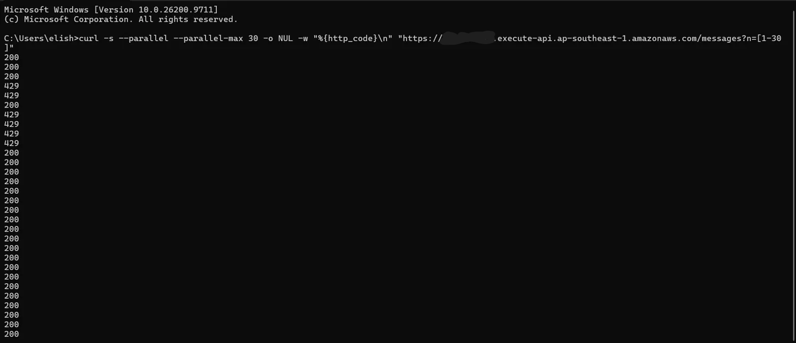

# Lab 5 Submission

## About us

- Group number: 1
- Section: IV-CCSAD
- Group IAM user: ccsad-g01
- Website endpoint: http://umak-elec3-ccsad-g01-linktree.s3-website-ap-southeast-1.amazonaws.com
- HTTP API name: umak-elec3-ccsad-g01-api

## Screenshots

## Questions

1. In Lab 4, your API answered `curl` and the address bar of your browser. In Step 3, the same API did not answer your page. Why?

   Our page and our API are on different origins: the page is on http at the S3 host, and the API is on https at the execute-api host. CORS is a browser rule for scripts on a page, so the browser blocked our script from reading the answer because the API did not send an Access-Control-Allow-Origin header allowing our site. In Lab 4, curl and the address bar are not scripts on a page from another origin, so CORS did not apply to them.

2. Which pillar of the AWS Well-Architected Framework does your throttle serve? Explain in two sentences.

   The throttle serves the Reliability pillar. It limits how many requests API Gateway passes on, so a flood of requests cannot overload our function and table, and the API keeps working for normal visitors. Refused requests get a 429 and never run our function, which also keeps our cost low.

3. Your guestbook shows each message with `textContent`. What could a visitor do if the page put each message into the page as HTML with `innerHTML`?

   A visitor could post a message that contains HTML or a script, such as an img tag with an onerror handler, and it would run in the browser of everyone who opens our page. This is called cross-site scripting (XSS). It could redirect visitors, change the page, or steal data, and our API has no sign-in, so anyone could do this. With textContent, the message is shown only as plain text, so it cannot run.
