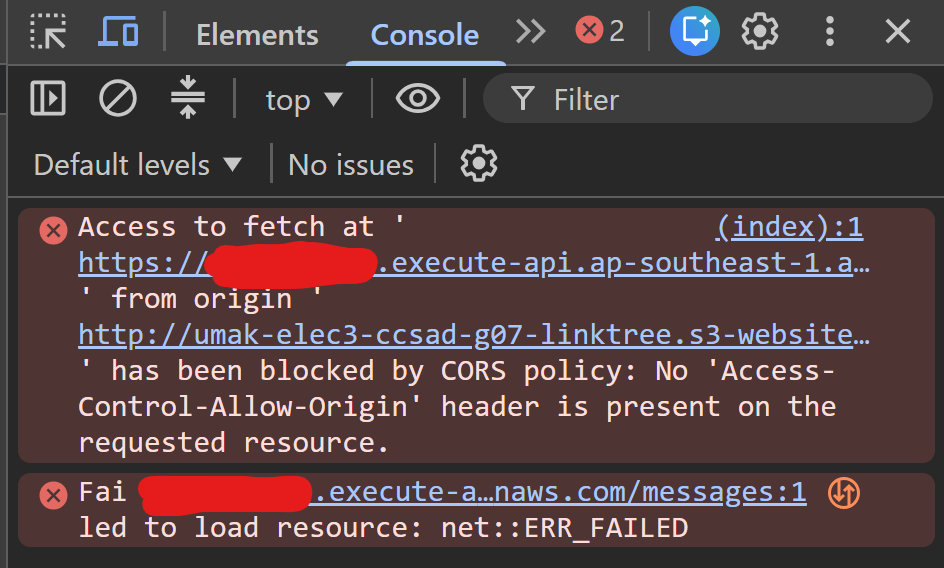
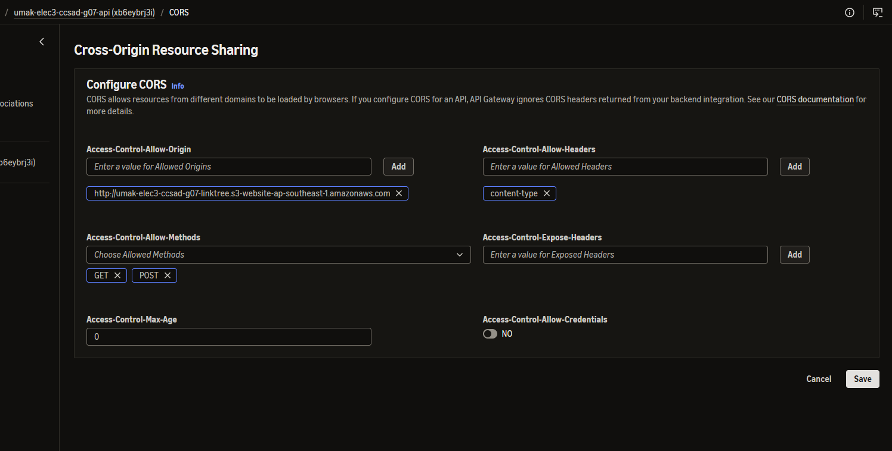
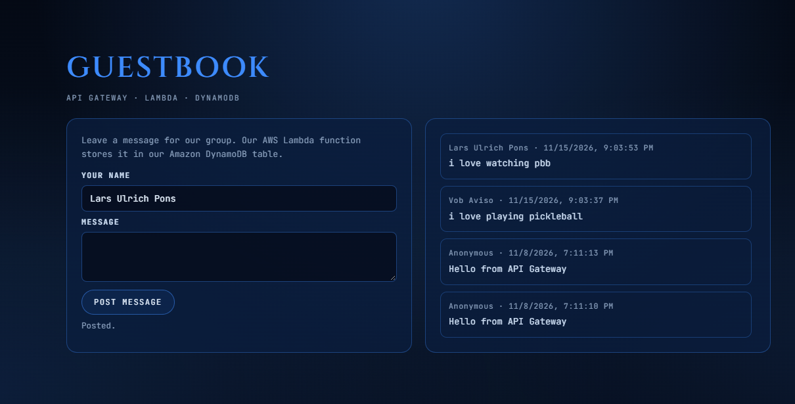
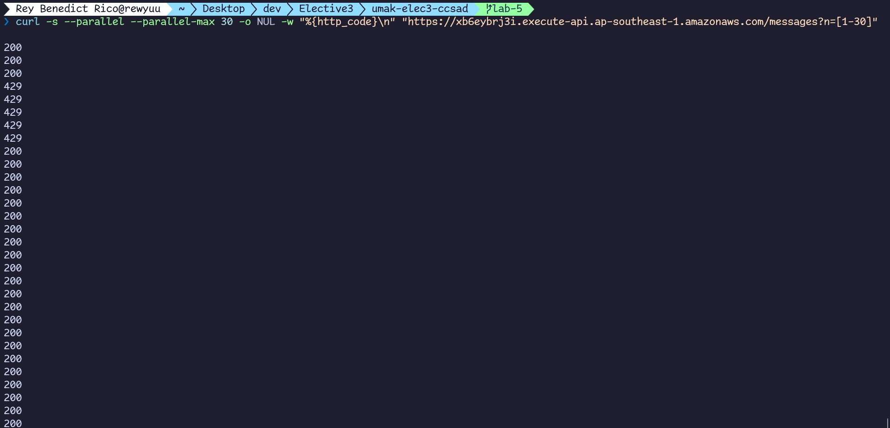

# Lab 5 Submission

<!--
How to use this template:

1. Copy this file to submissions/lab-5/group-<number>/submission.md
2. Replace every <answer> with your group's answer. Delete the angle brackets too.
3. Save cors-error.png, cors.png, site.png, and throttle.png in the same folder.
4. Crop the AWS console top bar out of cors.png, and cover every ARN.
5. Cover your API ID, the part between https:// and .execute-api, in cors-error.png, cors.png, and throttle.png.
6. Do not add your index.html. It holds your invoke URL.
7. Do not write full names or student numbers in this file.
-->

## About us

- Group number: 7
- Section: IV - CCSAD
- Group IAM user: ccsad-g07
- Website endpoint: http://umak-elec3-ccsad-g07-linktree.s3-website-ap-southeast-1.amazonaws.com
- HTTP API name: https://xb6eybrj3i.execute-api.ap-southeast-1.amazonaws.com

## Screenshots

## Questions

1. In Lab 4, your API answered `curl` and the address bar of your browser. In Step 3, the same API did not answer your page. Why?

   Browsers block a web page from reading responses from a different origin unless that server allows it, and this rule is called CORS (same-origin policy). Our page is served from the S3 website URL while the API is on an execute-api URL, so the browser treated the page’s fetch as a cross-origin request and refused to hand over the response. curl and the address bar aren’t web pages running a script, so the rule doesn’t apply to them. The fix is to add our site’s origin to the API’s CORS settings, so the API answers with the headers that tell the browser it’s allowed.

2. Which pillar of the AWS Well-Architected Framework does your throttle serve? Explain in two sentences.

   The throttle serves the Reliability pillar, because it caps how many requests per second the API accepts, so a burst of traffic can’t overwhelm Lambda and DynamoDB and make the guestbook fail for everyone. It also helps Security by limiting the damage a bot or spammer can do, though its main purpose is keeping the service available.

3. Your guestbook shows each message with `textContent`. What could a visitor do if the page put each message into the page as HTML with `innerHTML`?

   A visitor could post a message that contains HTML or JavaScript, such as , and the browser would run it in every later visitor’s page. This is called cross-site scripting (XSS). The attacker’s code could then steal data from the page, redirect visitors to another site, or change what the page shows. textContent avoids this by treating the message as plain text, so it displays as typed instead of running.
