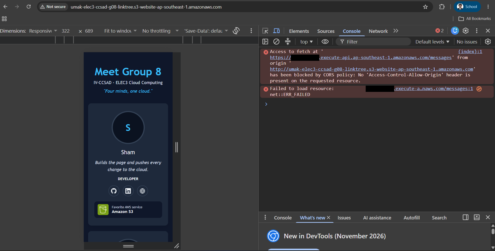
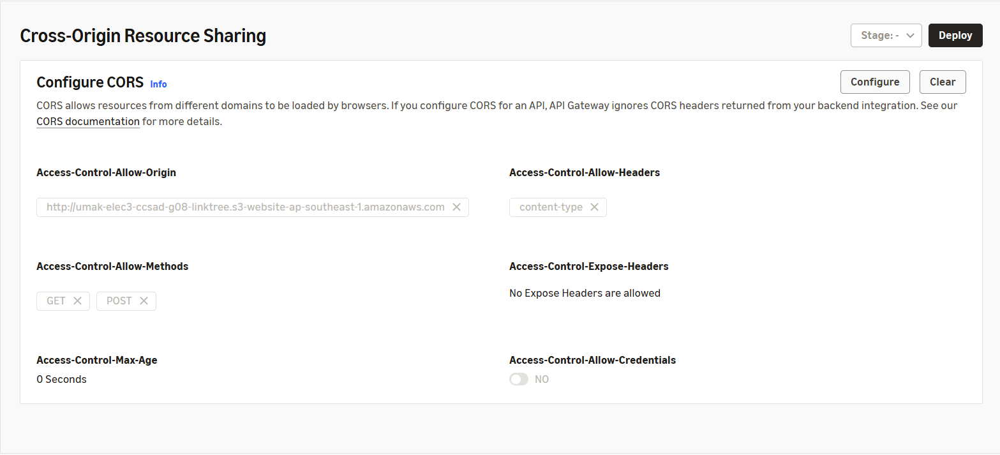
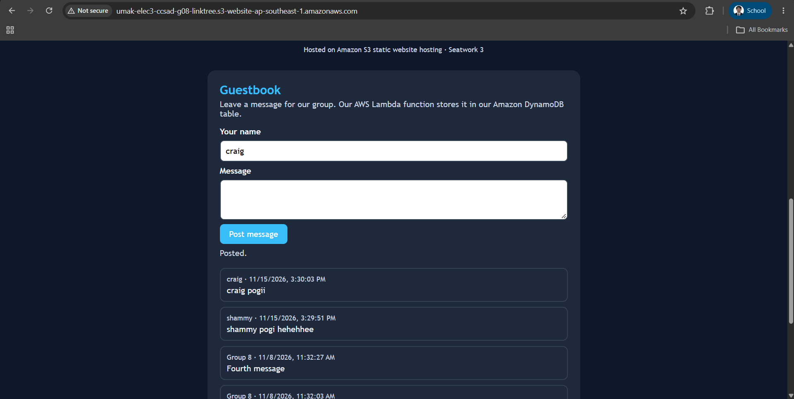
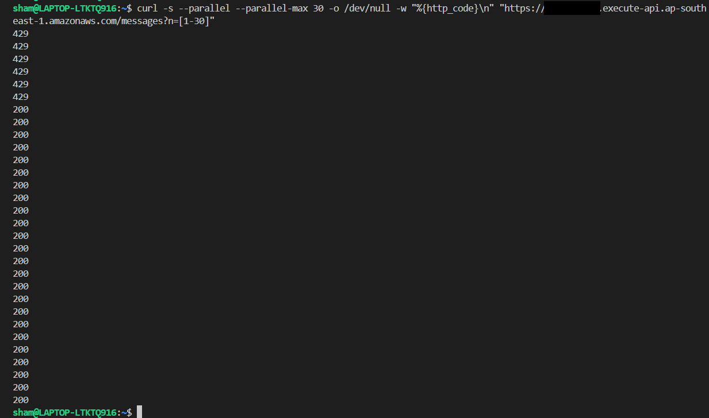

# Lab 5 Submission

## About us

- Group number: 08
- Section: IV-CCSAD
- Group IAM user: ccsad-g08
- Website endpoint: http://umak-elec3-ccsad-g08-linktree.s3-website-ap-southeast-1.amazonaws.com
- HTTP API name: umak-elec3-ccsad-g08-api

## Screenshots

## Questions

1. In Lab 4, your API answered `curl` and the address bar of your browser. In Step 3, the same API did not answer your page. Why?

   CORS is a rule that the browser enforces on scripts, not a rule of the API. In Lab 4, `curl` and the address bar were not scripts on a page, so the browser did not apply CORS to them and the API answered. In Step 3, the script on our page came from the S3 website origin (`http`, the S3 host) and called the API on another origin (`https`, the `execute-api` host). The API did not send an `Access-Control-Allow-Origin` header that allowed our site, so the browser blocked the script from reading the answer and showed `Failed to fetch`.

2. Which pillar of the AWS Well-Architected Framework does your throttle serve? Explain in two sentences.

   The throttle serves the Reliability pillar. It limits the API to 2 requests per second with a burst of 5, so a flood of requests gets `429 Too Many Requests` before it reaches our Lambda function and DynamoDB table, and the guestbook keeps working for normal visitors.

3. Your guestbook shows each message with `textContent`. What could a visitor do if the page put each message into the page as HTML with `innerHTML`?

   A visitor could post a message that contains HTML or a `<script>`, for example an `` tag with an `onerror` handler, and the page would run it as code. This is called cross-site scripting (XSS). Everyone who opened the guestbook would run that code in their own browser. It could change what the page shows, redirect visitors to another site, or steal data from the page. With `textContent`, the message is shown as plain text, so the browser never runs it.
