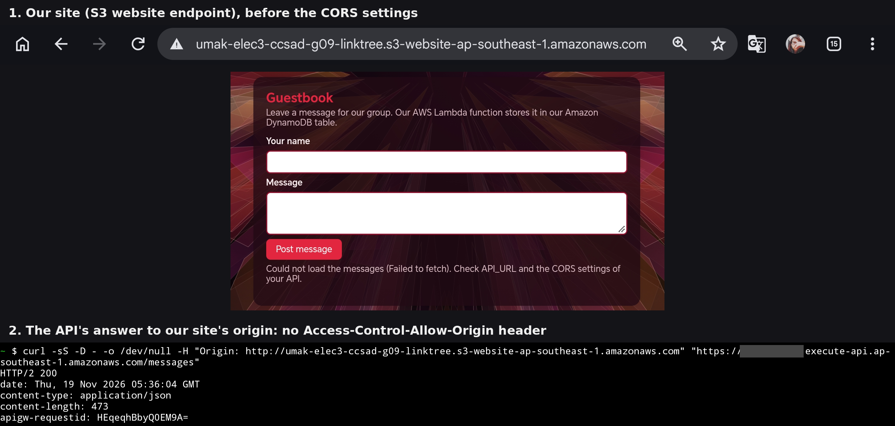
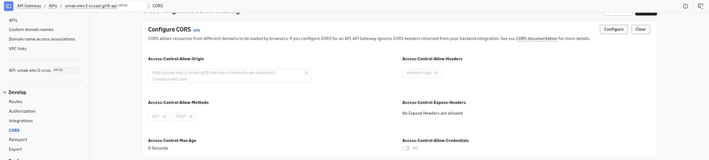
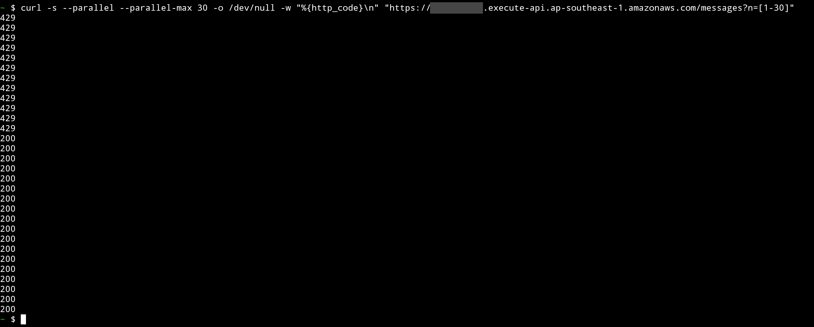

# Lab 5 Submission

## About us

- Group number: 9
- Section: IV-CCSAD
- Group IAM user: ccsad-g09
- Website endpoint: http://umak-elec3-ccsad-g09-linktree.s3-website-ap-southeast-1.amazonaws.com
- HTTP API name: umak-elec3-ccsad-g09-api

## Screenshots

Note: we did Lab 5 on an Android tablet, and Chrome for Android has no developer Console. So `cors-error.png` shows our page with the guestbook's "Failed to fetch" line, and a `curl` request with our site's `Origin` header. Before Step 4, our API's answer had no `Access-Control-Allow-Origin` header, which is the reason the browser blocked our page.

## Questions

1. In Lab 4, your API answered `curl` and the address bar of your browser. In Step 3, the same API did not answer your page. Why?

   Our page and our API are on different origins: the page is on `http` at the S3 website host, and the API is on `https` at the `execute-api` host. CORS is a browser rule for scripts on a page: a script may read an answer from another origin only when that origin allows the page with an `Access-Control-Allow-Origin` header. Our API sent no such header, so the browser blocked the guestbook script from reading the answer. `curl` and the address bar are not scripts on a page, so CORS does not apply to them, and they got the answer.

2. Which pillar of the AWS Well-Architected Framework does your throttle serve? Explain in two sentences.

   The throttle serves the Reliability pillar, and it also supports Security and Cost Optimization. It limits our API to 2 requests per second with a burst of 5, so a flood of requests gets `429 Too Many Requests` from API Gateway instead of overloading our Lambda function and DynamoDB table, and our guestbook keeps working for normal visitors while each refused request costs us nothing.

3. Your guestbook shows each message with `textContent`. What could a visitor do if the page put each message into the page as HTML with `innerHTML`?

   A visitor could post a message that holds HTML or a script, for example ``, and it would run in the browser of every person who opens our page. This is stored cross-site scripting (XSS): the attacker could change our page, show a fake form, steal data from visitors, or send requests from their browsers. With `textContent`, the message is shown as plain text, so the code never runs.
