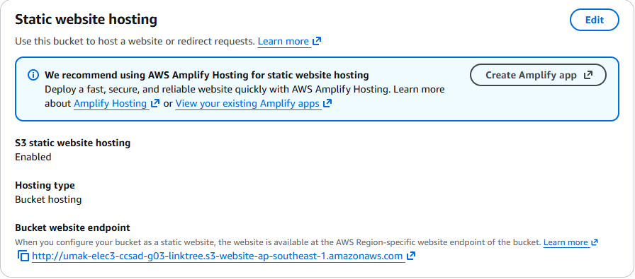
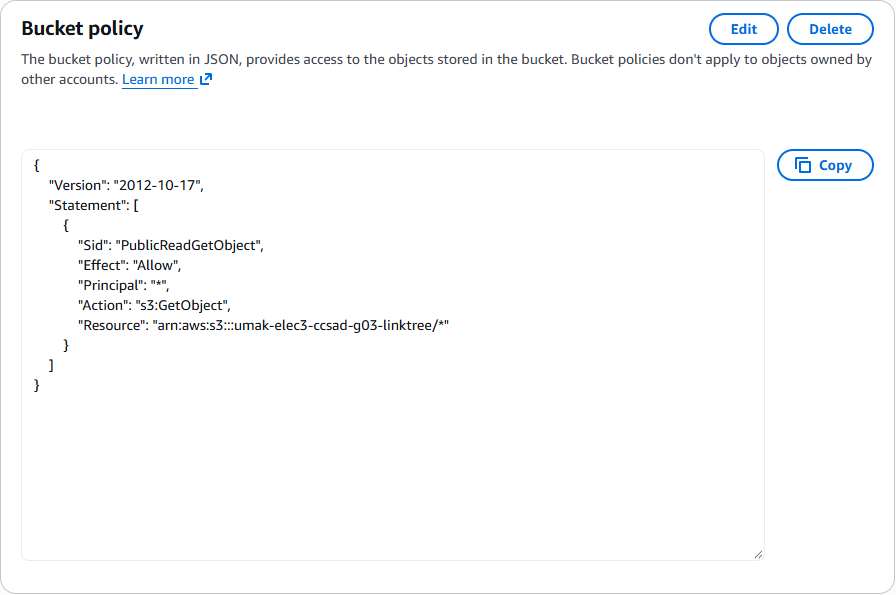
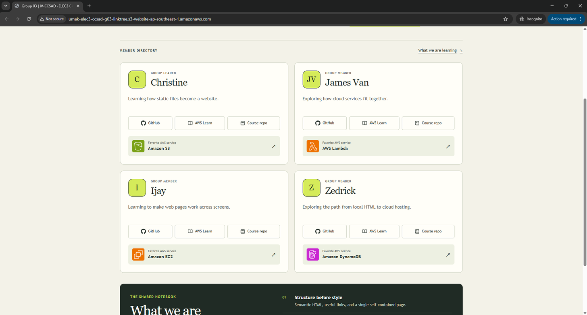

# Seatwork 3 Submission

## About us

- Group number: 03
- Section: IV-CCSAD
- Group IAM user: ccsad-g03
- Bucket name: umak-elec3-ccsad-g03-linktree
- Website endpoint: http://umak-elec3-ccsad-g03-linktree.s3-website-ap-southeast-1.amazonaws.com

## Screenshots

## Contribution

| GitHub username | What this groupmate did |
| --- | --- |
| dcchristine | Checked our bucket name, Singapore region, and website hosting settings. |
| salgadojamesvan | Checked that the public bucket policy gives read access only to our bucket's objects. |
| yajiiiii | Checked that the public website opens the correct page in a private browser window. |
| Tajarros-Zed | Handled the S3 setup and upload, and prepared the screenshots and submission files. |

## Checklist

- [x] Our bucket uses the required name and the Singapore region.
- [x] Only our approved `index.html` is uploaded.
- [x] Static website hosting is enabled with `index.html` as the index document.
- [x] Public access settings were changed for our website bucket only.
- [x] The saved bucket policy allows only `s3:GetObject` on our bucket's objects.
- [x] The website opens our page in a private browser window.
- [x] All three screenshots are included. The AWS account bar is cropped from `hosting.png` and `policy.png`, and `site.png` shows the browser address bar.
- [x] All required details and confirmed group contributions are complete.
