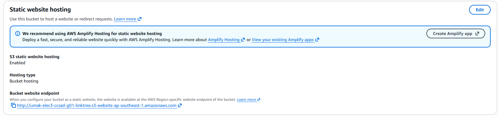
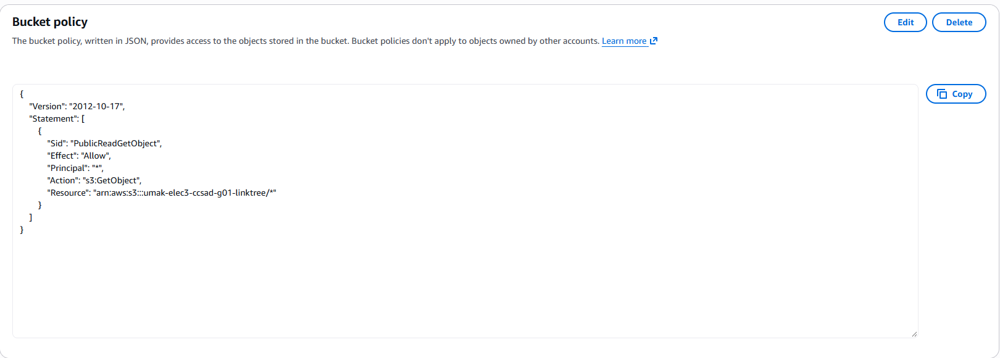
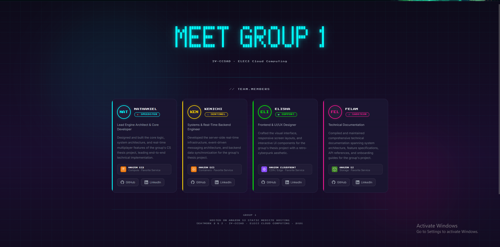

# Seatwork 3 Submission

<!--
How to use this template:

1. Copy this file to submissions/seatwork-3/group-<number>/submission.md
2. Replace every <answer> with your group's answer. Delete the angle brackets too.
3. Save hosting.png, policy.png, and site.png in the same folder.
4. Crop the AWS console top bar out of hosting.png and policy.png.
5. Write GitHub usernames, not full names or student numbers.
-->

## About us

- Group number: 1
- Section: IV-CCSAD
- Group IAM user: AURELIUS
- Bucket name: umak-elec3-ccsad-g01-linktree
- Website endpoint: https://umak-elec3-ccsad-g01-linktree.s3.ap-southeast-1.amazonaws.com/index.html

## Screenshots

![Static website hosting with the endpoint]

![Saved bucket policy]

![Our page open in the browser]

## Contribution

| GitHub username | What this groupmate did |
| --- | --- |
| NathanielCamachoUmak | Created the webpage |
| kcalicaa12346055-sudo | Planned the webpage and Tested |
| madeliiine | Provided the design motifs |
| Flaaa01 | Wrote documentation and tested features |