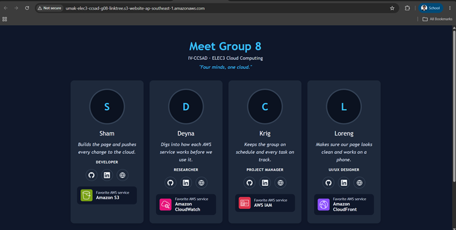
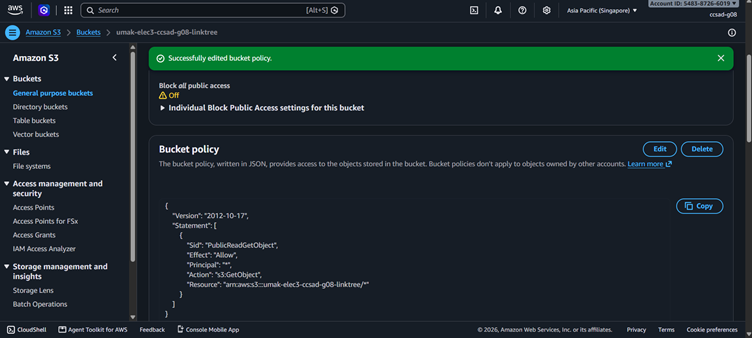
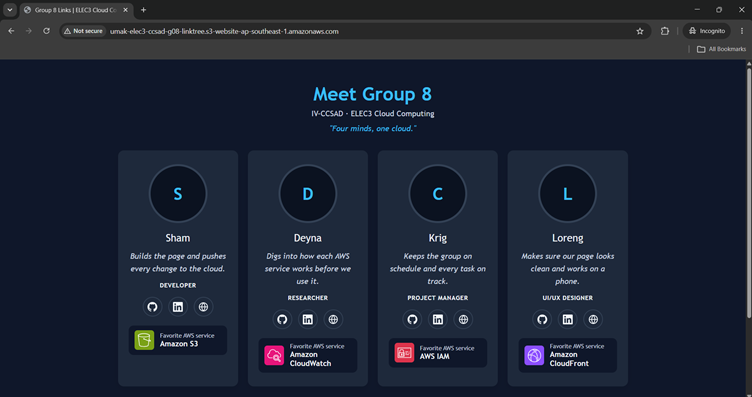

# Seatwork 3 Submission

## About us

- Group number: 8
- Section: IV-CCSAD
- Group IAM user: ccsad-g08
- Bucket name: umak-elec3-ccsad-g08-linktree
- Website endpoint: http://umak-elec3-ccsad-g08-linktree.s3-website-ap-southeast-1.amazonaws.com

## Screenshots

## Contribution

| GitHub username | What this groupmate did |
| --- | --- |
| shamKirzon | Created the bucket, uploaded the page and turned on website hosting |
| deejay-torres | Set up Block Public Access and checked the policy |
| h0pSpaint | Tested the endpoint in a private window and kept time |
| lurrenggg | Took and cropped the screenshots and wrote the submission |
