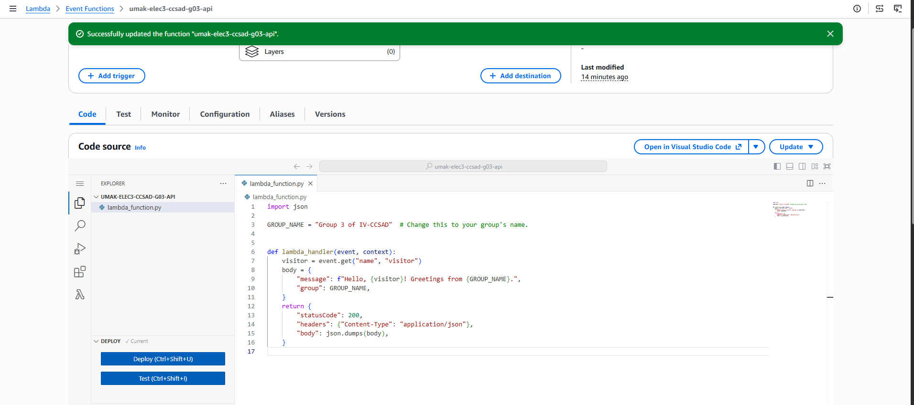
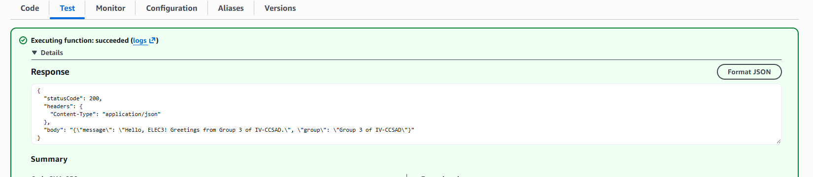
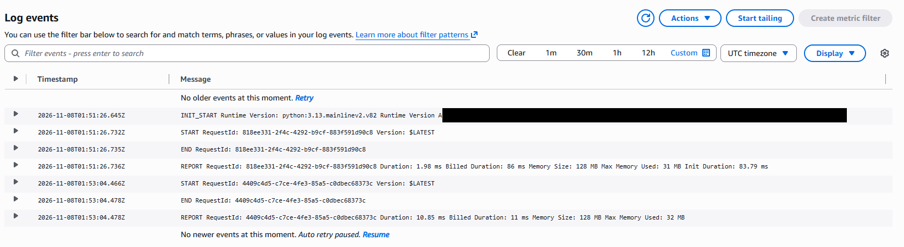

# Seatwork 4 Submission

## About us

- Group number: 03
- Section: IV-CCSAD
- Group IAM user: ccsad-g03
- Function name: umak-elec3-ccsad-g03-api

## Handler code

```python
import json

GROUP_NAME = "Group 3 of IV-CCSAD"  # Change this to your group's name.


def lambda_handler(event, context):
    visitor = event.get("name", "visitor")
    body = {
        "message": f"Hello, {visitor}! Greetings from {GROUP_NAME}.",
        "group": GROUP_NAME,
    }
    return {
        "statusCode": 200,
        "headers": {"Content-Type": "application/json"},
        "body": json.dumps(body),
    }
```

## REPORT lines

First run, a cold start:

```text
REPORT RequestId: 818ee331-2f4c-4292-b9cf-883f591d90c8 Duration: 1.98 ms Billed Duration: 86 ms Memory Size: 128 MB Max Memory Used: 31 MB Init Duration: 83.79 ms
```

Second run, a warm start:

```text
REPORT RequestId: 4409c4d5-c7ce-4fe3-85a5-c0dbec68373c Duration: 10.85 ms Billed Duration: 11 ms Memory Size: 128 MB Max Memory Used: 32 MB
```

## Question

Why does the second REPORT line have no Init Duration?

The second run was a warm start. Lambda reused the execution environment that it had created for the first run, so it did not need to start Python and load our code again. Init Duration only appears on a cold start, when Lambda prepares a new environment, which is why only the first REPORT line has it.

## Screenshots







## Contribution

| GitHub username | What this groupmate did |
| --- | --- |
| dcchristine | Created the Lambda function with Python 3.13 and our group's role. |
| salgadojamesvan | Wrote and deployed the handler with our group name. |
| yajiiiii | Created the `hello` test event and ran the function twice. |
| Tajarros-Zed | Found the REPORT lines in CloudWatch, took the screenshots, and wrote `submission.md`. |
