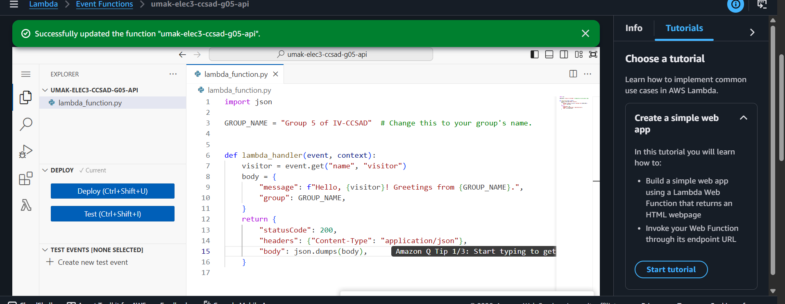
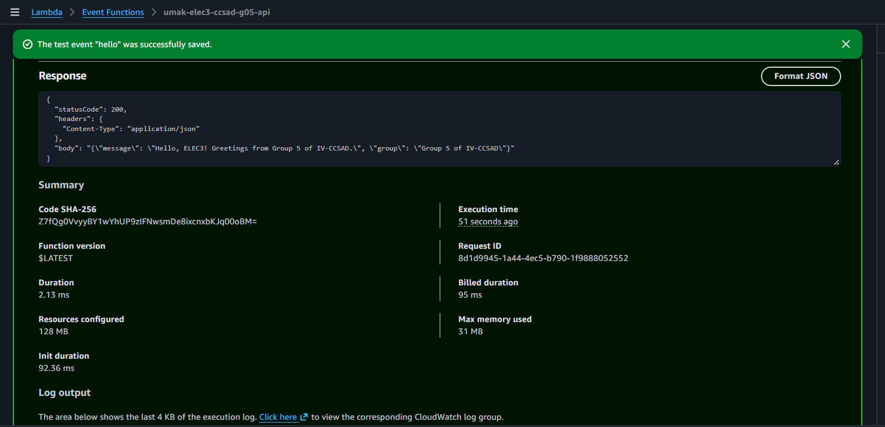
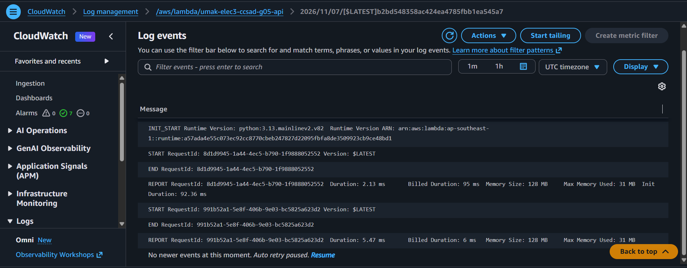

# Seatwork 4 Submission

<!--
How to use this template:

1. Copy this file to submissions/seatwork-4/group-<number>/submission.md
2. Replace every <answer> with your group's answer. Delete the angle brackets too.
3. Save code.png, test.png, and report.png in the same folder.
4. Crop the AWS console top bar out of all three screenshots, and cover every ARN.
5. Write GitHub usernames, not full names or student numbers.
-->

## About us

- Group number: 05
- Section: IV-CCSAD
- Group IAM user: ccsad-g05
- Function name: umak-elec3-ccsad-g05-api

## Handler code

```python
import json

GROUP_NAME = "Group 5 of IV-CCSAD"  # Change this to your group's name.


def lambda_handler(event, context):
    visitor = event.get("name", "visitor")
    body = {
        "message": f"Hello, {visitor}! Greetings from {GROUP_NAME}.",
        "group": GROUP_NAME,
    }
    return {
        "statusCode": 200,
        "headers": {"Content-Type": "application/json"},
        "body": json.dumps(body),
    }
```

## REPORT lines

First run, a cold start:

```text
REPORT RequestId: 8d1d9945-1a44-4ec5-b790-1f9888052552	
Duration: 2.13 ms	
Billed Duration: 95 ms	
Memory Size: 128 MB	
Max Memory Used: 31 MB	
Init Duration: 92.36 ms
```

Second run, a warm start:

```text
REPORT RequestId: 991b52a1-5e8f-406b-9e03-bc5825a623d2	
Duration: 5.47 ms	
Billed Duration: 6 ms	
Memory Size: 128 MB	
Max Memory Used: 31 MB
```

## Question

Why does the second REPORT line have no Init Duration?

The reason why the second REPORT line doesn't have a Init Duration is because it's the second run and is a warm start. AWS Lambda only initializes overhead such as downloading code or running global setup code when provisioning in a new execution environment. Since the previous REPORT line initializes the container already, there is no need to initialize a new container and it can reuse the initialized container. As a result, the Init Duration field is omitted from REPORT log metrics for all warm requests. 

## Screenshots







## Contribution

| GitHub username | What this groupmate did |
| --- | --- |
| DeviDo2 | Lead the group and navigated the AWS site |
| gracefeliciano | Guided the navigator |
| PalattaoMekylla | Filled out the contents of the submission.md |
| GlorianaSkye | Filled out the contents of the submission.md |
