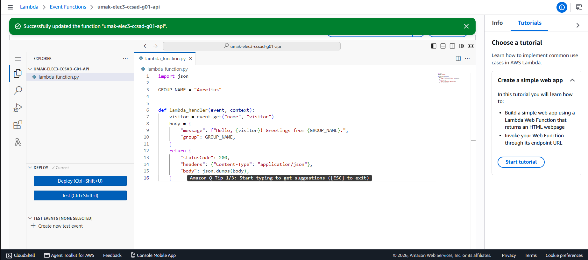
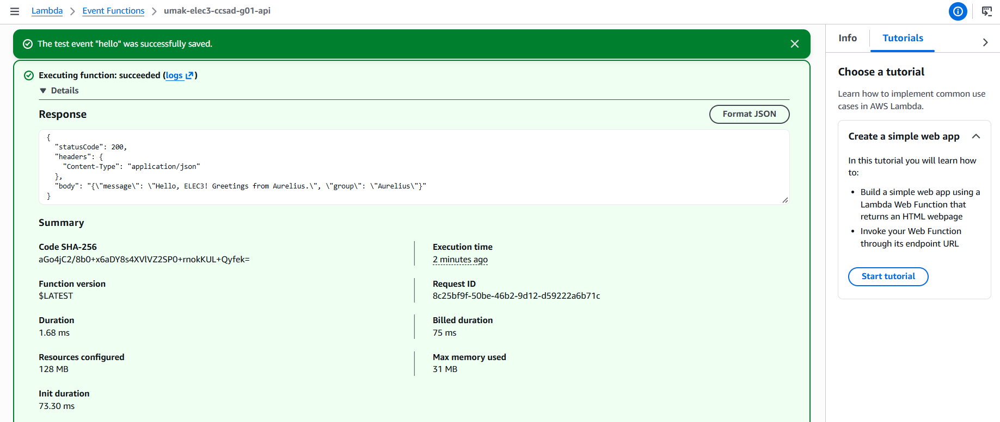
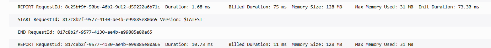

# Seatwork 4 Submission

## About us

- Group number: 1
- Section: IV-CCSAD
- Group IAM user: ccsad-g01
- Function name: umak-elec3-ccsad-g01-api

## Handler code

```python
import json

GROUP_NAME = "Aurelius"


def lambda_handler(event, context):
    visitor = event.get("name", "visitor")
    body = {
        "message": f"Hello, {visitor}! Greetings from {GROUP_NAME}.",
        "group": GROUP_NAME,
    }
    return {
        "statusCode": 200,
        "headers": {"Content-Type": "application/json"},
        "body": json.dumps(body),
    }
```

## REPORT lines

First run, a cold start:

```text
REPORT RequestId: 8c25bf9f-50be-46b2-9d12-d59222a6b71c Duration: 1.68 ms Billed Duration: 75 ms Memory Size: 128 MB Max Memory Used: 31 MB Init Duration: 73.30 ms
```

Second run, a warm start:

```text
REPORT RequestId: 817c8b2f-9577-4130-ae4b-e99885e80a65 Duration: 10.73 ms Billed Duration: 11 ms Memory Size: 128 MB Max Memory Used: 31 MB
```

## Question

Why does the second REPORT line have no Init Duration?

The second run was a warm start. After the first run, Lambda kept the execution environment, with Python already started and our code already loaded, so the second run reused it. Init Duration only measures the time to create a new environment and load the code, which happens only on a cold start, so it does not appear on the second line.

## Screenshots







## Contribution

| GitHub username | What this groupmate did |
| --- | --- |
| Flaaa01 | Created the Lambda function in Asia Pacific (Singapore) with Python 3.13 and the group's execution role, and took the code.png screenshot. |
| NathanielCamachoUmak | Wrote and deployed the handler code with the group name, and checked the formatting and straight quotes. |
| kcalicaa12346055-sudo | Created the "hello" test event, ran the function twice, and took the test.png screenshot. |
| madeliiine | Found the log group in CloudWatch, copied both REPORT lines, took the report.png screenshot, and wrote the answer about cold and warm starts. |
