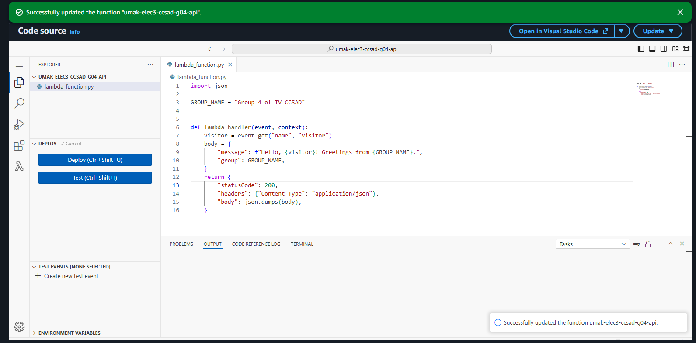
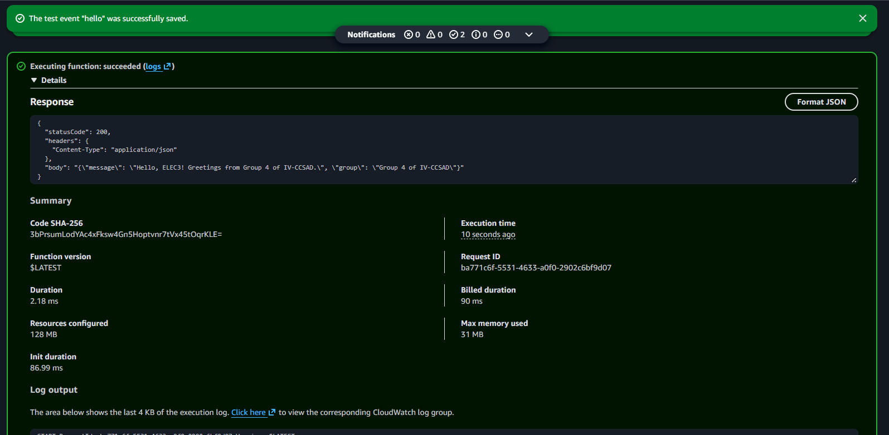
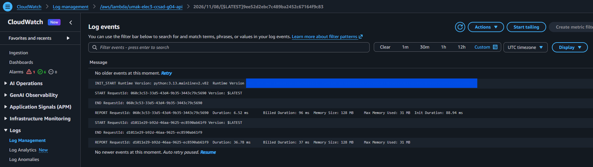

# Seatwork 4 Submission

## About us

- Group number: 4
- Section: IV-CCSAD
- Group IAM user: ccsad-g04
- Function name: umak-elec3-ccsad-g04-api

## Handler code

```python
import json

GROUP_NAME = "Group 4 of IV-CCSAD"


def lambda_handler(event, context):
    visitor = event.get("name", "visitor")
    body = {
        "message": f"Hello, {visitor}! Greetings from {GROUP_NAME}.",
        "group": GROUP_NAME,
    }
    return {
        "statusCode": 200,
        "headers": {"Content-Type": "application/json"},
        "body": json.dumps(body),
    }
```

## REPORT lines

First run, a cold start:

```text
REPORT RequestId: 060c3c53-33d5-43d4-9b35-3443c79c5690	Duration: 6.52 ms	Billed Duration: 96 ms	Memory Size: 128 MB	Max Memory Used: 31 MB	Init Duration: 88.94 ms
```

Second run, a warm start:

```text
REPORT RequestId: d1011e29-b92d-46aa-9625-ec8590ab61f9	Duration: 36.78 ms	Billed Duration: 37 ms	Memory Size: 128 MB	Max Memory Used: 31 MB
```

## Question

Why does the second REPORT line have no Init Duration?

Our first run was a cold start: an INIT_START line came before it, and its REPORT line shows Init Duration: 88.94 ms. The second run reused that initialized execution environment, so Lambda did not initialize it again. That is why the second REPORT line has no Init Duration.

## Screenshots







## Contribution

| GitHub username | What this groupmate did |
| --- | --- |
| StDevRhenz | Lambda setup and execution role. |
| Andre-Arcilla | Handler code, deployment, and `code.png`. |
| paupausiopau | Test event, two runs, and `test.png`. |
| ScarlettRed6 | CloudWatch REPORT lines, `report.png`, and submission write-up. |
