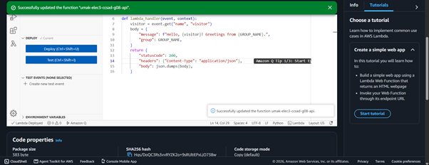
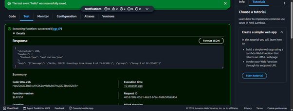
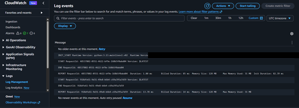

# Seatwork 4 Submission

## About us

- Group number: 8
- Section: IV-CCSAD
- Group IAM user: ccsad-g08
- Function name: umak-elec3-ccsad-g08-api

## Handler code

```python
import json

GROUP_NAME = "Group 8 of IV-CCSAD"

def lambda_handler(event, context):
    visitor = event.get("name", "visitor")
    body = {
        "message": f"Hello, {visitor}! Greetings from {GROUP_NAME}.",
        "group": GROUP_NAME,
    }
    return {
        "statusCode": 200,
        "headers": {"Content-Type": "application/json"},
        "body": json.dumps(body),
    }
```

## REPORT lines

First run, a cold start:

```text
REPORT RequestId: 48537802-0551-4622-bf9e-168b5f0abd04 Duration: 1.80 ms Billed Duration: 85 ms Memory Size: 128 MB Max Memory Used: 31 MB Init Duration: 82.39 ms
```

Second run, a warm start:

```text
REPORT RequestId: 918dfe61-9d31-49e8-b6b4-c69a395a7d59 Duration: 13.78 ms Billed Duration: 14 ms Memory Size: 128 MB Max Memory Used: 31 MB
```

## Question

Why does the second REPORT line have no Init Duration?

Init Duration is the time Lambda spends creating a new execution environment and loading our code. It only happens on a cold start. Our first run was a cold start, so its REPORT line shows Init Duration: 82.39 ms, and an INIT_START line came before it. We ran the test again about a minute later, and Lambda reused the same environment, so nothing had to be created or loaded. That was a warm start, so its REPORT line has no Init Duration.

## Screenshots







## Contribution

| GitHub username | What this groupmate did                                       |
| --------------- | ------------------------------------------------------------- |
| shamKirzon      | Created the function and chose the group role                 |
| h0pSpaint       | Wrote and deployed the handler code                           |
| deejay-torres   | Created the hello test event and ran it twice                 |
| lurrenggg       | Found the REPORT lines in CloudWatch and wrote the submission |
