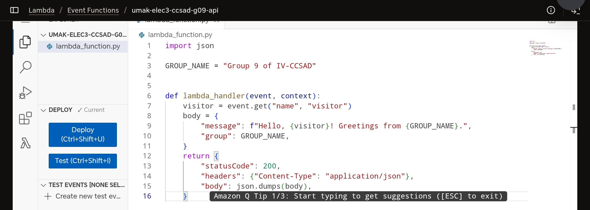
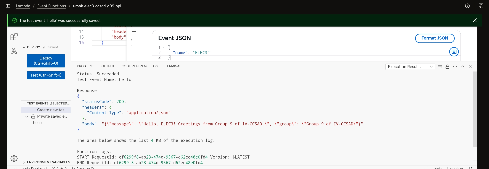
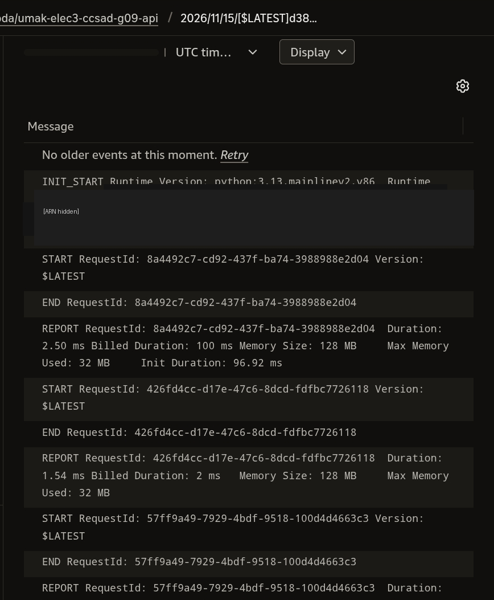

# Seatwork 4 Submission

## About us

- Group number: 9
- Section: IV-CCSAD
- Group IAM user: ccsad-g09
- Function name: umak-elec3-ccsad-g09-api

## Handler code

```python
import json

GROUP_NAME = "Group 9 of IV-CCSAD"


def lambda_handler(event, context):
    visitor = event.get("name", "visitor")
    body = {
        "message": f"Hello, {visitor}! Greetings from {GROUP_NAME}.",
        "group": GROUP_NAME,
    }
    return {
        "statusCode": 200,
        "headers": {"Content-Type": "application/json"},
        "body": json.dumps(body),
    }
```

## REPORT lines

First run, a cold start:

```text
REPORT RequestId: 8a4492c7-cd92-437f-ba74-3988988e2d04 Duration: 2.50 ms Billed Duration: 100 ms Memory Size: 128 MB Max Memory Used: 32 MB Init Duration: 96.92 ms
```

Second run, a warm start:

```text
REPORT RequestId: 426fd4cc-d17e-47c6-8dcd-fdfbc7726118 Duration: 1.54 ms Billed Duration: 2 ms Memory Size: 128 MB Max Memory Used: 32 MB
```

## Question

Why does the second REPORT line have no Init Duration?

The second run was a warm start. Lambda kept the execution environment from the first run and reused it, so it did not have to create a new environment, start Python, and load our code again. Init Duration only measures that setup time, so it appears only on a cold start, like our first run (96.92 ms).

## Screenshots







## Contribution

| GitHub username | What this groupmate did |
| --- | --- |
| Jsmnt | Created the Lambda function with the group's execution role, wrote and deployed the handler, created the test event and ran it twice, found the REPORT lines in CloudWatch, took the screenshots, and wrote this submission |
