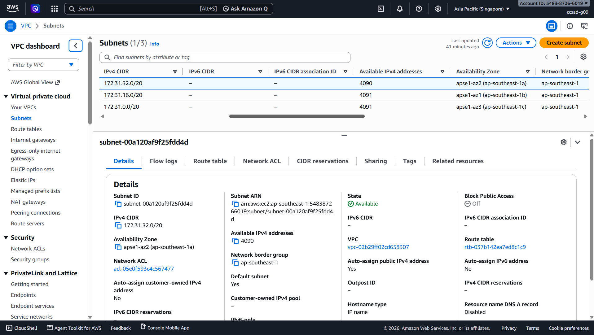
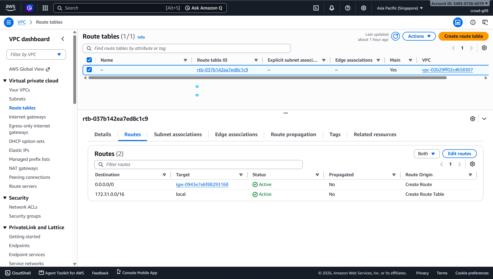
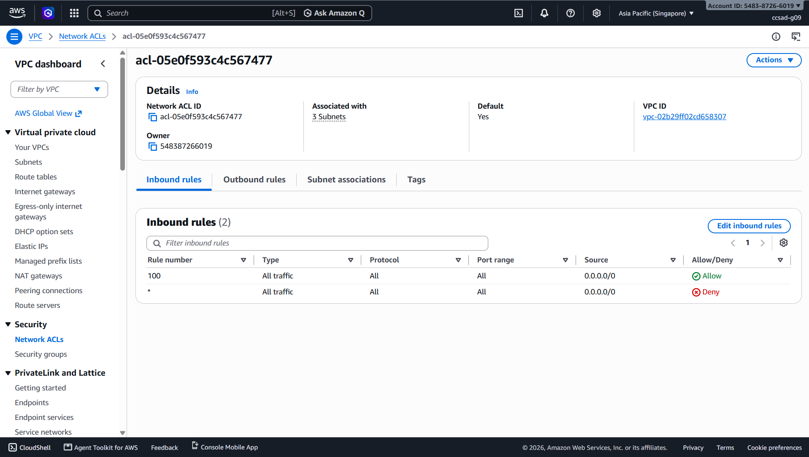
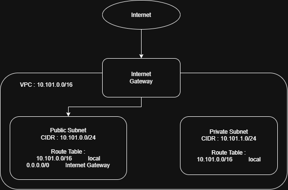

# Assignment 2 Submission

<!--
How to use this template:

1. Copy this file to submissions/assignment-2/<your-github-username>/submission.md
2. Replace every answer placeholder with your own answer. Delete the angle brackets too.
3. Save your four images in the same folder, with the exact file names below.
4. Do not write your full name or your student number in this file.
-->

## About me

- GitHub username: eson-gcia
- Section: IV - CCSAD
- IAM user name that I signed in with: ccsad-g09
- X: 101

---

## Part A. Explore

### A1. The VPC

Default VPC IPv4 CIDR:

172.31.0.0/16

Number of addresses in that CIDR:

65,536

### A2. The subnets

| Availability Zone | IPv4 CIDR |
| --- | --- |
| apse1-az2 (ap-southeast-1a) | 172.31.32.0/20 |
| apse1-az1 (ap-southeast-1b) | 172.31.16.0/20 |
| apse1-az3 (ap-southeast-1c) | 172.31.0.0/20 |

Screenshot 1. Save it as `screenshot-1-subnets.png` in your folder. The image line below shows it.

### A3. Available addresses

Available IPv4 addresses in each subnet:

4090
4091
4091

Why is the number lower than 4,096?

AWS reserves five IPv4 addresses in every subnet for networking purposes. These include the network address, the VPC router address, DNS server address, future use, and the broadcast address. Therefore, a /20 subnet has 4,096 total addresses but only 4,091 are normally usable.

What uses the missing address in the subnet with the lowest number?

The subnet with 4,090 available addresses has one additional address currently being used by a resource, such as a network interface or another AWS resource.

### A4. The route table

| Destination | Target |
| --- | --- |
| 0.0.0.0/0 | igw-0943e7e6f88293168 |
| 172.31.0.0/16 | local |

Screenshot 2. Save it as `screenshot-2-routes.png` in your folder. The image line below shows it.

### A5. Public or private

Are the default subnets public or private? Which route proves it?

The default subnets are public because their route table has a default route of 0.0.0.0/0 pointing to the Internet Gateway igw-0943e7e6f88293168. This allows resources with public IPv4 addresses to communicate with the internet.

### A6. The internet gateway

State of the internet gateway:

Attached

What happens to the default subnets if the gateway is detached?

The default subnets can no longer access the internet through the Internet Gateway. Resources may still communicate with other resources inside the VPC using the local route, but internet connectivity through the gateway will stop.

### A7. NAT gateways

Number of NAT gateways:

0

Can a server in a new private subnet download updates? Why?

Not through a NAT Gateway. The default VPC has no NAT Gateway, so a server in a private subnet would not have a route to the internet for downloading updates. A NAT Gateway would need to be created in a public subnet and the private subnet's route table would need to point to it.

### A8. The network ACL

| Rule number | Source | Allow or Deny |
| --- | --- | --- |
| 100 | 0.0.0.0/0 | Allow |
| 0 | 0.0.0.0/0 | Deny |

How is a network ACL different from a security group?

A network ACL controls traffic at the subnet level and is stateless, meaning inbound and outbound traffic must be allowed separately. A security group controls traffic at the instance or network-interface level and is stateful, so return traffic is automatically allowed.

Screenshot 3. Save it as `screenshot-3-network-acl.png` in your folder. The image line below shows it.

### A9. The default security group

Inbound rule (type and source):

All traffic — source: the default security group itself

Which resources can send traffic to an instance that uses it?

Other resources that are associated with the same default security group can send traffic to the instance.

---

## Part B. Prepare

### B1. Plan two subnets

- Public subnet CIDR: 10.101.0.0/24
- Private subnet CIDR: 10.101.1.0/24

### B2. Route tables

Route table of the public subnet:

| Destination | Target |
| --- | --- |
| 10.101.0.0/16 | local |
| 0.0.0.0/0 | Internet Gateway |

Route table of the private subnet:

| Destination | Target |
| --- | --- |
| 10.101.1.0/16 | local |

### B3. My VPC diagram

Tool used (Excalidraw, draw.io, Lucidchart, or paper):

Draw.io

Save your diagram as `vpc-diagram.png` in your folder. The image line below shows it.

### B4. Predict a change

Can you still open the web page from your laptop? Why?

No. If the public subnet loses its route to the Internet Gateway, the instance will no longer have a path to the internet, so I cannot open its web page from my laptop.

Can the instance still reach another instance in the VPC? Why?

Yes. The local route 172.31.0.0/16 → local still allows communication between resources inside the VPC.

### B5. Place a database

Which subnet gets the database? Why?

The private subnet gets the database because it does not need to be directly accessible from the public internet. This provides better security while still allowing applications in the public subnet to communicate with it through the VPC.

### B6. My question about VPCs

What is your question, and what made you think of it?

Question: If a private subnet does not have direct internet access, how can a server inside it safely download software updates?

I thought of this because private resources still need updates even though they should not be directly exposed to the internet. This made me wonder how AWS allows private servers to access the internet without making them public.
